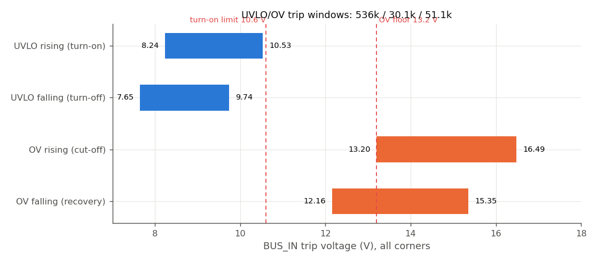
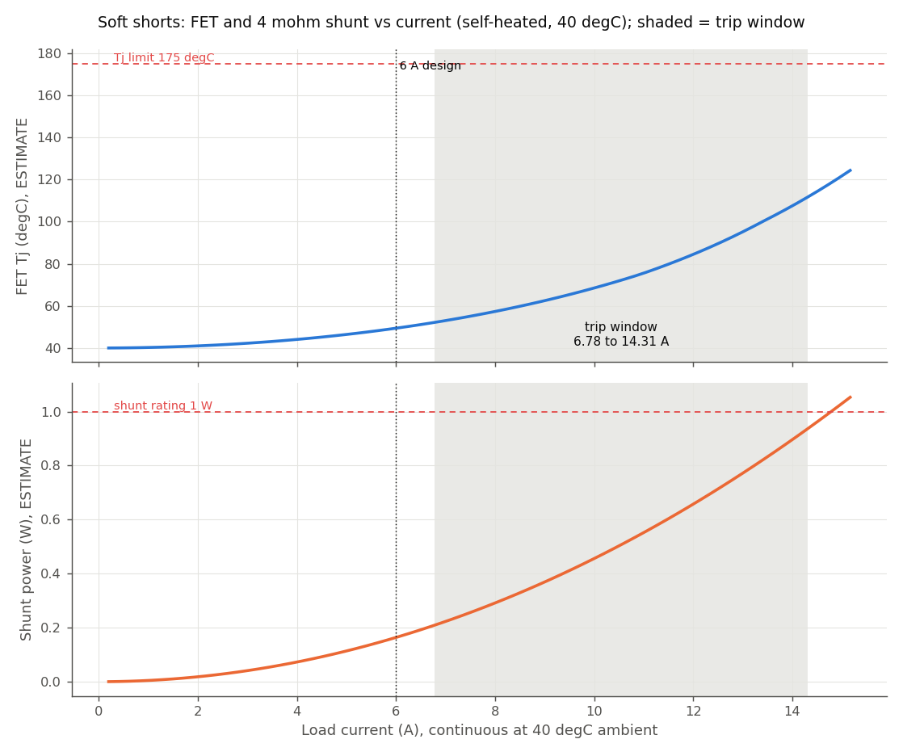
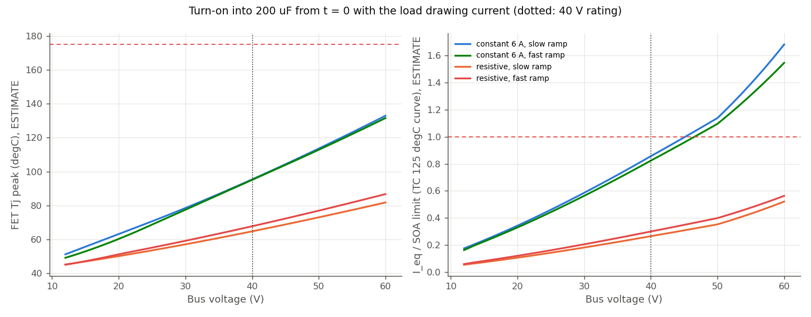
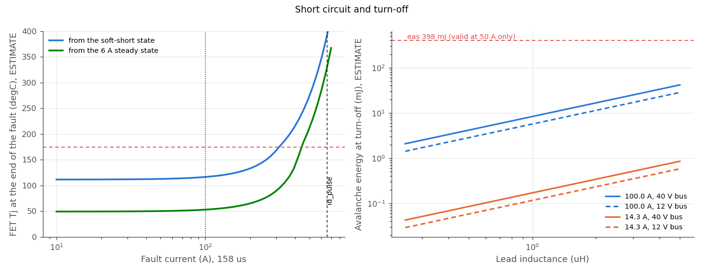

# TPS48000HighSideSwitch block: design analysis

> GENERATED by `python3 blocks/TPS48000HighSideSwitch/analysis.py` (see its header for --params and --out). Do not edit this file; change the script or the params and re-run.

- Library: zener-library v0.8.0 (`analysis/_zl.py`).
- Results date: 2026-11-23.
- Instance `TPS`, params `benches/TPS48000HighSideSwitch/params.json`. Key results: `design-analysis/values.json` (generated by the same run).
- Design values: read from the .zen through `benches/TPS48000HighSideSwitch/bind.zen` (section 13); design outputs for the .zen: `design-analysis/design-outputs.json`.

High-side electronic switch: TPS48000QDGXQ1 + ISC035N10NM5LF2 + 4 mohm WSK2512-LOW shunt, 6 A design current, bus 12 to 40 V (bench 12 V), TA 5 to 40 degC.

Conventions: PASS / FAIL against a datasheet, `spec.md` or the designer's requirement; ESTIMATE for curve-based, typical-based or assumption-based results (the status then says PASS or FAIL of the estimate); REPORT ONLY where no limit is set; OPEN ITEM for zero margin or an accepted risk; UNBOUNDED where the datasheet gives no bound.

## Contents

1 summary; 2 operating conditions and inputs; 3 DS 8.2.2 design-procedure walk-through; 4 UVLO/OV divider; 5 trip window and soft shorts; 6 steady state; 7 turn-on; 8 short circuit and turn-off; 9 gate drive; 10 ratings; 11 firmware and host notes; 12 limits of this analysis; 13 topology preconditions and design values.

## 1. Summary of key results

| Key | Result | Value (worst case) | Limit | Margin | Status |
|---|---|---|---|---|---|
| `uvlo_rise_max_v` | UVLO rising trip max (turn-on guaranteed below) | 10.527 V | <= 10.6 V (10.8 - 0.2) | +0.073 V | PASS |
| `uvlo_turnon_margin_v` | Turn-on margin to the minimum bus | 0.273 V | >= 0.2 V | +0.073 V | PASS |
| `ov_rise_min_v` | OV rising trip min | 13.203 V | >= 13.2 V | +0.003 V | PASS |
| `divider_current_ua` | Divider current at the bench bus (worst-case range) | 19.21 to 19.68 uA | 10 to 20 uA | +0.32 uA | PASS |
| `en_pin_40v_v` | EN/UVLO pin at 40 V bus (max) | 5.417 V | <= 65 V rec | +59.58 V | PASS |
| `ov_pin_40v_v` | OV pin at 40 V bus (max) | 3.417 V | <= 70 V abs | +66.58 V | PASS |
| `trip_min_a` | Short-circuit trip, minimum (self-heated, tol, TCR, solder BOL) | 6.78 A | > 6 A design current | +0.78 A (+13.0 %) | ESTIMATE, PASS |
| `trip_max_a` | Highest non-tripping current (trip maximum) | 14.31 A | report | - | REPORT ONLY |
| `soft_shunt_w` | Shunt power at the highest non-tripping current, 40 degC | 0.937 W | <= 1 W | +0.063 W | ESTIMATE, PASS |
| `soft_fet_tj_c` | FET Tj at the highest non-tripping current, 40 degC | 111.6 degC | <= 175 degC | +63.4 K | ESTIMATE, PASS |
| `fet_tj_des_c` | FET Tj at 6 A, 40 degC | 49.4 degC | <= 175 degC | +125.6 K | ESTIMATE, PASS |
| `shunt_p_des_w` | Shunt power at 6 A, 40 degC | 0.164 W | <= 1 W | +0.836 W | ESTIMATE, PASS |
| `shunt_elem_des_c` | Shunt element temperature at 6 A, 40 degC | 56.4 degC | <= 170 degC (ASSUMED) | +113.6 K | ESTIMATE, PASS only if the element limit is the assumed one |
| `tps_tj_c` | TPS48000 Tj at 40 degC (rth_ja typical) | 40.21 degC | <= 150 degC | +109.8 K | ESTIMATE, PASS |
| `drop_des_mv` | BUS_IN to BUS_OUT drop at 6 A (max over ambient) | 58.6 mV | report | - | REPORT ONLY (ESTIMATE) |
| `inrush_min_a` | Inrush current into the reference load, minimum | 1.43 A | report | - | REPORT ONLY |
| `inrush_max_a` | Inrush current into the reference load, maximum | 2.74 A | report | - | REPORT ONLY |
| `ramp_time_12v_ms` | Ramp time at the bench bus (slowest corner) | 1.67 ms | report | - | REPORT ONLY |
| `ramp_time_40v_ms` | Ramp time at 40 V (slowest corner) | 5.58 ms | report | - | REPORT ONLY |
| `turnon_tj_c` | FET Tj peak during turn-on, 12 and 40 V, both loads, both ramp corners | 95.4 degC | <= 175 degC | +79.6 K | ESTIMATE, PASS |
| `turnon_soa_ratio` | Turn-on I_eq / SOA limit (TC 125 degC curve), worst | 0.857 | <= 1 | +0.143 | ESTIMATE, PASS |
| `turnon_max_pass_v` | Largest passing bus voltage at turn-on (grid 0.5 V, to 80 V) | 45 V | >= 40 V rated | +5.0 V | ESTIMATE, PASS |
| `tsc_min_us` | Latch-off delay tSC, eq. 8, minimum | 70.7 us | report | - | REPORT ONLY |
| `tsc_max_us` | Latch-off delay tSC, eq. 8, maximum | 132.9 us | report | - | REPORT ONLY |
| `tsc_max_ext_us` | Latch-off delay tSC maximum with V(TMR_SC) max (not a DS equation) | 154.5 us | report | - | REPORT ONLY |
| `fault_tj_c` | FET Tj after 100 A for tSC max, from the soft-short state | 116.7 degC | <= 175 degC | +58.3 K | ESTIMATE, PASS |
| `fault_i_limit_a` | Fault current with Tj at the limit (tSC max, soft-short start) | 312 A | >= 100 A | +212 A | ESTIMATE, PASS |
| `fault_id_pulse_margin_a` | Fault current vs pulsed drain current | 100 A | <= 656 A (`id_pulse`) | +556 A | PASS |
| `fault_shunt_energy_mj` | Shunt energy in the fault (no DS bound) | 7.20 mJ | not bounded by the DS | - | REPORT ONLY (UNBOUNDED) |
| `fault_cs_v` | CS+ to CS- in the fault | 0.454 V | <= 100 V abs | +99.5 V | PASS |
| `avalanche_max_mj` | Avalanche energy, worst of the L sweep (0.25-5 uH) | 41.7 mJ | `eas` 398 mJ at 50 A only | 9.6x | ESTIMATE (eas not valid above 50 A) |
| `cbst_min_nf` | Bootstrap capacitor minimum needed (eq. 4, C1 max) | 159.6 nF | <= 360 nF (low corner, no DC bias loss) | +200 nF | ESTIMATE: DC-bias loss not bounded in the library |
| `t_drv_en_worst_ms` | Initial gate-driver enable delay t_drv_en, worst | 64.3 ms | report | - | REPORT ONLY |
| `turnoff_transient_no_tvs` | Turn-off through lead inductance, no TVS: avalanche clamps BUS_IN at V(BR)DSS min or above vs VS / CS+ abs max | >= 100 V | <= 100 V (`abs_vs_cs_gnd`) | +0 V (V(BR) is a minimum, so the clamp can be higher) | FAIL (risk: unprotected transient; TVS deferred by the designer; DS p.27-28 recommends a TVS) |
| `gate_overlap_v` | V(G_GOOD) max above V(BST-SRC) ON min | 0.24 V | <= 0 V (no overlap) | -0.24 V | FAIL (accepted residual risk, OPEN ITEM) |
| `v_c1_max_v` | C1 gate to GND, worst case (bus max + V(BST-SRC_OFF) max) | 53.86 V | <= 100 V (C0G rated_v, derate 1) | +46.14 V | PASS |
| `cbst_dc_bias_allow_frac` | Largest DC-bias and aging loss of CBST that still meets eq. 4 at the low corner (not a DS equation) | 55.6 % allowed loss | loss NOT BOUNDED in the library | - | OPEN ITEM: DC-bias loss not bounded |
| `c1_dump_peak_a` | C1 dump peak current into PD through R2 (v_c1_max_v / R2 min, not a DS equation) | 5.45 A | PD peak sink not bounded (i_pd_peak: 2 A typ only) | - | OPEN ITEM: PD sink and R2 pulse rating not bounded |
| `ratings_min_margin` | Smallest rating margin (table in section 10, normalised: see table) | 32 rows | all margins >= 0 | none failing | PASS |

Divider of the bench instance (configs): r_top 536 kohm, r_mid 30.1 kohm, r_bot 51.1 kohm.

## 2. Operating conditions and inputs

Every input is in the params file with its basis (`<key>_basis`). Design intent comes from `blocks/TPS48000HighSideSwitch/spec.md`.

| Input | Value | Basis |
|---|---|---|
| Design maximum continuous current | 6 A | designer decision 2026-11-15 (`i_design_a_basis`) |
| Ambient | 5 to 40 degC | laboratory, IEC 61010-1 cl. 1.4.1 (`ta_basis`); derate 1 |
| Bus, rated | 12 to 40 V DC | designer decision 2026-11-15 |
| Bus, bench instance | 12 V nominal, minimum 10.8 V | 12 V -10 % (spec.md) |
| UVLO turn-on | guaranteed at or below 10.6 V (10.8 - 0.2 V margin) | spec.md |
| OV | never trips below 13.2 V | 12 V +10 % (spec.md) |
| Logic rail V3V3 | 3.3 V +/-3 % (3.201 to 3.399 V) | board rail (spec.md) |
| Shunt | `WSK25124L000DEA`: 4 mohm, code D (+/-0.5 %), TCR +/-75 ppm/degC | DS p.1, Standard Electrical Specifications, TOL. +/-0.5 % column; DS p.1, Global Part Number Information, tolerance code D = +/-0.5 %; DS p.2, Technical Specifications, Temperature coefficient (RESISTOR CHARACTERISTICS), +/-75 for 0.003 ohm to 0.0049 ohm |
| Shunt TCR reference temperature | 25 degC | ASSUMPTION: the DS states none |
| Shunt thermal resistance (element to ambient) | 100 K/W | ESTIMATE: (derate_zero - derate_knee) / p70 from the DS p.3 derating graph |
| Shunt element limit | 170 degC | ASSUMPTION (the derating curve's zero point), not `t_oper` |
| Shunt BOL (solder heat) | +/-(R x 0.5 % + 0.5 mohm) | DS p.3, PERFORMANCE, Resistance to solder heat, TEST LIMITS; test limit used as a bound |
| FET thermal | RthJA 50 K/W (6 cm2 copper: LAYOUT REQUIREMENT), RthJC 0.7 K/W, Tj max 175 degC | DS p.4, Table 3 Thermal characteristics, Thermal resistance junction-ambient, 6 cm2 cooling area (RthJA), footnote 5 |
| FET Rds(on) at 8.24 V gate drive | 3.5 mohm (10 V max) x Tj curve x typical VGS ratio | ESTIMATE: only the 10 V maximum is a bound |
| ZthJC | 0.0121 K/W at 10 us to 0.7 K/W (100 ms and longer) | ESTIMATE: DS Diagram 5 single-pulse curve rows, typical |
| Reference load capacitance | 200 uF | designer decision 2026-11-15 |
| Prospective fault current | 100 A | system requirement on the PSU current limit or a per-channel fuse (designer 2026-11-15) |
| ERJ-3EKF resistors | -1.198 to +1.202 % over TA | tolerance DS PDF p.3, Ratings <+/-1 %>, Resistance tolerance (%), ERJ3EK row; DS PDF p.2, tolerance code F = +/-1 %, TCR DS PDF p.3, Ratings <+/-1 %>, T.C.R. (x10-6/K), ERJ3EK row (+/-100, one value for the whole 10 to 1 M range); tolerance referenced to 20 degC, TCR to 25 degC |
| 6.8 nF capacitors (C1, CTMR), 100 V | GCM188 C0G ±5% (`GCM1885C2A682JE02D`): 0.9490 to 1.0526 x nominal | tolerance, 30 ppm/degC to 40 degC and the -10 degC Table A drift row for 5 to 25 degC (ESTIMATE bound) |
| Bootstrap capacitor | 1 x 470 nF (`GCM21BR71H474KA55L`, X7R 50 V 0805) = 470 nF nominal | 0.7650 to 1.2650 x nominal: tolerance and tc (DS p.2, no DC-bias or aging loss) |
| VS and SRC bypass capacitors | 2 x 100 nF (`GCM188R71H104KA57D`, X7R 50 V) | catalog tolerance ±10%; DC-bias loss not bounded |
| Lead inductance (turn-off avalanche) | 0.25, 0.5, 1, 2, 5 uH | DESIGN INPUT sweep, the real value is not known |

**6.8 nF capacitor choice (C1 and CTMR, 100 V).** The GCM188 catalog lists C0G 6.8 nF 100 V at +/-5 % (`GCM1885C2A682JE02D`, also +/-2 % `GCM1885C2A682GE02`): C0G +/-5 % is used.

Design definition (parts and values as built into the analysis):

| Function | Part / MPN | Value | Basis |
|---|---|---|---|
| Controller | TI TPS48000QDGXQ1 (`TPS48000QDGXRQ1`) | VSSOP-19 | designer choice 2026-11-15 |
| High-side FET | Infineon ISC035N10NM5LF2 | 100 V, 3.5 mohm max at 10 V | DS p.5, Table 4 Static characteristics, Drain-source on-state resistance RDS(on) |
| Shunt | Vishay `WSK25124L000DEA` | 4 mohm | DS p.1, Standard Electrical Specifications, TOL. +/-0.5 % column; DS p.1, Global Part Number Information, tolerance code D = +/-0.5 % |
| Gate ramp R1 / latch-off RTMR | `ERJ3EKF1003V` | 100 kohm | ERJ-3EKF; one BOM line |
| Gate damping R2 | `ERJ3EKF10R0V` | 10 ohm | DS p.16 |
| Gate ramp C1 (gate to GND, DS Fig 7-4) / timer CTMR | `GCM1885C2A682JE02D` (100 V) | 6.8 nF | GCM188 C0G ±5% (`GCM1885C2A682JE02D`) |
| Bootstrap CBST | `GCM21BR71H474KA55L` | 470 nF | designer decision D14 (one part) |
| VS and SRC bypass | `GCM188R71H104KA57D` x 2 | 100 nF | DS p.5 (external capacitor, min 22 nF); DS p.28 |
| ISCP resistor RISCP | `ERJ3EKF1052V` | 10.5 kohm | DS p.7, 5.5 Electrical Characteristics, Short Circuit Protection, V(SCP), R(ISCP) = 10.5 kohm |
| UVLO/OV ladder | `ERJ3EKF5363V`, `ERJ3EKF3012V`, `ERJ3EKF5112V` | 536 kohm / 30.1 kohm / 51.1 kohm | section 4 |
| FAULT_N / PGOOD_N pull-ups | `ERJ3EKF1002V` | 10 kohm | designer choice |
| BOM lines | 13 | 2 ICs, 1 shunt and 10 distinct passive values | 100 nF (VS, SRC), 470 nF (CBST), 6.8 nF (C1, CTMR), 100 kohm (R1, RTMR), 10 kohm (pull-ups) |

## 3. DS design-procedure walk-through (TPS4800-Q1 8.2.2, p.23-25)

Each step repeats the datasheet's procedure in the datasheet's order. The DS example is a MOSFET VDS-sensed, auto-retry design (VIN 16 to 60 V, IOUT 20 A, ISC 60 A); this design senses a shunt and latches off. The library `EXAMPLES` already prove that each equation reproduces the DS example; the DS-printed numbers that are not in `component.toml` are marked `DS`.

| Step (DS order) | Equation and cite | DS example inputs -> result | This design: inputs | Nominal | Worst case | Chosen standard value |
|---|---|---|---|---|---|---|
| MOSFET Q1 | selection, DS p.23 | IAUS200N08S5N023: 80 V, +/-20 V VGS, 2.3 mohm typ at 10 V, Qg 85 nC typ (`DS`) | ISC035N10NM5LF2: 100 V, +/-20 V VGS, 3.5 mohm max at 10 V, Qg 70 typ / 88 nC max | - | VGS limit 20 V vs charge pump 13.86 V max; VDS 100 V vs bus 40 V | ISC035N10NM5LF2 |
| Bootstrap capacitor CBST | eq. 9 (eq. 4 with C1 = 0): CBST = Qg / 1 V; eq. 4 adds 10 x C1; DS p.5, 5.3 Recommended Operating Conditions, External Capacitor, BST to SRC | Qg 85 nC / 1 V -> 85 nF (DS p.23, 8.2.2 Selection of Bootstrap Capacitor, eq. 9, CBST = 85 nF) | Qg max 88 nC, dV 1 V, C1 6.8 nF | eq. 9: 88.0 nF; eq. 4: 156.0 nF | eq. 4 with C1 max (7.16 nF): 159.6 nF | DS: 100 nF 10 %. Here: 1 x 470 nF X7R 50 V 0805 (GCM21B) = 470 nF nominal, 359.6 nF low corner (no DC-bias loss) |
| Short-circuit threshold RISCP | eq. 10 = eq. 5: RISCP = (ISC x RSNS - 19 mV) / 2 uA; DS p.7, 5.5 Electrical Characteristics, Short Circuit Protection, V(SCP), R(ISCP) = 10.5 kohm | ISC 60 A, RDS(ON) 2.3 mohm -> eq. 5 gives 59.5 kohm; the DS prints 50.5 kohm (DS inconsistency, library decision log) (`DS`) | RSNS = shunt 4 mohm; nominal trip ISC = V(SCP) typ 40 mV / RSNS | ISC 10.00 A -> RISCP 10.50 kohm | trip window 6.78 to 14.31 A (section 5, table rows 31.1 / 48.9 mV) | DS: 51 kohm 1 %. Here: 10.5 kohm 1 % (E96), the exact row value of `v_scp_r10k5` |
| Fault timer CTMR | eq. 11 (= eq. 6, auto-retry): CTMR = ITMR x tSC / 1.1; eq. 8 (latch-off): DS p.7, 5.5 Electrical Characteristics, Delay Timer (TMR), I(TMR_SRC_CB) | 87 uA x 50 us / 1.1 V -> 3.955 nF (DS p.24, 8.2.2 Selection of CTMR, eq. 11, 3.95 nF before the standard-value choice) | latch-off with RTMR 100 kohm across CTMR 6.8 nF (C0G), I(TMR_SRC_CB) 65/87/106 uA | eq. 8: tSC = 91.9 us (typ current). Note eq. 11 for the same CTMR would give 86.0 us (auto-retry, not used) | eq. 8: 70.7 to 132.9 us (C tolerance, RTMR tolerance, I min/max) | DS: 3.3 nF 10 %. Here: 6.8 nF ±5% (shares the C1 BOM line) |
| UVLO and OV divider | eq. 12: V(OVR) = R3 / (R1+R2+R3) x VINOVP; eq. 13: V(UVLOR) = (R2+R3) / (R1+R2+R3) x VINUVLO; I(R123) >= 20 x leakage | VINUVLO 16 V, VINOVP 60 V, V(OVR) 1.225 V, V(UVLOR) 1.23 V, R1 470 kohm -> R2 28.7, R3 10.4 kohm (DS p.24, 8.2.2 Setting the UVLO and OV, eq. 12 with V(OVR) 1.225 V, VINOVP 60 V) | nominal targets 9.3 V UVLO / 14.9 V OV (the nominal trips of the selected design, rounded to 0.1 V; the design itself is selected on worst case, section 4), R1 = 536 kohm, V(OVR) typ 1.23 V, V(UVLOR) typ 1.23 V | R2 30.70 kohm, R3 50.99 kohm (continuous solution) | UVLO rising 8.24 to 10.53 V, OV rising 13.20 to 16.49 V; I(R123) 19.2 uA min vs 20 x leakage 9.8 uA | DS: 470 / 29.4 / 10 kohm 1 %. Here: 536 kohm / 30.1 kohm / 51.1 kohm (E96, 1 %) |
| Inrush | eq. 2: IINRUSH = CLOAD x VBATT / Tcharge; eq. 3: C1 = 0.63 x V(BST-SRC) x CLOAD / (R1 x IINRUSH), DS p.15-16 | no inrush step in the 8.2.2 example; eq. 3 text uses V(BST-SRC) = 11 V | CLOAD 200 uF, R1 100 kohm, C1 6.8 nF C0G; V(BST-SRC) 8.24 / 10.3 / 13.86 V (`v_bst_src_on` min / typ, `v_bst_src_off` max) | eq. 3 solved for IINRUSH at typ: 1.91 A; ramp 4.19 ms at 40 V, 1.26 ms at 12 V (eq. 2) | 1.43 to 2.74 A with V(BST-SRC), C1 and R1 tolerances; ramp 2.92 to 5.58 ms at 40 V | C1 = 6.8 nF C0G (designer choice; not derived from a target inrush) |

DS check of the printed example inputs against the equations: eq. 12 with V(OVR) = 1.225 V gives 60 V for the DS divider (R1 470 k, R2 28.7 k, R3 10.4 k); eq. 13 gives 16.015 V. The DS example solves with V(OVR) = 1.225 V, which is not a table row (the table is 1.17 / 1.23 / 1.28 V); this design uses the table rows. The DS eq. 6 text uses ITMR = 80 uA while eq. 11 and the table use 87 uA typ; the analysis uses the table row bounds. V(TMR_SC) in the DS equations is the printed 1.1 V; the row is 0.87 / 1.1 / 1.26 V (section 8).

## 4. UVLO/OV divider

Selection rule (stated, applied by this script on every run): E96 ERJ-3EKF 1 % resistors from 1 kohm to 1 Mohm; total resistance 607 to 1186 kohm so the divider draws 10 to 20 uA at 12 V over the resistor tolerance; feasible when the UVLO rising trip maximum is at or below 10.6 V (10.8 V - 0.2 V margin) and the OV rising trip minimum is at or above 13.2 V over every corner; among feasible triples the one with the highest UVLO falling minimum (turn-off as close below the turn-on as the hysteresis allows; compared at 0.1 V resolution, as finer differences carry no meaning), then the lowest OV rising maximum. 12575 candidates were screened (a nominal window only removes triples that cannot be feasible), 3261 were feasible. Corners: V(UVLOR/F) and V(OVR/F) min and max (DS p.6, 5.5 Electrical Characteristics, Enable, UVLO, V(UVLOR); DS p.6, 5.5 Electrical Characteristics, Overvoltage Protection, V(OVR)), each resistor at the tolerance + TCR limit over TA plus the solder-heat BOL (-1.198 / +1.202 %), I(EN/UVLO) = 490 nA and I(OV) = 205 nA at both signs (no MIN printed; the 70 V maximum applied at every bus voltage: conservative).

**Selected:** r_top = 536 kohm, r_mid = 30.1 kohm, r_bot = 51.1 kohm (`ERJ3EKF5363V`, `ERJ3EKF3012V`, `ERJ3EKF5112V`). The params file holds exactly this selection.

| Trip | Nominal (typ threshold) | Min (worst case) | Max (worst case) | Limit | Margin | Status |
|---|---|---|---|---|---|---|
| UVLO rising (turn-on) | 9.349 V | 8.236 V | 10.527 V | max <= 10.6 V | +0.073 V | PASS |
| UVLO falling (turn-off) | 8.665 V | 7.651 V | 9.738 V | max below the minimum bus 10.8 V | +1.062 V | PASS |
| OV rising (cut-off) | 14.856 V | 13.203 V | 16.485 V | min >= 13.2 V | +0.003 V | PASS |
| OV falling (recovery) | 13.769 V | 12.159 V | 15.353 V | report | - | REPORT ONLY |

Turn-on margin to the 10.8 V minimum bus: 0.273 V (required >= 0.2 V): **PASS**. The windows INCLUDE the ERJ-3EKF solder-heat BOL (+/-1 % on every resistor, both signs, test limit used as a bound, DS PDF p.4, Performance, ERJ XGN...3EK...series +/-1 % (F), Resistance to soldering heat) on top of tolerance and TCR. Information, without BOL: UVLO rising maximum 10.348 V, OV rising minimum 13.450 V.

Divider current at 12 V: 19.44 uA nominal (19.21 to 19.68 uA over resistor tolerance); the DS asks for at least 20 x the pin leakage (9.8 uA for the larger of I(EN/UVLO) and I(OV)): met.

| At a bus of | EN/UVLO pin (min to max) | OV pin (min to max) | R_top voltage / power (max) | Status |
|---|---|---|---|---|
| 40 V | 5.110 to 5.417 V (rec 0 to 65 V; abs 70 V) | 3.209 to 3.417 V (abs 70 V; no OV rec row) | 34.9 V / 2.28 mW (limits 75 V / 100 mW) | PASS |
| 12 V | 1.503 to 1.656 V | 0.941 to 1.047 V | 10.5 V / 0.207 mW | PASS |

Figure 4. The four trip windows over all corners against the turn-on limit and the OV floor.

The ladder is selected for the bench bus (12 V nominal). A board on a different nominal bus reselects it by running this analysis with its own params; above the OV rising trip (13.2 to 16.5 V) this bench instance is cut off by design, so the 40 V pin voltages are a pin-rating check, not an operating point.

## 5. Trip window and soft shorts

Short-circuit trip = V(CS+ - CS-) reaching V(SCP). RISCP = 10.5 kohm: V(SCP) 31.1 / 40 / 48.9 mV (DS p.7, 5.5 Electrical Characteristics, Short Circuit Protection, V(SCP), R(ISCP) = 10.5 kohm); the RISCP tolerance and TCR add +/-0.252 mV (slope 2 uA x RISCP from eq. 5, not a bound on the row). Shunt: 4 mohm code D, resistance R_hi / R_lo = R0 (1 +/- tol) (1 +/- TCR |T - 25|) +/- (R0 x 0.5 % + 0.5 mohm) (not a DS equation; `resistance_worst` plus the solder-heat BOL term), at the self-heated element temperature (theta 100 K/W, ESTIMATE), over TA 5 to 40 degC.

| Quantity | Value | Corner | Note |
|---|---|---|---|
| Trip minimum | **6.779 A** | V(SCP) min 30.85 mV, R_hi = 4.551 mohm, TA 40 degC, element 60.9 degC | ESTIMATE (element temperature) |
| Trip maximum = highest non-tripping current | **14.311 A** | V(SCP) max 49.15 mV, R_lo = 3.435 mohm, TA 40 degC, element 110.3 degC (low-R self-heating) | ESTIMATE (element temperature) |
| Nominal (information) | 10.00 A | V(SCP) typ 40 mV / 4 mohm | typical, not a bound |
| Trip minimum margin over 6 A | +0.779 A (+13.0 %) |  | ESTIMATE, PASS |

Soft shorts (a load current above 6 A and below the trip maximum never trips: the TPS48000 has only the short-circuit comparator). Requirement: every current up to the trip maximum is either tripped or survived continuously at 40 degC by the FET (Tj) and the shunt (power).

| At the highest non-tripping current | Result | Limit | Margin | Status |
|---|---|---|---|---|
| Current | 14.311 A | - | - | REPORT ONLY |
| FET Tj (RthJA 50 K/W, Rds at 8.24 V gate, ESTIMATE) | 111.6 degC (Rds 6.99 mohm) | 175 degC | 63.4 K | ESTIMATE, PASS |
| Shunt power, judged: I^2 x R_hi at its self-heated element (corners mixed: a bound) | 0.937 W (element 133.7 degC) | 1 W | 0.063 W | ESTIMATE, PASS |
| Shunt power, one unit: I^2 x R_lo (the low-R unit that does not trip), information | 0.703 W (element 110.3 degC) | 1 W | 0.297 W | ESTIMATE, PASS |
| Shunt element temperature (judged case), element limit ASSUMED | 133.7 degC | 170 degC | 36.3 K | ESTIMATE, PASS only under the assumed limit |

**Soft-short requirement: PASS** (ESTIMATE: it rests on the shunt thermal resistance read from the derating curve, the FET Rds model at 8.24 V and RthJA at 6 cm2 of copper, a layout requirement). The shunt power margin is 6.3 % of the rating: thin and estimate-based, flagged. Calibration cannot move the trip (bounded discrete V(SCP) rows over temperature), so none is credited.

Figure 5. FET Tj (top) and shunt power (bottom) against continuous current at 40 degC ambient; the shaded band is the trip window.

## 6. Steady state at 6 A

FET: Tj = TA + RthJA x I^2 x Rds8(Tj), solved self-consistently (residual below 1e-9 K); Rds8 is the ESTIMATE above. Shunt: R_hi at the self-heated element (ESTIMATE). 

| Quantity | TA 5 degC | TA 40 degC | Limit | Margin (at 40 degC) | Status |
|---|---|---|---|---|---|
| FET Tj | 13.2 degC | 49.4 degC | 175 degC | 125.6 K | ESTIMATE, PASS |
| FET Rds(on) at 8.24 V gate and Tj | 4.58 mohm | 5.22 mohm | - | - | ESTIMATE |
| FET dissipation | 0.165 W | 0.188 W | 3 W (`ptot_pcb`, 25 degC) | 2.81 W | PASS |
| Shunt element temperature | 21.3 degC | 56.4 degC | 170 degC (ASSUMED) | 113.6 K | ESTIMATE under the assumed limit |
| Shunt resistance, worst high (BOL) | 4.541 mohm | 4.549 mohm | - | - | - |
| Shunt power | 0.163 W | 0.164 W | 1 W | 0.836 W | ESTIMATE, PASS |
| BUS_IN to BUS_OUT drop (shunt R_hi + FET) | 54.7 mV | 58.6 mV | report | - | REPORT ONLY (ESTIMATE) |

Shunt rated working voltage (P x R)^1/2 at the lowest R: 58.8 mV against 27.3 mV at 6 A (DS p.2, Technical Specifications, Maximum working voltage, (P x R)^1/2). Case temperature at the steady point (Tj - P x RthJC): 49.3 degC.

TPS48000 junction temperature: Tj = TA + rth_ja x P, rth_ja = 92.3 K/W is TYPICAL ONLY (no JEDEC board stated), so this is an ESTIMATE: P = 2.27 mW (40 V x i_gnd_full max 56 uA plus the FLT/PGOOD sinks), Tj = 40.21 degC at 40 degC, 109.8 K below `tj_abs` 150 degC (DS p.5, 5.1 Absolute Maximum Ratings, Operating junction temperature, Tj). Gate-drive switching power is negligible (a few ms of charge pump per turn-on).

Quiescent current and power budget:

| Supply and state | Current | Power | Basis |
|---|---|---|---|
| BUS_IN at 12 V, enabled (`i_gnd_full` max) | 56.0 uA + ladder 19.2 to 19.7 uA | 0.908 mW | DS p.6, 5.5 Electrical Characteristics, Supply Voltage, I(GND), V(EN/UVLO) = 2 V |
| BUS_IN at 12 V, shutdown (EN/UVLO low, `i_shdn` max) | 4.3 uA + ladder 19.2 to 19.7 uA | 0.288 mW | DS p.6, 5.5 Electrical Characteristics, Supply Voltage, I(SHDN), V(EN/UVLO) = 0 V, V(SRC) = 0 V |
| BUS_IN at 40 V, enabled (`i_gnd_full` max) | 56.0 uA + ladder 64.0 to 65.6 uA | 4.864 mW | DS p.6, 5.5 Electrical Characteristics, Supply Voltage, I(GND), V(EN/UVLO) = 2 V |
| BUS_IN at 40 V, shutdown (EN/UVLO low, `i_shdn` max) | 4.3 uA + ladder 64.0 to 65.6 uA | 2.796 mW | DS p.6, 5.5 Electrical Characteristics, Supply Voltage, I(SHDN), V(EN/UVLO) = 0 V, V(SRC) = 0 V |
| V3V3, FAULT_N asserted (pull-up 10 kohm, V3V3 max, R min) | 0.344 mA | 1.169 mW | pull-up from the ERJ-3EKF rows |
| V3V3, PGOOD_N asserted (pull-up 10 kohm) | 0.344 mA | 1.169 mW | pull-up from the ERJ-3EKF rows |
| FLT / FLT_GD low level (R_pd max x sink current) | 36.8 mV | - | DS p.7, 5.5 Electrical Characteristics, Input Control, FLT, FLT_GD Pull-down resistance, R(FLT), R(FLT_GD) |

The ladder current flows at all times (it is the cost of the UVLO/OV monitor); `i_gnd_full` is a full-range bound that covers the charge pump (its -40 to 85 degC subset `i_gnd_m40_85` is covered by it).

## 7. Turn-on

Gate network (DS Fig 7-4 p.15): PU -> R1 -> gate, PD tied to the gate, gate -> R2 -> C1 -> GND (designer correction D12, C1 not to SRC). Gate ramp: slew = 0.63 x V(BST-SRC) / (R1 x C1) (DS eq. 3 solved for IINRUSH / CLOAD; R2 = 10 ohm only damps). Corners: slow = V(BST-SRC) min 8.24 V, C1 max (7.158 nF), R1 max; fast = V(BST-SRC) max 13.86 V, C1 min (6.453 nF), R1 min. Initial delay before the ramp: t_drv_en (section 11).

| Quantity | Slow corner | Typical (information) | Fast corner |
|---|---|---|---|
| V(BST-SRC) (`v_bst_src_on` min / typ, `v_bst_src_off` max) | 8.24 V | 10.3 V | 13.86 V |
| Slew rate | 7.166 V/ms | 9.543 V/ms | 13.696 V/ms |
| Inrush into 200 uF (CLOAD x slew) | 1.433 A | 1.909 A | 2.739 A |
| Ramp time at 12 V | 1.675 ms | 1.258 ms | 0.876 ms |
| Ramp time at 40 V | 5.582 ms | 4.192 ms | 2.921 ms |

FET check with the load drawing current from t = 0 (no PGOOD wait): constant 6 A, and resistive (40 V / 6 A scaled to each bus voltage so the current is 6 A at full output). The FET carries load current plus CLOAD x slew while it drops the bus. Tj = 40 degC case + superposition of ZthJC step responses over the power waveform, then the steady 6 A dissipation (ESTIMATE, section 2). SOA: I_eq = P_peak / VBUS against the TC 125 degC curve rows (log-log in VDS and pulse width, typical curve reads, ESTIMATE); the TC 25 degC curve is shown for information. Pass = Tj <= 175 degC and I_eq <= the SOA current.

| Load | Ramp corner | VBUS (V) | Ramp (ms) | Peak FET I (A) | Peak P (W) | Tj peak (degC) | I_eq / SOA TC125 (A) | SOA TC25 (A, info) | Tj peak, case at 49 degC (restart, info) | Status |
|---|---|---|---|---|---|---|---|---|---|---|
| const. 6 A | slow ramp | 12 | 1.67 | 7.43 | 89 | 51.2 | 7.43 / 42.44 | - | 60.4 | ESTIMATE, PASS |
| const. 6 A | slow ramp | 40 | 5.58 | 7.43 | 297 | 95.4 | 7.43 / 8.68 | 11.19 | 104.6 | ESTIMATE, PASS |
| const. 6 A | fast ramp | 12 | 0.88 | 8.74 | 105 | 49.1 | 8.74 / 53.70 | - | 58.4 | ESTIMATE, PASS |
| const. 6 A | fast ramp | 40 | 2.92 | 8.74 | 350 | 95.1 | 8.74 / 10.61 | 13.68 | 104.3 | ESTIMATE, PASS |
| resistive | slow ramp | 12 | 1.67 | 7.43 | 28 | 45.2 | 2.30 / 42.44 | - | 54.4 | ESTIMATE, PASS |
| resistive | slow ramp | 40 | 5.58 | 7.43 | 92 | 64.7 | 2.30 / 8.68 | 11.19 | 74.0 | ESTIMATE, PASS |
| resistive | fast ramp | 12 | 0.88 | 8.74 | 38 | 45.0 | 3.18 / 53.70 | - | 54.3 | ESTIMATE, PASS |
| resistive | fast ramp | 40 | 2.92 | 8.74 | 127 | 67.7 | 3.18 / 10.61 | 13.68 | 77.0 | ESTIMATE, PASS |

Worst Tj 95.4 degC (79.6 K margin); worst I_eq / SOA 0.857. Restart sensitivity (case at the 6 A steady-state temperature 49.3 degC instead of 40 degC): all cases still pass.

**Largest passing bus voltage (required output):** sweep 12 to 80 V in 0.5 V steps (pass is contiguous from 12 V; monotonic over the sweep: True):

| Load | Ramp corner | Largest passing VBUS (V) | First failing VBUS |
|---|---|---|---|
| const. 6 A | slow ramp | 45 | 45.5 V: SOA |
| const. 6 A | fast ramp | 46.5 | 47 V: SOA |
| resistive | slow ramp | 79.5 | 80 V: SOA |
| resistive | fast ramp | 79 | 79.5 V: SOA |

**Result: 45 V** (the lowest of the four), against the 40 V rating: **PASS**, margin +5.0 V (12 % above the rating). This is a FET SOA and Tj statement for the turn-on ramp; the block's bus rating is also limited by the controller pins (section 10) and the instance's OV trip. The SOA curve rows are typical only, so the margin is an ESTIMATE; the largest passing voltage moves with the ramp corners: the constant-current load is the limiting case. The peak FET current in the ramp is 8.74 A, below the trip minimum 6.78 A (SCP is also blanked until V(G_GOOD), DS p.17). The 6 A design current is the rating: above it the rating does not hold (spec Load turn-on rating).

Figure 7. FET Tj peak (left) and I_eq / SOA limit (right) against bus voltage for the two loads and the two ramp corners. Dotted line: 40 V rating.

## 8. Short circuit and turn-off

Latch-off delay (blanking time before the latch, DS p.19 eq. 8): tSC = C / [RTMR x ln(1 / (1 - 1.1 / (RTMR x I)))]; eq. 8 is linear in tSC, so the library function `ctmr_latch` evaluated at tSC = 1 s gives the factor. Inputs:

| Input | Range | Basis |
|---|---|---|
| C | 6.8 nF C0G ±5%: 0.9490 to 1.0526 x | tolerance, 30 ppm/degC to 40 degC and the -10 degC Table A drift row for 5 to 25 degC (ESTIMATE bound) |
| RTMR | 100 kohm: 0.9880 to 1.0120 x | ERJ-3EKF tolerance + TCR over TA |
| I(TMR_SRC_CB) | 65 / 87 / 106 uA | DS p.7, 5.5 Electrical Characteristics, Delay Timer (TMR), I(TMR_SRC_CB) |
| V(TMR_SC) | 0.87 / 1.1 / 1.26 V | DS p.7, 5.5 Electrical Characteristics, Delay Timer (TMR), V(TMR_SC) |

- tSC per eq. 8 as printed (1.1 V constant): **70.7 to 132.9 us** (nominal 91.9 us at I typ and nominal C); minimum = C min, I max, R max; maximum = C max, I min, R min.
- With the TMR threshold V(TMR_SC) as a variable (not a DS equation: eq. 8 prints 1.1 V and the table spans 0.87 to 1.26 V): 55.2 to 154.5 us. This wider bound is used for the fault energy below.
- Time at the fault current used below: tSC max + `t_sc_hard` max (4 us, comparator to PD falling with CTMR open; the same delay is ASSUMED after the timer) = 158.5 us.

**FET, prospective fault current 100 A** (the FET is assumed fully enhanced: V(DS) = I x Rds, the source is current-limited at 100 A; a stiff voltage source across a linear-mode FET is not covered). Tj = Tj0 + I^2 x ZthJC(158 us) x Rds8(Tj) (ESTIMATE; ZthJC 0.0707 K/W from the single-pulse curve). Tj0 is the state before the fault.

| Quantity | Result | Limit | Margin | Status |
|---|---|---|---|---|
| FET Tj at the end of the fault, from the 6 A steady state (Tj0 49.4 degC) | 53.1 degC | 175 degC | 121.9 K | ESTIMATE, PASS |
| FET Tj at the end of the fault, from the soft-short state (Tj0 111.6 degC), judged | 116.7 degC | 175 degC | 58.3 K | ESTIMATE, PASS |
| Fault current at which Tj reaches the limit (soft-short start) | 312 A | >= 100 A | +212 A | ESTIMATE, PASS |
| Pulsed drain current (`id_pulse`, DS p.3, Table 2 Maximum ratings, Pulsed drain current ID,pulse (footnote 3: Diagrams 3 and 4)) | 100 A | 656 A | 556 A | PASS |
| Shunt in the fault: power 45 W (R_hi 4.54 mohm), energy | 7.20 mJ | no DS bound: `perf_short_time_overload` gives +/-0.5 % + 0.5 mohm at an unprinted overload level | - | REPORT ONLY (UNBOUNDED) |
| CS+ to CS- in the fault (I x R_hi) | 0.454 V | 100 V (`abs_cs_pair`, DS p.5, 5.1 Absolute Maximum Ratings, Input Pins, CS+ to CS-) | 99.5 V | PASS |

Saturation current at VGS 8 V, VDS 5 V is 224 A TYPICAL (`ioutput_tj25_vgs8v_vds5v`, Tj 25 degC, curve): the saturation current at the 8.24 V minimum drive and at hot Tj is not bounded, so the assumption that the FET stays ohmic at 100 A cannot be proven from the library. 

**Turn-off avalanche** (no TVS, no output diode; designer decision): E = 0.5 L I^2 x V(BR) / (V(BR) - VBUS), the energy of the lead inductance into an ideal clamp at V(BR) min = 100 V (DS p.5, Table 4 Static characteristics, Drain-source breakdown voltage V(BR)DSS); not a DS equation. The `eas` row (398 mJ, DS p.3, Table 2 Maximum ratings, Avalanche energy, single pulse EAS (footnote 4: Diagram 14)) is valid only at 50 A and RGS = 25 ohm, so it is compared for orientation, not as a bound above 50 A. The energy of the load and supply capacitance is excluded.

| L (uH) | 100 A, 12 V (mJ) | 100 A, 40 V (mJ) | 14.3 A, 12 V (mJ) | 14.3 A, 40 V (mJ) |
|---|---|---|---|---|
| 0.25 | 1.42 | 2.08 | 0.03 | 0.04 |
| 0.5 | 2.84 | 4.17 | 0.06 | 0.09 |
| 1 | 5.68 | 8.33 | 0.12 | 0.17 |
| 2 | 11.36 | 16.67 | 0.23 | 0.34 |
| 5 | 28.41 | 41.67 | 0.58 | 0.85 |

Worst of the sweep 41.7 mJ, 9.6 x below the 50 A `eas` row: **ESTIMATE** (the row does not cover these currents). Open item, not judged: without a TVS the clamp level of the input node during turn-off is the FET avalanche (V(BR) min 100 V, not a maximum), which is at or above the controller's `abs_vs_cs_gnd` 100 V (VS, CS+, CS- to GND; the 70 V `abs_input_vs_pos` row covers EN/UVLO, OV, INP and CS_SEL, which see BUS_IN only through the divider or logic) for a long enough input lead inductance with no local bulk capacitance; DS p.27-28 recommends a TVS. The static VDS check is in section 10.

Figure 8. Left: FET Tj at the end of a 158 us fault against fault current. Right: avalanche energy against lead inductance.

## 9. Gate drive

V(BST-SRC) ON min 8.24 V (DS p.6, 5.5 Electrical Characteristics, Charge Pump, V(BST-SRC_ON)) against V(G_GOOD) max 8.48 V (DS p.7, 5.5 Electrical Characteristics, Gate Driver Outputs, V(G_GOOD)). The corners overlap by 0.24 V: on a worst-case part the gate drive can be below the power-good threshold, so PGOOD_N may not assert or may chatter, and short-circuit protection (monitored only after G_GOOD, DS p.17) may be intermittently blanked. Designer decision 2026-11-15: no TI query; carried as an ACCEPTED RESIDUAL RISK, verified on built units by measuring V(BST-SRC) minimum ripple and FLT_GD behaviour. Status: **FAIL as a corner check (OPEN ITEM, accepted)**, margin -0.24 V.

| Check | Applied | Limit | Margin | Status |
|---|---|---|---|---|
| V(BST-SRC) / gate to SRC, highest charge-pump row | 13.86 V | `abs_gate_bst_src` 19 V | 5.14 V | PASS |
| FET VGS, same value | 13.86 V | `vgs` 20 V | 6.14 V | PASS |
| BST, PU, PD to GND | 53.86 V | `abs_gate_out_gnd` 112 V | 58.14 V | PASS |
| Gate drive at the minimum for the Rds(on) estimate | 8.24 V | Rds only bounded at 10 V | - | ESTIMATE (typical VGS ratio) |

**Bootstrap capacitor.** Needed: 159.6 nF (eq. 4, Qg max, C1 max; nominal C1 156.0 nF). Fitted one 470 nF X7R 50 V 0805 (GCM21B, designer decision D14) = 470 nF nominal; low corner over tolerance and temperature 359.6 nF (tolerance and tc (DS p.2, no DC-bias or aging loss)); recommended minimum 100 nF (DS p.5, 5.3 Recommended Operating Conditions, External Capacitor, BST to SRC). The DC-bias capacitance loss of the GCM21B X7R at about 13.86 V is **NOT BOUNDED in the library** (DS p.13 shows an example curve only; `dc_bias`: not specified), and aging loss likewise. It cannot be stated here: the capacitor keeps the design only if at least 44 % of the low-corner capacitance survives DC bias and aging (allowed loss 56 %, `cbst_dc_bias_allow_frac`). Verify on a built unit (BST ripple) or from the manufacturer's DC-bias tool. The same holds for the VS and SRC bypass capacitors at 40 V (DS minimum 22 nF).

## 10. Ratings (absolute maximum and recommended operating)

Applied values are the worst case of the declared voltages and the sections above. Margin = min(applied - rating min, rating max - applied).

| Check | Applied (worst case) | Rating (library key) | Margin | Result | Cite |
|---|---|---|---|---|---|
| BUS_IN at VS, rec (applied 10.8 to 40 V) | 10.8 to 40 V | `rec_vs`: 3.5 to 95 V | 7.3 V | PASS | DS p.5, 5.3 Recommended Operating Conditions, Input Pins, VS to GND |
| BUS_IN at VS, abs (VS > 0) | 10.8 to 40 V | `abs_input_vs_pos`: -1 to 70 V | 11.8 V | PASS | DS p.5, 5.1 Absolute Maximum Ratings, Input Pins, EN/UVLO, OV, INP, CS_SEL, V(VS) > 0 V |
| VS, CS+, CS- to GND, abs | 10.8 to 40 V | `abs_vs_cs_gnd`: -65 to 100 V | 60 V | PASS | DS p.5, 5.1 Absolute Maximum Ratings, Input Pins, VS, CS+, CS- to GND |
| SRC (BUS_OUT) to GND, abs | 0 to 40 V | `abs_src_gnd`: -65 to 100 V | 60 V | PASS | DS p.5, 5.1 Absolute Maximum Ratings, Input Pins, SRC to GND |
| CS+ to CS-, normal (6 A, worst R) | 0 to 0.0273 V | `abs_cs_pair`: -1 to 100 V | 1 V | PASS | DS p.5, 5.1 Absolute Maximum Ratings, Input Pins, CS+ to CS- |
| CS+ to CS-, fault (+/-100 A) | -0.4545 to 0.4545 V | `abs_cs_pair`: -1 to 100 V | 0.5455 V | PASS | DS p.5, 5.1 Absolute Maximum Ratings, Input Pins, CS+ to CS- |
| EN/UVLO pin at 40 V bus (worst corner), rec | 5.11 to 5.417 V | `rec_en_inp_cs_sel`: 0 to 65 V | 5.11 V | PASS | DS p.5, 5.3 Recommended Operating Conditions, Input Pins, EN/UVLO, INP, CS_SEL to GND |
| EN/UVLO pin at 40 V bus, abs | 5.11 to 5.417 V | `abs_input_vs_pos`: -1 to 70 V | 6.11 V | PASS | DS p.5, 5.1 Absolute Maximum Ratings, Input Pins, EN/UVLO, OV, INP, CS_SEL, V(VS) > 0 V |
| OV pin at 40 V bus, abs (no OV rec row) | 3.209 to 3.417 V | `abs_input_vs_pos`: -1 to 70 V | 4.209 V | PASS | DS p.5, 5.1 Absolute Maximum Ratings, Input Pins, EN/UVLO, OV, INP, CS_SEL, V(VS) > 0 V |
| EN (INP) logic high (V3V3 max 3.399 V), rec | 0 to 3.399 V | `rec_en_inp_cs_sel`: 0 to 65 V | 61.6 V | PASS | DS p.5, 5.3 Recommended Operating Conditions, Input Pins, EN/UVLO, INP, CS_SEL to GND |
| FAULT_N / PGOOD_N pins at V3V3 max, rec | 0 to 3.399 V | `rec_flt`: 0 to 15 V | 11.6 V | PASS | DS p.5, 5.3 Recommended Operating Conditions, Output Pins, FLT to GND |
| FAULT_N / PGOOD_N pins at V3V3 max, abs | 0 to 3.399 V | `abs_flt_gnd`: -1 to 20 V | 1 V | PASS | DS p.5, 5.1 Absolute Maximum Ratings, Input Pins, FLT, FLT_GD to GND |
| FLT sink current (asserted, V3V3 max, pull-up min) | 0 to 0.344 mA | `abs_i_flt_sink`: -inf to 10 mA | 9.656 mA | PASS | DS p.5, 5.1 Absolute Maximum Ratings, Sink current, I(FLT) |
| ISCP pin (I(ISCP) max x RISCP max) | 0 to 0.1329 V | `abs_iscp_tmr_scp_test`: -0.3 to 5.5 V | 0.3 V | PASS | DS p.5, 5.1 Absolute Maximum Ratings, Input Pins, ISCP, TMR, SCP_TEST to GND |
| TMR pin (V(TMR_SC) max, timer clamp) | 0 to 1.26 V | `abs_iscp_tmr_scp_test`: -0.3 to 5.5 V | 0.3 V | PASS | DS p.5, 5.1 Absolute Maximum Ratings, Input Pins, ISCP, TMR, SCP_TEST to GND |
| V(BST-SRC) and gate to SRC (highest charge-pump row) | 0 to 13.86 V | `abs_gate_bst_src`: -0.3 to 19 V | 0.3 V | PASS | DS p.5, 5.1 Absolute Maximum Ratings, Input Pins, PU, PD, BST to SRC |
| FET VGS (highest charge-pump row) | 0 to 13.86 V | `vgs`: -20 to 20 V | 6.14 V | PASS | DS p.3, Table 2 Maximum ratings, Gate source voltage VGS |
| BST, PU, PD to GND (40 V + charge pump) | 0 to 53.86 V | `abs_gate_out_gnd`: -65 to 112 V | 58.14 V | PASS | DS p.5, 5.1 Absolute Maximum Ratings, Output Pins, PU, PD, G2, BST to GND |
| FET VDS static (40 V bus) | 0 to 40 V | `vds_rating`: -inf to 100 V | 60 V | PASS | DS p.1, Table 1 Key performance parameters, VDS |
| TA ambient (grade 1) | 5 to 40 degC | `ta_grade_1`: -40 to 125 degC | 45 degC | PASS | DS p.1, Features, AEC-Q100 bullet 'Device temperature grade 1: -40 degC to +125 degC ambient operating temperature range' |
| FET drain current, continuous (6 A, PCB rating at 25 degC) | 0 to 6 A | `id_pcb`: -inf to 19 A | 13 A | PASS | DS p.3, Table 2 Maximum ratings, Continuous drain current ID (row 3), footnote 2 |
| FET drain current, fault (100 A) | 0 to 100 A | `id_pulse`: -inf to 656 A | 556 A | PASS | DS p.3, Table 2 Maximum ratings, Pulsed drain current ID,pulse (footnote 3: Diagrams 3 and 4) |
| 6.8 nF C1, gate to GND at 53.86 V (bus max + V(BST-SRC) max) | 0 to 53.86 V | `rated_v`: -100 to 100 V | 46.14 V | PASS | Murata product list export gcm-series-product-list-2026-11-14.csv, row GCM1885C2A682JE02# |
| 470 nF CBST, BST to SRC at 13.86 V (highest charge-pump row) | 0 to 13.86 V | `rated_v`: -50 to 50 V | 36.14 V | PASS | Murata product list export gcm-series-product-list-2026-11-14.csv, row GCM21BR71H474KA55# |
| VS and SRC bypass capacitors (40 V, DC bias loss not bounded) | 0 to 40 V | `rated_v`: -50 to 50 V | 10 V | PASS | Murata product list export gcm-series-product-list-2026-11-14.csv, row GCM188R71H104KA57# |
| ERJ-3EKF, R_top voltage at 40 V (limiting element voltage) | 0 to 34.89 V | `v_limit`: -inf to 75 V | 40.11 V | PASS | DS PDF p.3, Ratings <+/-1 %>, Limiting element voltage (V), ERJ3EK row |
| ERJ-3EKF, R_top power at 40 V (70 degC rating) | 0 to 2.284 mW | `p70`: -inf to 100 mW | 97.72 mW | PASS | DS PDF p.3, Ratings <+/-1 %>, Power rating (70 degC) (W), ERJ3EK row |
| Junction temperature, TPS48000 (ESTIMATE, rth_ja typical) | 40.21 degC | `tj_abs` 150 degC max | 109.8 degC | ESTIMATE, PASS | DS p.5, 5.1 Absolute Maximum Ratings, Operating junction temperature, Tj |
| Junction temperature, FET at the design current (ESTIMATE) | 49.39 degC | `tj_tstg` 175 degC max | 125.6 degC | ESTIMATE, PASS | DS p.3, Table 2 Maximum ratings, Operating and storage temperature Tj, Tstg |
| Shunt dissipation at the design current vs rating (ESTIMATE element) | 0.1638 W | p70 x derate: 1 W | 0.8362 W | PASS | DS p.1, Standard Electrical Specifications, POWER RATING P70 degC, W, 1.0 |
| Shunt sense voltage vs (P x R)^1/2 (lowest R) | 27.3 mV | (P x R)^1/2 = 58.78 mV | 31.49 mV | PASS | DS p.2, Technical Specifications, Maximum working voltage, (P x R)^1/2 |
| V(BST-SRC) ON min vs V(G_GOOD) max (gate-drive overlap, accepted residual risk) | 8.24 V (min) | `v_g_good` max 8.48 V | -0.24 V | FAIL (accepted residual risk, OPEN ITEM) | DS p.6, 5.5 Electrical Characteristics, Charge Pump, V(BST-SRC_ON); DS p.7, 5.5 Electrical Characteristics, Gate Driver Outputs, V(G_GOOD) |

The gate-drive overlap row is the accepted residual risk of section 9; every other row passes: yes. The ESD and storage-temperature ratings are rating-only (owner: assembly). OV has no recommended-operating row in the library (the DS recommended table covers EN/UVLO, INP and CS_SEL): the absolute row is used. Transient limits (hot-plug, turn-off inductive spike) are not covered by DC rows: see section 8 and 12.

## 11. Firmware and host notes

- **Fault latch.** After a short-circuit trip the switch is latched off and FAULT_N is low. The latch is reset by toggling EN low then high (spec.md, DS p.19); the DS prints no minimum low time, so a minimum EN-low time is an OPEN ITEM (measure on the bench).
- **EN levels.** EN drives INP: V(INP_H) max 2 V (a high level at or above it turns the FET on) and V(INP_L) min 0.8 V (a low level at or below it turns the FET off), DS p.7, 5.5 Electrical Characteristics, Input Control, V(INP_H). The 3.20 V rail minimum high level satisfies the high threshold; the host's low level must be at or below 0.8 V.
- **PGOOD_N** is a status output for the host (FET fully enhanced, FLT_GD low when V(PD-SRC) exceeds V(G_GOOD)), not a load interlock. Because of the gate-drive overlap (section 9) it may not assert on a worst-case part: do not use it to gate safety functions.
- **FAULT_N** is low on short circuit, UVLO, OV or SCP diagnosis (DS p.3).
- **Timing.** First enable after power-up or UVLO: t_drv_en (initial gate-driver enable delay, eq. 1) = 50.8 ms at the nominal 470 nF, range 4.7 to **64.3 ms worst case** (max: CBST at its high corner 595 nF, V(BST_UVLOR) max 10.81 V, I(BST) min 100 uA; min: CBST low corner, V(BST_UVLOR) min, I(BST) max; DS p.6, 5.5 Electrical Characteristics, Charge Pump, I(BST)). Then the ramp: 0.88 to 1.67 ms at 12 V (2.92 to 5.58 ms at 40 V), then FLT_GD (PGOOD_N) low after t_pd_flt_gd_on 120 us typ (no max printed). A later EN rising edge with BST already charged: INP to PU in 1.68 us max. Turn-off: EN falling to PD falling 6.52 us max (DS p.7, 5.6 Switching Characteristics, tPD(EN_OFF), CL = 47 nF). A host should wait at least the worst-case t_drv_en plus the longest ramp before reporting a start-up timeout (`TIMEOUT` = 70 ms at 40 V).
- **Latch-off delay** tSC = 71 to 133 us (eq. 8; up to 154 us with V(TMR_SC) max): overcurrent shorter than the minimum is ridden through.
- **Trip window** 6.78 to 14.31 A: a load between 6 A and the trip maximum may not trip and is not protected by a latch (the soft-short requirement, section 5, is met by survival).

## 12. Limits of this analysis

- DC and single-event worst case: no board-level transient simulation (hot-plug, supply ripple, load transients), no EMI. The turn-off inductive spike and the input-node clamp are not analysed beyond the avalanche energy estimate (section 8).
- Curve-read values are ESTIMATES: the FET SOA rows (typical, TC 25 and 125 degC), ZthJC single-pulse rows, the Rds(on) temperature curve and the Rds(8.24 V)/Rds(10 V) ratio. Only `rds_on_10v` max is a bound. RthJA 50 K/W holds only with 6 cm2 of copper (a layout requirement, not started).
- Shunt: the thermal resistance (100 K/W) is read from the derating graph (ESTIMATE); the element limit (170 degC) is an ASSUMPTION; the TCR reference temperature (25 degC) and its validity span are not in the DS. The solder-heat BOL term is a qualification test limit used as a bound. EOL drift (load life, humidity) is out of scope.
- The trip window applies the V(SCP) table row for the exact RISCP value; the CS input offset and the comparator delay are not separate terms (the row is a threshold at the CS pins). The RISCP effect uses the eq. 5 slope of 2 uA, a library equation, not a bound.
- Soft-short shunt power mixes corners (R_hi at the current of the low-R trip maximum): a bound, so conservative; the one-unit value is reported beside it.
- tSC uses the library equation (1.1 V printed) and, separately, the V(TMR_SC) row bounds (not a DS equation). The turn-off delay after the timer (`t_sc_hard`) is an ASSUMPTION.
- The fault Tj assumes the FET fully enhanced at the fault current; the saturation current at the minimum gate drive and at high Tj is typical-only (not bounded). The fault is a current-limited source, not a stiff voltage source across a linear-mode FET.
- Avalanche energy: ideal clamp at V(BR) min, loop inductance only; the `eas` row is valid at 50 A only; the avalanche curve rows (`iav_*`) are typical and stop at 50 A.
- The shunt short-time overload (`perf_short_time_overload`) states no overload level: the fault energy in the shunt (7.2 mJ) is reported, not judged.
- DC-bias and aging capacitance loss of the X7R parts (CBST, GCM21B 470 nF; VS and SRC bypass, GCM188 100 nF) is not bounded in the library (section 9). The C0G parts (C1, CTMR) have no DC-bias loss, but the C0G temperature drift below 25 degC is an estimate from the -10 degC drift row.
- C1 dump (not a DS equation): C1 at 53.86 V discharges through R2 into PD when the gate is pulled to SRC: peak 5.45 A (R2 min), 294 W peak in R2, energy 10.38 uJ, tau 72 ns. The PD peak sink is printed only as 2 A typical (`i_pd_peak`, DS p.7): NOT BOUNDED. The R2 single-pulse rating is NOT BOUNDED (the ERJ-3EKF library has no pulse row): open item.
- TPS48000 junction temperature uses `rth_ja` typical only (ESTIMATE). EN/UVLO and OV pin leakage has no MIN printed: used at both signs and at the 70 V maximum for all bus voltages.
- ERJ-3EKF tolerance is referenced to 20 degC and the TCR to 25 degC (library notes); BOL (soldering heat +/-1 %) is a sensitivity only (section 4).
- No reverse-polarity blocking, no input TVS, no output diode (designer decision): DS p.27-28 recommends them; open items in the spec.
- The V(G_GOOD) / V(BST-SRC) ON overlap is an accepted residual risk (section 9).
- The DS example numbers marked `DS` in section 3 are quoted from the datasheet text, not from `component.toml` (adding them to the library is a library change).
- Library: zener-library v0.8.0 (`analysis/_zl.py`). The FET curve rows (`soa_*`, `zthjc_*`, `rds_*`, `ioutput_*`) are in this release.

## 13. Topology preconditions and design values

The circuit this analysis assumes is declared in `blocks/TPS48000HighSideSwitch/topology.toml` and checked against the bench netlist (`benches/TPS48000HighSideSwitch/bind.zen`, pcb test) by `tools/bind.py` on every verify run. When a precondition breaks, the sections listed beside it are no longer valid.

| Precondition | Requires |
|---|---|
| `CS-P` | Kelvin tap E1 straight to CS+, nothing else on CS_P |
| `CS-N` | Kelvin tap E2 straight to CS-, nothing else on CS_N |
| `POWER-PATH` | BUS_IN -> shunt I1-I2 -> DRAIN -> FET D-S -> BUS_OUT, the shunt and FET in series and nothing else on DRAIN |
| `SHUNT-PATH` | Shunt terminals on separate nets: the bus current flows through the shunt |
| `SHUNT-MPN` | Shunt MPN is the library MPN of the instance configs rshunt and rshunt_tol |
| `BUS-IN` | VS, the divider top and the VS bypass on BUS_IN, with the shunt current terminal I1 |
| `BUS-OUT` | FET source, SRC, the bootstrap return and the SRC bypass on BUS_OUT |
| `BUS-RANGE` | BUS_IN and BUS_OUT declare one bus voltage range (the analysis has one bus range) |
| `DIVIDER` | UVLO/OV ladder BUS_IN -> R_TOP -> EN/UVLO -> R_MID -> OV -> R_BOT -> GND (DS Fig 7-5), nothing else on its nodes |
| `GATE` | Gate node: FET gate, PD (fast turn-off), R_GATE from PU and R_DAMP to C_GATE, nothing else |
| `BOOTSTRAP` | C_BST alone from BST to BUS_OUT (SRC) |
| `ISCP` | R_ISCP alone from ISCP to GND (sets V(SCP)) |
| `TIMER` | C_TMR and R_TMR from TMR to GND, nothing else on TMR |
| `MODE-PINS` | CS_SEL and SCP_TEST tied to GND (the sense mode and SCP test the analysis models) |
| `VS-BYPASS` | C_VS from VS to GND and C_SRC from SRC to GND |
| `STATUS-PULLUPS` | FAULT_N (FLT) and PGOOD_N (FLT_GD) pulled up to V3V3 by R_FAULT and R_PGOOD |

| Section | Rests on preconditions |
|---|---|
| 2 | `SHUNT-MPN` |
| 3 | `DIVIDER` |
| 4 | `BUS-IN`, `BUS-RANGE`, `DIVIDER` |
| 5 | `CS-P`, `CS-N`, `POWER-PATH`, `SHUNT-PATH`, `SHUNT-MPN`, `ISCP`, `MODE-PINS` |
| 6 | `POWER-PATH`, `SHUNT-PATH`, `SHUNT-MPN`, `BUS-IN`, `BUS-RANGE` |
| 7 | `POWER-PATH`, `BUS-OUT`, `BUS-RANGE`, `GATE`, `BOOTSTRAP` |
| 8 | `CS-P`, `CS-N`, `POWER-PATH`, `SHUNT-PATH`, `SHUNT-MPN`, `BUS-RANGE`, `GATE`, `ISCP`, `TIMER`, `MODE-PINS` |
| 9 | `BUS-OUT`, `GATE`, `BOOTSTRAP`, `VS-BYPASS` |
| 10 | `CS-P`, `CS-N`, `BUS-IN`, `BUS-OUT`, `BUS-RANGE`, `DIVIDER`, `VS-BYPASS`, `STATUS-PULLUPS` |
| 11 | `STATUS-PULLUPS` |

Design values read from the .zen (not the params file), instance `TPS`:

| Analysis input | Value | Source |
|---|---|---|
| `rshunt_ohm` | 0.004 | config `rshunt` = `4m` |
| `rshunt_tol_code` | 'D' | config `rshunt_tol` = `D` |
| `riscp_ohm` | 10500.0 | config `riscp` = `10.5k` |
| `ctmr_f` | 6.8e-09 | config `ctmr` = `6.8nF` |
| `rtmr_ohm` | 100000.0 | config `rtmr` = `100k` |
| `r1_ohm` | 100000.0 | config `rgate` = `100k` |
| `c1_f` | 6.8e-09 | config `cgate` = `6.8nF` |
| `r2_ohm` | 10.0 | R_DAMP MPN `ERJ3EKF10R0V` value (library) |
| `r_top_ohm` | 536000.0 | config `r_top` = `536k` |
| `r_mid_ohm` | 30100.0 | config `r_mid` = `30.1k` |
| `r_bot_ohm` | 51100.0 | config `r_bot` = `51.1k` |
| `r_fault_pullup_ohm` | 10000.0 | R_FAULT MPN `ERJ3EKF1002V` value (library) |
| `r_pgood_pullup_ohm` | 10000.0 | R_PGOOD MPN `ERJ3EKF1002V` value (library) |
| `c_small_rated_v` | 100.0 | C_TMR MPN `GCM1885C2A682JE02D` rated_v (library) |
| `c_small_dielectric` | 'C0G' | C_TMR MPN `GCM1885C2A682JE02D` dielectric (library) |
| `c_small_tolerance` | '+/-5%' | C_TMR MPN `GCM1885C2A682JE02D` tolerance (library) |
| `cbst_f` | 4.7e-07 | C_BST MPN `GCM21BR71H474KA55L` value (library) |
| `cbst_rated_v` | 50.0 | C_BST MPN `GCM21BR71H474KA55L` rated_v (library) |
| `cbst_dielectric` | 'X7R' | C_BST MPN `GCM21BR71H474KA55L` dielectric (library) |
| `cbst_tolerance` | '+/-10%' | C_BST MPN `GCM21BR71H474KA55L` tolerance (library) |
| `cbyp_f` | 1e-07 | C_VS MPN `GCM188R71H104KA57D` value (library) |
| `cbyp_rated_v` | 50.0 | C_VS MPN `GCM188R71H104KA57D` rated_v (library) |
| `vbus_lo_v` | 12.0 | net `VBUS_IN` (`12–40V (26V nom.)`) min |
| `vbus_hi_v` | 40.0 | net `VBUS_IN` (`12–40V (26V nom.)`) max |
| `v3v3_nom_v` | 3.3 | net `V3V3` (`3.3V 3%`) nominal |
| `v3v3_tol_frac` | 0.03 | net `V3V3` (`3.3V 3%`) tolerance |
| `ta_min_c` | 5.0 | bench config `ambient` = `5–40°C (22.5°C nom.)` min |
| `ta_max_c` | 40.0 | bench config `ambient` = `5–40°C (22.5°C nom.)` max |
| `derate` | 1.0 | bench config `derate` = `1.0` |

## Input verification

149 library rows read; every one carries a `verified` stamp (an independent check against the datasheet page image, or a machine-readable manufacturer export).

