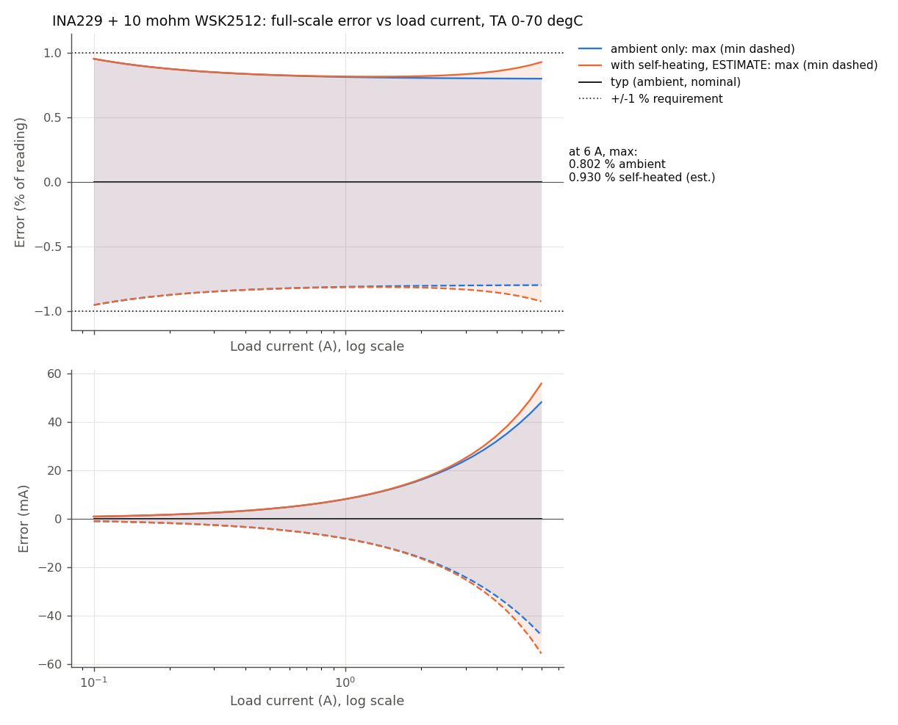
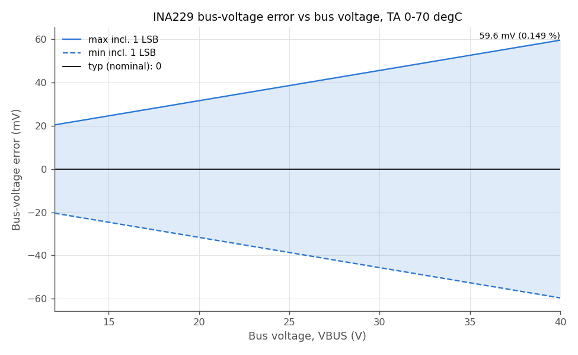
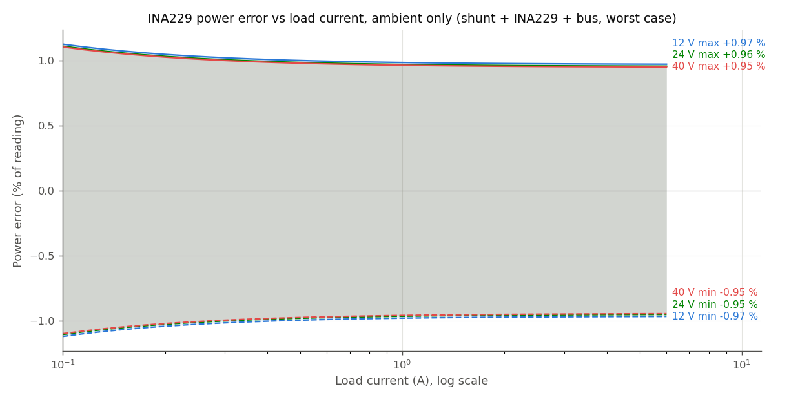
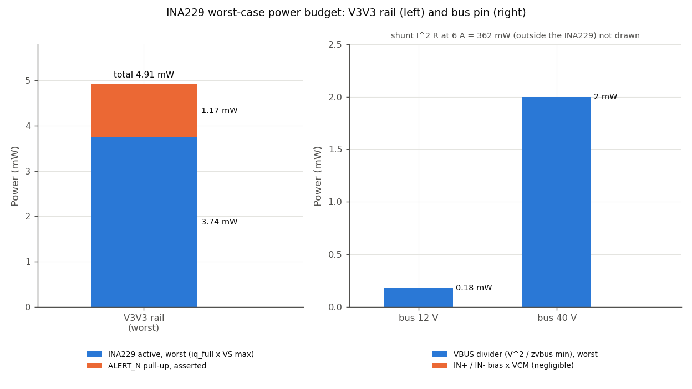

# INA229 + WSK2512 shunt block: design analysis

> GENERATED by `python3 -m analysis.ina229_block` from `analysis/ina229_block.py`. Do not edit this file; change the script and re-run.

- Library: zener-library v0.3.0 (`analysis/_zl.py`, component data and calc functions).
- Run date: 2026-11-15.
- Board values and key results: `docs/design-analysis/values.json` (generated by the same run).

High-side current sense: 6 A bidirectional full scale, bus 12 to 40 V, TA 0 to 70 degC, VS 3.3 V +/-3 %. Design: ADCRANGE 0, 10 mohm code D (`WSK2512R0100DEA`).

## Operating conditions and assumptions

- Full scale: 6 A, bidirectional (designer choice 2026-11-15). Bus 12 to 40 V DC, high-side.
- Accuracy requirement: +/-1 % of reading at 6 A full scale (designer requirement 2026-11-15), judged on the self-heated worst case (ESTIMATE). The 100 mA error is REPORT ONLY.
- TA 0 to 70 degC (board ambient); nominal (typ) reference 25 degC.
- VS = 3.3 V +/-3 %, one rail shared by the host and the INA229.
- Derate = 1. Shunt TCR reference temperature 25 degC (the WSK2512 DS states none; assumed).
- Self-heating is an ESTIMATE from the shunt derating curve (theta_est, section 3).
- Element temperature limit 170 degC is an ASSUMPTION (`T_ELEM_LIMIT`), not t_oper.
- Ambient full-scale error uses 2 interior samples per input (quadratic in TA); the self-heated band is multilinear in its two temperatures, so corners are exact (section 5).
- MISO series resistor 33 ohm (placeholder), ALERT_N pull-up 10 kohm (spec.md).

Conventions: PASS / FAIL against a datasheet, spec.md or the designer's requirement; ESTIMATE for curve-based or typical-based results; REPORT ONLY where no limit is set; REFERENCE for comparison only; OPEN ITEM for zero or placeholder margin; CHECK for a value with no spec limit.

## Contents

Design definition; summary; 1 shunt operating point; 2 shunt power and rating; 3 shunt self-heating (estimate); 4 firmware constants; 5 full-scale current error; 6 error vs current; 7 bus-voltage error; 8 power measurement error; 9 INA229 junction temperature (estimate); 10 quiescent current and power budget; 11 ratings; 12 MISO; 13 limits.

## Design definition

| Function | Part | Value / choice | Basis (library cite or source) |
|---|---|---|---|
| Monitor | TI INA229AIDGS | ADCRANGE 0 (+/-163.8 mV), CURRENT_LSB, SHUNT_CAL | DS p.5, 6.5 Electrical Characteristics, INPUT, Shunt voltage input range VDIFF, ADCRANGE = 0 |
| Shunt | `WSK2512R0100DEA` (Vishay WSK2512) | 10 mohm, +/-0.5 % (code D), 1 W at 70 degC, 4-terminal Kelvin sense | DS p.1, Standard Electrical Specifications, TOL. +/-0.5 % column; DS p.1, Global Part Number Information, tolerance code D = +/-0.5 %; DS p.1, Standard Electrical Specifications, POWER RATING P70 degC, W, 1.0 |
| VS bypass | Murata GCM188R71H104KA57 | 100 nF X7R 50 V 0603, at pin VS | INA229 DS section 9 (not analysed here) |
| MISO series resistor | Panasonic ERJ-3EKF | 33 ohm 0603, at the INA229 MISO pin (placeholder) | design choice; section 12 |
| ALERT_N pull-up | `ERJ3EKF1002V` (Panasonic ERJ-3EKF) | 10 kohm 0603 to V3V3, DNP-able | DS PDF p.3, Ratings <+/-1 %>, Resistance tolerance (%), ERJ3EK row; DS PDF p.2, tolerance code F = +/-1 % |

## Summary of key results

| Result | Value (worst case) | Limit | Margin | Status |
|---|---|---|---|---|
| Sense voltage headroom (self-heated worst Vsense at 6 A) | 60.47 mV | 163.8 mV (ADCRANGE 0) | 103.4 mV (63.09 %) | PASS |
| Shunt dissipation at 6 A, 70 degC (ambient rating) | 0.3624 W | 1 W (p70 x derate) | 0.6376 W (63.76 %) | PASS |
| Shunt element temperature at 6 A, 70 degC (theta_est 100 degC/W, self-consistent) | 106.3 degC | 170 degC (ASSUMED element limit) | 63.72 degC | ESTIMATE, PASS only if element limit = 170 degC (assumption) |
| Full-scale current error at 6 A, SELF-HEATED (judged) | -0.9246 to +0.9296 % (max 0.930 %) | +/-1 % of reading | +0.070 % of reading | PASS, ESTIMATE |
| Full-scale current error at 6 A, ambient only (reference) | -0.7984 to +0.8018 % (max 0.802 %) | reference only | n/a | REFERENCE (not judged) |
| Current error at 100 mA, self-heated (report) | -0.9523 to +0.9557 % (max 0.956 %) | none set at 100 mA | n/a | REPORT ONLY (no limit set), ESTIMATE |
| Current error at 100 mA, ambient only (report) | -0.9522 to +0.9557 % (max 0.956 %) | none set at 100 mA | n/a | REPORT ONLY (no limit set) |
| Bus-voltage error at 12 V (incl. 1 LSB) | +/-20.4 mV (+/-0.17 %) | none set | n/a | REPORT ONLY (no limit set) |
| Bus-voltage error at 40 V (incl. 1 LSB) | +/-59.6 mV (+/-0.149 %) | none set | n/a | REPORT ONLY (no limit set) |
| Power error at 6 A, 12 V (ambient) | -0.967 to +0.9731 % | none set | n/a | REPORT ONLY (no limit set) |
| Power error at 6 A, 40 V (ambient) | -0.9462 to +0.952 % | none set | n/a | REPORT ONLY (no limit set) |
| INA229 junction temperature at TA 70 degC (typical-based) | 71.04 degC (all power) | 150 degC (tj_abs) | 78.96 degC | ESTIMATE, PASS |
| INA229 quiescent current, active worst | 1.1 mA (iq_full); 0.64 mA typ at 25 degC | none set | n/a | REPORT ONLY |
| Quiescent power, V3V3 total worst (active + ALERT_N asserted) | 4.911 mW | none set | n/a | REPORT ONLY |
| Firmware: CURRENT_LSB, SHUNT_CAL | 11.4441 uA/LSB; SHUNT_CAL 1500 | exact integer (no spec limit) | +0 count | CHECK (exact integer; no spec limit) |
| Differential, hard load short (IN+ = 40 V, IN- = 0 V) | 40 to 40 V | `vin_diff_abs`: -40 to 40 V | 0 V | PASS, ZERO MARGIN (OPEN ITEM) |
| VIO high level, MOSI/MISO/SCLK/ALERT_N (3.3 V +/-3 %) | 3.399 to 3.399 V | `vio_abs`: -0.3 to 3.501 V | 0.102 V | PASS |
| MISO output source resistance (design placeholder) | 33 ohm | <= 400 ohm (`voh_25c`) | 367 ohm | PASS (placeholder, OPEN ITEM) |

Status: PASS / FAIL against a limit from spec.md or the datasheet. ESTIMATE: a curve-based or typical-based result (theta_est, rtheta_ja, the self-heating band), not a datasheet bound. REPORT ONLY: no limit set in spec.md (`ERR_LIMIT_PCT` is set to 1 % for the full-scale current error only). REFERENCE: shown for comparison, not judged. OPEN ITEM: passes with zero or placeholder margin. CHECK: a value with no spec limit to judge against.

## 1. Shunt operating point

Sense limit, ADCRANGE 0: `vdiff_adcr0_full` max = 163.8 mV (DS p.5, 6.5 Electrical Characteristics, INPUT, Shunt voltage input range VDIFF, ADCRANGE = 0). The shunt element runs at the self-heated temperature of section 3 (theta_est 100 degC/W, ESTIMATE); R_element is the worst tolerance and TCR at that temperature.

| Check | Vsense at I_MAX (mV) | Limit (mV) | Headroom (mV) | Headroom (% of limit) | Result |
|---|---|---|---|---|---|
| Self-heated worst case, ESTIMATE (judged) | 60.47 | 163.8 | 103.4 | 63.09 | PASS |
| Ambient resistance at TA 70 degC (reference) | 60.39 | 163.8 | 103.4 | 63.14 | PASS |

Board values (`ina229.zen`): `rshunt="10mohm"`, `rshunt_tol="D"`, `vsense_max="60.5mV"`. vsense_max is the self-heated worst Vsense 60.47 mV rounded up to 0.1 mV.

## 2. Shunt power and rating

Worst-case dissipation at I_MAX = 6 A and R_worst (TA 70 degC, ambient resistance; the worst corner): **0.3624 W**. Rating: `p70` max = 1 W at 70 degC ambient (DS p.1, DS p.1, Standard Electrical Specifications, POWER RATING P70 degC, W, 1.0), `rated_power` at TA = 70 degC (derating knee `derate_knee` = 70 degC and zero `derate_zero` = 170 degC are read off the DS p.3 graph, curve) x derate 1 = 1 W.

| Check | Worst-case (W) | Rated (W) | Margin (W) | Margin (% of rating) | Result | Cite |
|---|---|---|---|---|---|---|
| Shunt dissipation at 6 A, 70 degC (ambient rating) | 0.3624 | 1 | 0.6376 | 63.76 | PASS | DS p.1, Standard Electrical Specifications, POWER RATING P70 degC, W, 1.0 |

Rated working voltage (`max_working_voltage`, DS p.2 (P x R)^1/2): 0.1003 V at R_worst 10.07 mohm, vs worst Vsense 60.47 mV (self-heated): PASS.

The rating is against ambient. The element temperature is estimated in section 3, not rated by the DS.

## 3. Shunt self-heating (ESTIMATE)

### 3.1 Rated power vs ambient (derating curve)

Rated power = `p70` (1 W) up to the knee 70 degC, then a straight line to 0 W at 170 degC (`calc.rated_power`, DS p.3 graph, curve). Above the knee the curve is an estimate, not a bound.

Figure 1. Derating curve with the 6 A, 70 degC operating point (dissipation at worst R, from section 2).

### 3.2 Hot-spot thermal resistance and the self-heating equation (estimate)

**theta_est = (derate_zero - derate_knee) / p70 = (170 - 70) / 1 = 100 degC/W (ESTIMATE).** The DS prints no thermal resistance; this is read off the derating curve (derivation in `theta_est`, section notes in the script). It is not a datasheet value; the real element-to-ambient resistance depends on the copper and the layout (open item).

The self-heating rise is solved self-consistently: x = theta_est x I^2 x R(TA + x), where R is the worst-case `resistance_worst` (largest tolerance and TCR) at the element temperature TA + x. Fixed-point iteration from x = 0 converges; at 6 A and TA 70 degC the residual is 1.21e-13 degC (required below 0.001 degC).

### 3.3 Shunt temperature vs current (estimate)

| Current (A) | Worst P at TA 0 (W) | Worst P at TA 70 (W) | Rise at TA 0 (degC) | Rise at TA 70 (degC) | T_shunt at TA 0 (estimate, degC) | T_shunt at TA 70 (estimate, degC) | Margin to 170 degC at TA 70 (degC, assumed limit) |
|---|---|---|---|---|---|---|---|
| 0.1 | 0.0001006 | 0.0001007 | 0.01006 | 0.01007 | 0.01006 | 70.01 | 99.99 |
| 1 | 0.01006 | 0.01007 | 1.006 | 1.007 | 1.006 | 71.01 | 98.99 |
| 2 | 0.04024 | 0.04026 | 4.023 | 4.027 | 4.023 | 74.03 | 95.97 |
| 3 | 0.09053 | 0.09059 | 9.05 | 9.062 | 9.05 | 79.06 | 90.94 |
| 4 | 0.1609 | 0.1611 | 16.09 | 16.11 | 16.09 | 86.11 | 83.89 |
| 5 | 0.2515 | 0.2516 | 25.13 | 25.19 | 25.13 | 95.19 | 74.81 |
| 6 | 0.3621 | 0.3624 | 36.19 | 36.28 | 36.19 | 106.3 | 63.72 |

Reproduce a row: T_shunt = TA + rise, rise = theta_est x I^2 x R_worst(T_shunt); the 'Worst P' columns are at ambient resistance (rating basis) and are below the element-resistance power that sets the rise.

Limits: the element limit used here is **170 degC, an ASSUMPTION** (the derating curve's zero point, `derate_zero`, read as the element limit). It is NOT `t_oper`: the library records `t_oper` (max 170 degC, DS p.2) as an AMBIENT operating range, so it is not cited as the element limit. At 6 A and TA 70 degC: T_shunt = 106.3 degC (ESTIMATE), margin 63.72 degC: **ESTIMATE, PASS only if element limit = 170 degC (assumption)**. The estimate depends on theta_est; the copper, the layout and the true element limit are open items.

Figure 2. Estimated shunt element temperature vs current at TA 0 and 70 degC (self-consistent, worst-case R), against the assumed 170 degC element limit.

### 3.4 Dissipation vs current and the derated limit at each ambient

| TA (degC) | Derated limit (W) | Worst dissipation at full scale (W) | Margin (W) | Margin (%) | Result |
|---|---|---|---|---|---|
| 0 | 1 | 0.3621 | 0.6379 | 63.79 | PASS |
| 25 | 1 | 0.3618 | 0.6382 | 63.82 | PASS |
| 50 | 1 | 0.3621 | 0.6379 | 63.79 | PASS |
| 70 | 1 | 0.3624 | 0.6376 | 63.76 | PASS |

The limit is flat at p70 x derate below the knee (70 degC), so the 70 degC row is the tightest. Dissipation is I^2 x R_worst (ambient resistance, rating against ambient, as the DS states).

Figure 3. Worst-case dissipation vs current at TA 0, 25, 50 and 70 degC, with the derated limit at each ambient. The four dissipation curves overlap: the shunt TCR changes R by under 0.3 % across 0-70 degC, far below the scale of the chart.

## 4. Firmware constants

| Constant | Value | Equation / cite |
|---|---|---|
| CURRENT_LSB | 1.14440918e-05 A/LSB (11.4441 uA) | I_MAX / 2^19, DS p.30 Equation 3 (`calc.current_lsb`); same for both ADCRANGE |
| SHUNT_CAL (raw) | 1500.000000 | 13107.2e6 x CURRENT_LSB x R_NOM, DS p.30 Equation 2 (`calc.shunt_cal`, ADCRANGE 0) |
| SHUNT_CAL (register) | **1500** | rounded integer written to the register |

R_NOM used in SHUNT_CAL = 10 mohm (WSK2512R0100DEA). SHUNT_CAL is an exact integer, so the rounding term is zero.

## 5. Full-scale current error at 6 A (TA 0 to 70 degC)

Design shunt: 10 mohm, code D, `WSK2512R0100DEA`, ADCRANGE 0. Inputs (INA229 INPUTS map for `current_error`, plus the shunt):

| Term | Min | Max | Source |
|---|---|---|---|
| Shunt tolerance | -0.5 % | +0.5 % | DS p.1, Standard Electrical Specifications, TOL. +/-0.5 % column; DS p.1, Global Part Number Information, tolerance code D = +/-0.5 % |
| Shunt TCR | -35 ppm/degC | 35 ppm/degC | DS p.2, Technical Specifications, Temperature coefficient (RESISTOR CHARACTERISTICS), +/-35 for 0.005 ohm to 0.2 ohm |
| Vos (VCM choice) | -1 uV | 1 uV | DS p.5, 6.5 Electrical Characteristics, INPUT, Shunt offset voltage Vos, VCM = 48 V |
| dVos/dT | -10 nV/degC | 10 nV/degC | DS p.5, 6.5 Electrical Characteristics, INPUT, Shunt offset voltage drift dVos/dT |
| Gain error GSERR | -0.05 % | 0.05 % | DS p.5, 6.5 Electrical Characteristics, DC ACCURACY, Shunt voltage gain error GSERR |
| Gain drift GS_DRFT | -20 ppm/degC | 20 ppm/degC | DS p.5, 6.5 Electrical Characteristics, DC ACCURACY, Shunt voltage gain error drift GS_DRFT |
| SHUNT_CAL rounding | +0 % | +0 % | `SHUNT_CAL` 1500 vs raw 1500.0000, DS p.30 Eq. 2 |
| 1 LSB | -11.44 uA | +11.44 uA | `current_lsb(I_MAX)`, DS p.30 Eq. 3 (added separately) |

**Vos row.** The larger-magnitude of the two DS rows (`vos_vcm48_25c`, `vos_vcm0_25c`, +/-1 uV max at 25 degC) is used: `vos_vcm48_25c`. Neither row is at the 12-40 V bus voltage; the offset is specified at VCM 48 V and 0 V only (open item).

| Contributor (this term alone, others at zero) | Min (A) | Max (A) | Min (%) | Max (%) |
|---|---|---|---|---|
| Shunt tolerance (code D) | -0.03 | 0.03 | -0.5 | 0.5 |
| Shunt TCR (TA 0-70 degC) | -0.00945 | 0.00945 | -0.1575 | 0.1575 |
| VOS + drift | -0.000145 | 0.000145 | -0.002417 | 0.002417 |
| Gain error + drift | -0.0084 | 0.0084 | -0.14 | 0.14 |
| SHUNT_CAL integer rounding | 0 | 0 | 0 | 0 |
| 1 LSB (conservative, +/- one step) | -1.144e-05 | 1.144e-05 | -0.0001907 | 0.0001907 |

Sum of individual contributor maxima = 0.047995 A; the combined ambient worst case without the LSB is 0.0480975 A, which is 0.000103 A MORE than that sum. The excess is the cross products of the terms that each multiply the current: tolerance x TCR = 4.72e-05 A and (tolerance + TCR) x gain = 5.52e-05 A (sum 0.000102 A; the remaining 6.6e-08 A is the higher-order and Vos terms). The combined corner, not the sum, is the number to use.

**Ambient-only result (reference; all terms, worst-case corners, plus 1 LSB):**

| Quantity | Min | Typ | Max |
|---|---|---|---|
| Error (A) | -0.0479 | 0 | 0.04811 |
| Error (% of full-scale reading) | -0.7984 | 0 | 0.8018 |

Typ = all terms at their DS typical value of zero (bound-only rows are centred; typ_pm rows are centred with the DS typical spread kept separately: gserr typ spread 0.01 %, Vos typ spread 0.3 uV). It is the nominal part at 25 degC, not a statistical typical.

Sampling check (ambient): the function is quadratic in TA (the shunt TCR times the gain drift), so interior samples are needed. Corners only (samples = 0) give min -0.0478926 A, max 0.0480975 A; with 2 interior samples min -0.0478926 A, max 0.0480975 A. Difference: 0.00e+00 A low side, 0.00e+00 A high side.

**Self-heated ESTIMATE (the judged result).** The shunt element runs from TA 0 degC plus its lowest-R rise to TA 70 degC plus its worst-R rise (self-consistent, section 3). At 6 A the element reaches 106.3 degC at TA 70 degC (rise 36.28 degC), so the shunt TCR is evaluated up to 106.3 degC. The INA229 drift stays at the ambient 0 to 70 degC.

| Case (6 A) | Min error (A) | Max error (A) | Min (% of reading) | Max (% of reading) | Max magnitude (% of reading) | 1 % check |
|---|---|---|---|---|---|---|
| Ambient only (TA 0-70 degC), reference | -0.0479 | 0.04811 | -0.7984 | 0.8018 | 0.8018 | REFERENCE, not judged |
| With self-heating (ESTIMATE), judged | -0.05547 | 0.05578 | -0.9246 | 0.9296 | 0.9296 | PASS vs 1 % (margin +0.070 %), ESTIMATE |

Self-heating check: corners only give min -0.0554633 A, max 0.0557658 A; with 2 interior samples min -0.0554633 A, max 0.0557658 A. The function is MULTILINEAR in the shunt and the ambient temperature (separate inputs), so corners are exact, and the interior check agrees.

Result: the self-heated worst case at 6 A is **0.930 %** of reading (ambient reference 0.802 %). Requirement 1 %: **PASS** for the current design. The shunt TCR and the self-heating rise are the terms that move from the ambient to the self-heated case.

## 6. Error spread vs current (100 mA to 6 A)

40 log-spaced points. Each point is the worst-case function of section 5, with the 1 LSB term added to min and max. Blue: ambient only (TA 0-70 degC). Orange: with self-heating (ESTIMATE), where the shunt is at its element temperature band. Top: % of reading, with the +/-1 % requirement dotted. Bottom: mA.

Figure 4. Full-scale current error vs load current, ambient only and with the self-heating estimate.

Ambient only: at 0.1 A min -0.952 %, max 0.956 %; at 6 A min -0.798 %, max 0.802 %. With self-heating (ESTIMATE): at 0.1 A min -0.952 %, max 0.956 %; at 6 A min -0.925 %, max 0.93 %. The self-heated band differs only at the high end (the shunt rises 36.3 degC at 6 A and 0.01 degC at 0.1 A).

Worst case, self-heated (ESTIMATE): **6 A: 0.930 % of reading (judged vs 1 %: PASS); 100 mA: 0.956 % (REPORT ONLY, no limit set at 100 mA)** (ambient only: 6 A 0.802 %, 100 mA 0.956 %).

## 7. Bus-voltage worst-case error

Terms and cites: `vos_bus_25c` (DS p.5, 6.5 Electrical Characteristics, INPUT, VBUS offset voltage Vos_bus), `vos_bus_drift_full` (DS p.5, 6.5 Electrical Characteristics, INPUT, VBUS offset voltage drift dVos/dT), `gberr_25c` (DS p.5, 6.5 Electrical Characteristics, DC ACCURACY, VBUS voltage gain error GBERR), `gb_drift_25c` (DS p.5, 6.5 Electrical Characteristics, DC ACCURACY, VBUS voltage gain error drift GB_DRFT), `lsb_vbus_25c` (DS p.5, 6.5 Electrical Characteristics, DC ACCURACY, 1 LSB step size, Bus voltage).

`vos_bus_psrr_25c` (DS p.5, 6.5 Electrical Characteristics, INPUT, VBUS offset voltage vs power supply PSRR) prints only a typ, +/-0.25 mV/V in the TYP column and no MIN or MAX. It is not a bound and is excluded from min and max (typ-only row). Its typical size is shown in the last column with dVS = +/-99 mV (3.3 V +/-3 %). The PSRR row's test condition is VS = 2.7 to 5.5 V, so the dVS reference is an assumption (open item).

| V_true (V) | Min err (mV) | Typ err (mV) | Max err (mV) | Min (% of V) | Max (% of V) | Min incl. 1 LSB (mV) | Max incl. 1 LSB (mV) | PSRR typical, not bounded (mV) |
|---|---|---|---|---|---|---|---|---|
| 12 | -20.2 | 0 | 20.2 | -0.1683 | 0.1683 | -20.4 | 20.4 | +/-0.02475 |
| 18 | -28.6 | 0 | 28.6 | -0.1589 | 0.1589 | -28.8 | 28.8 | +/-0.02475 |
| 28 | -42.6 | 0 | 42.6 | -0.1521 | 0.1521 | -42.8 | 42.8 | +/-0.02475 |
| 36 | -53.8 | 0 | 53.8 | -0.1494 | 0.1494 | -54 | 54 | +/-0.02475 |
| 40 | -59.4 | 0 | 59.4 | -0.1485 | 0.1485 | -59.6 | 59.6 | +/-0.02475 |

Figure 5. Bus-voltage error vs bus voltage 12 to 40 V (band: min to max incl. 1 LSB; the typ-only PSRR is not in the band).

1 LSB = 195.3125 uV (`lsb_vbus_25c`), added to min and max. Typ = nominal part at 25 degC with all bound rows centred (their DS typical spread is not added).

The bus offset (`vos_bus_25c`) is specified only at VBUS = 20 mV, and the bus gain error at the table header condition. Their use at 12-40 V assumes the errors are flat with bus voltage (open item).

## 8. Power measurement error (V x I)

Worst case over all corners of the current error (section 5, ambient) and the bus-voltage error (section 7), combined as (1 + e_I / I)(1 + e_V / V) - 1 (`power_error`). The temperature is shared and enumerated at 4 points (min, interior and max); 1 LSB is added to each of current and bus voltage. Ambient only (the self-heated current error is in section 5 and is not combined here). No requirement is set for power error: REPORT ONLY.

| Current (A) | 12 V min (%) | 12 V max (%) | 24 V min (%) | 24 V max (%) | 40 V min (%) | 40 V max (%) |
|---|---|---|---|---|---|---|
| 0.1 | -1.121 | 1.127 | -1.106 | 1.112 | -1.1 | 1.106 |
| 6 | -0.967 | 0.9731 | -0.9521 | 0.958 | -0.9462 | 0.952 |

Sampling check (9 ambient points vs the 4 used, at 6 A): difference at 12 V 0.00e+00 low, 0.00e+00 high; at 40 V 0.00e+00 low, 0.00e+00 high (fraction).

Cross-check: the INA229 device spec `ptme_full` (DS p.5, 6.5 Electrical Characteristics, DC ACCURACY, Power total measurement error (TME) PTME) is -0.5 to +0.5 % at full scale over -40 to 125 degC. It is a device figure with an ideal shunt and does not include the external shunt's tolerance and TCR, which this result does. The power error here is therefore larger, as expected.

Figure 6. Worst-case power measurement error vs current at 12, 24 and 40 V (min and max, ambient only).

## 9. INA229 junction temperature (ESTIMATE, typical-based)

| Term | Value | Basis (library cite) |
|---|---|---|
| Supply current, active worst (`iq_full`) | 1.1 mA | DS p.6, 6.5 Electrical Characteristics, POWER SUPPLY, Quiescent current IQ, VSENSE = 0 V, TA = -40 degC to +125 degC |
| Power from V3V3, active worst | 3.739 mW | `iq_full` x VS max (3.399 V) |
| ALERT_N asserted: sink into the part (worst) | 0.138 mW | VOL max 0.4 V x I_alert max 344.9 uA (section 10); DS p.6, 6.5 Electrical Characteristics, DIGITAL INPUT / OUTPUT, Logic output level, low VOL, IOL = 1 mA |
| Dissipation from V3V3 (INA229) | **3.877 mW** | iq + ALERT sink |
| VBUS divider at 40 V (V^2 / zvbus min) | 2 mW (incl. IN bias) | DS p.5, 6.5 Electrical Characteristics, INPUT, VBUS pin input impedance ZVBUS |
| rtheta_ja (typical) | 177.6 degC/W | DS p.4, 6.4 Thermal Information, RthetaJA, DGS (VSSOP) 10 PINS |
| Junction temperature at TA 70 degC, V3V3 only (ESTIMATE) | **70.69 degC** | TA + P_V3 x rtheta_ja |
| Junction temperature at TA 70 degC, all INA229 power (ESTIMATE) | **71.04 degC** | adds the VBUS divider at 40 V |
| Absolute maximum junction temperature | 150 degC | DS p.3, 6.1 Absolute Maximum Ratings, TJ, Junction temperature |
| Margin to tj_abs (all power) | 78.96 degC | ESTIMATE, PASS |

`rtheta_ja` is a typical value (no max printed), so this is a typical-based estimate, not a worst-case bound. The junction temperature also depends on the board copper; the DS value assumes the JEDEC board.

## 10. Quiescent current and power budget

| Item | Supply | Min | Typ | Max | Basis (library cite) |
|---|---|---|---|---|---|
| INA229 active current, 25 degC (`iq_25c`) | V3V3 | - | 0.64 mA | 0.75 mA | DS p.6, 6.5 Electrical Characteristics, POWER SUPPLY, Quiescent current IQ, VSENSE = 0 V |
| INA229 active current, -40 to 125 degC (`iq_full`) | V3V3 | - | - | 1.1 mA | DS p.6, 6.5 Electrical Characteristics, POWER SUPPLY, Quiescent current IQ, VSENSE = 0 V, TA = -40 degC to +125 degC |
| INA229 shutdown current (`iqsd_25c`) | V3V3 | - | 2.8 uA | 5 uA | DS p.6, 6.5 Electrical Characteristics, POWER SUPPLY, Quiescent current, shutdown IQSD |
| ALERT_N pull-up current, asserted (VS / R) | V3V3 | 0 (not asserted) | 330 uA | 344.9 uA | 10 kohm ERJ3EKF1002V: R min 9.855 kohm over tol, TCR, 0-70 degC (ERJ-3EKF tol at 20 degC, TCR at 25 degC) |
| Power from V3V3: active, 25 degC | V3V3 | - | 2.112 mW | 2.549 mW | `iq_25c` x VS (nom / max 3.399 V) |
| Power from V3V3: active, worst | V3V3 | - | - | 3.739 mW | `iq_full` x VS max |
| Power from V3V3: ALERT_N asserted (rail) | V3V3 | 0 | 1.089 mW | 1.172 mW | VS x I_alert |
| VBUS input current at 12 V (`zvbus_25c`) | Bus | 10 uA | 12 uA | 15 uA | DS p.5, 6.5 Electrical Characteristics, INPUT, VBUS pin input impedance ZVBUS |
| VBUS input current at 40 V (`zvbus_25c`) | Bus | 33.33 uA | 40 uA | 50 uA | V / zvbus |
| Power in INA229 from VBUS at 12 V | Bus | 0.12 mW | 0.144 mW | 0.18 mW | V x I |
| Power in INA229 from VBUS at 40 V | Bus | 1.333 mW | 1.6 mW | 2 mW | V x I |
| IN+ / IN- input bias (`ib_25c`) | Bus | -2.5 nA | 0 | 2.5 nA | DS p.5, 6.5 Electrical Characteristics, INPUT, Input bias current IB; current, negligible power (< 1 uW) |
| Shunt insertion loss I^2 R at 6 A (outside the part) | Bus | 357.6 mW | 360 mW | 362.4 mW | `power_worst` at TA 0 and 70 degC (ambient R); typ = nominal 25 degC |
| ALERT pull-up resistor power, asserted (ERJ-3EKF) | V3V3 | - | - | 1.034 mW | rating p70 100 mW (DS PDF p.3, Ratings <+/-1 %>, Power rating (70 degC) (W), ERJ3EK row): PASS |

**Totals per supply.**

| Supply | Case | Total (mW) |
|---|---|---|
| V3V3 | Active, 25 degC, ALERT_N not asserted (typical) | 2.112 |
| V3V3 | Active, worst (`iq_full`, VS max), ALERT_N asserted | 4.911 |
| V3V3 | Shutdown, worst (`iqsd_25c`), ALERT_N asserted (conservative) | 1.189 |
| Bus 12 V | INA229 pin power, worst (VBUS divider + IN bias) | 0.18 |
| Bus 40 V | INA229 pin power, worst (VBUS divider + IN bias) | 2 |
| Bus 12 V | Shunt I^2 R at 6 A, worst (outside the INA229) | 362.4 |
| Bus 40 V | Shunt I^2 R at 6 A, worst (outside the INA229) | 362.4 |

Assumptions: `iq_full` and `iq_25c` are printed without a VS condition; the worst case assumes VS = 3.399 V. `zvbus_25c` is a 25 degC row; the 800 kohm minimum is applied at all temperatures (open item). The ALERT_N pull-up is assumed asserted in shutdown (conservative).

Figure 7. Worst-case power budget. Left: V3V3 rail (INA229 active plus ALERT_N pull-up asserted). Right: bus-pin power inside the INA229 at 12 and 40 V. The shunt I^2 R at 6 A (362 mW, outside the part) is annotated, not drawn to scale.

## 11. Ratings (absolute maximum and recommended operating)

| Check | Applied (worst case) | Rating (library key) | Margin | Result | Cite |
|---|---|---|---|---|---|
| Bus voltage VBUS (applied 12 to 40 V) | 12 to 40 V | `vbus_abs`: -0.3 to 85 V | 12.3 V | PASS | DS p.3, 6.1 Absolute Maximum Ratings, VBUS |
| Common mode VIN+/VIN- (abs, applied 12 to 40 V) | 12 to 40 V | `vcm_abs`: -0.3 to 85 V | 12.3 V | PASS | DS p.3, 6.1 Absolute Maximum Ratings, VIN+, VIN- Common-mode |
| Common mode VIN+/VIN- (rec, applied 12 to 40 V) | 12 to 40 V | `vcm_rec`: -0.3 to 85 V | 12.3 V | PASS | DS p.4, 6.3 Recommended Operating Conditions, VCM, Common-mode input range |
| Differential, hard load short (IN+ = 40 V, IN- = 0 V) | 40 to 40 V | `vin_diff_abs`: -40 to 40 V | 0 V | PASS, ZERO MARGIN (OPEN ITEM) | DS p.3, 6.1 Absolute Maximum Ratings, VIN+, VIN- Differential (VIN+) - (VIN-) |
| IIN into any pin (applied: input bias IB max) | 0 to 2.5e-06 mA | `iin_abs`: -inf to 5 mA | 5 mA | PASS | DS p.3, 6.1 Absolute Maximum Ratings, IIN, Input current into any pin |
| IOUT, digital output (applied: ALERT_N sink I_alert max) | 0 to 0.3449 mA | `iout_abs`: -inf to 10 mA | 9.655 mA | PASS | DS p.3, 6.1 Absolute Maximum Ratings, IOUT, Digital output current |
| VS supply, rec (applied 3.3 V +/-3 %) | 3.201 to 3.399 V | `vs_rec`: 2.7 to 5.5 V | 0.501 V | PASS | DS p.4, 6.3 Recommended Operating Conditions, VS, Operating supply range |
| VS supply, abs max (applied 3.3 V +/-3 %) | 3.201 to 3.399 V | `vs_abs`: -inf to 6 V | 2.601 V | PASS | DS p.3, 6.1 Absolute Maximum Ratings, Supply voltage VS |
| VIO, MOSI/MISO/SCLK/ALERT_N low level (applied 0 V; limit GND - 0.3 V) | 0 to 0 V | `vio_abs`: -0.3 to 3.501 V | 0.3 V | PASS | DS p.3, 6.1 Absolute Maximum Ratings, VIO, MOSI, MISO, SCLK, ALERT |
| VIO, MOSI/MISO/SCLK/ALERT_N high level (applied 3.3 V +/-3 % max; limit VS + 0.3 V, VS at its min) | 3.399 to 3.399 V | `vio_abs`: -0.3 to 3.501 V | 0.102 V | PASS | DS p.3, 6.1 Absolute Maximum Ratings, VIO, MOSI, MISO, SCLK, ALERT |
| TA ambient (rec, applied 0 to 70 degC) | 0 to 70 degC | `ta_rec`: -40 to 125 degC | 40 degC | PASS | DS p.4, 6.3 Recommended Operating Conditions, TA, Ambient temperature |
| Junction temperature (INA229, ESTIMATE) | 71.04 degC (ESTIMATE) | `tj_abs` 150 degC max | 78.96 degC | ESTIMATE, PASS | DS p.3, 6.1 Absolute Maximum Ratings, TJ, Junction temperature |
| Shunt sense voltage (worst, self-heated) | -60.47 to 60.47 mV | `vdiff_adcr0_full`: -163.8 to 163.8 mV | 103.4 mV | PASS | DS p.5, 6.5 Electrical Characteristics, INPUT, Shunt voltage input range VDIFF, ADCRANGE = 0 |
| Shunt dissipation vs rating (70 degC) | 0 to 0.3624 W | p70 x derate: 1 W | 0.6376 W | PASS | DS p.1, Standard Electrical Specifications, POWER RATING P70 degC, W, 1.0 |
| Shunt sense vs (P x R)^1/2 | 60.47 mV | (P x R)^1/2 = 100.3 mV | 39.86 mV | PASS | DS p.2, Technical Specifications, Maximum working voltage, (P x R)^1/2 |
| Storage temperature Tstg (abs) | - | `tstg_abs` -65 to 150 degC | - | rating only / owner: assembly | DS p.3, 6.1 Absolute Maximum Ratings, Tstg, Storage temperature |
| ESD HBM (abs) | - | `esd_hbm` +/-2000 V | - | rating only / owner: assembly | DS p.4, 6.2 ESD Ratings, Human body model (HBM), V(ESD) |
| ESD CDM (abs) | - | `esd_cdm` +/-1000 V | - | rating only / owner: assembly | DS p.4, 6.2 ESD Ratings, Charged device model (CDM), V(ESD) |

VIO (`vio_abs`, DS p.3): the printed limits are GND - 0.3 V and VS + 0.3 V, referenced to GND and VS. The supply is taken at its MINIMUM for the upper limit, as the library's `resolve` does: VS + 0.3 V = 3.501 V. The applied high level is the 3.3 V +/-3 % maximum, 3.399 V, so the margin is 102 mV. CS is not in the DS row (DS omission, library note): not checked.

Differential check: the hard-short differential equals the 40 V bus across the shunt (zero drop at the short). It sits exactly at the `vin_diff_abs` max of 40 V (DS p.3). Zero margin: OPEN ITEM.

The VS row checks 3.3 V +/-3 % (3.201 to 3.399 V) against `vs_rec` (2.7 to 5.5 V, DS p.4); the `vs_abs` max is 6 V (DS p.3).

The ESD rows (DS p.4 ESD ratings) and the storage temperature are rating-only: this board's assembly and handling process owns them (open item, owner assembly). IIN and IOUT are applied at the worst values this design produces.

## 12. MISO output note

`voh_25c` (DS p.6, 6.5 Electrical Characteristics, DIGITAL INPUT / OUTPUT, Logic output level, high VOH, IOL = 1 mA): the DS bounds the MISO output drop to 0.4 V at 1 mA, so the source resistance is bounded by R_out <= 0.4 V / 1 mA = **400 ohm** from the datasheet alone. The 33 ohm series resistor in the design is a placeholder DESIGN CHOICE; it is inside that bound but is not a derived value (OPEN ITEM). The row's condition prints IOL rather than IOH (DS ambiguity, noted in the library).

## 13. Limits of this analysis

- DC steady state only. No transient, no SPI timing, no ADC conversion-time effects.
- 25 degC-only rows are extended by their drift rows (SPEC recipe step 2). Drift rows are used as printed; GS_DRFT and GB_DRFT are DS-printed under the 25 degC header (DS ambiguity).
- Typical-only rows are not used as bounds: `vos_bus_psrr_25c` is shown separately (section 7), `rtheta_ja` is typical only (section 9, typical-based estimate), and the `typ` columns of bound rows are centred at zero, not the DS typical spread. `zvbus_25c` and `ib_25c` are 25 degC rows used at all temperatures (section 10).
- Self-heating (section 3.2) is a self-consistent fixed point: x = theta_est x I^2 x R_worst(TA + x), with R from `resistance_worst` at the element temperature, iterated to below 0.001 degC. theta_est is a derating-curve estimate of the shunt hot-spot thermal resistance, not a datasheet value. The result is ESTIMATE; the copper, the layout and the real element temperature are the open item.
- The element limit (170 degC) is an ASSUMPTION (derate_zero read as the element limit). `t_oper` is an ambient rating in the library and is not used as the element limit. PASS on the element margin holds only if the limit is 170 degC.
- Copper and connector heating at full scale is not analysed (trace, connector and terminal resistance and their temperature rise are outside this model).
- PCB thermal coupling between the shunt and the INA229 is ignored: the INA229 is assumed at ambient except for its own dissipation (section 9).
- The shunt TCR reference temperature (25 degC) and the TCR validity span are not stated in the WSK2512 DS.
- Excluded terms: CMRR (`cmrr_full`), INL, DNL, INA229 internal die-temperature effects, PCB and Kelvin trace resistance, the ADC noise, and the 1 LSB term is conservative (a quantizer is +/-0.5 LSB; 1 LSB was requested). SHUNT_CAL rounding is included (section 5). The INA229 POWER register is not used: the power result here is V x I from the measured current and bus voltage.
- The gain error row (`gserr_25c`) is specified at VCM = 24 V; the bus is 12-40 V (open item).
- The shunt rating is a DS rating against ambient at 70 degC; the element temperature is an estimate (section 3).
- The board's `vsense_max` (60.5 mV, `ina229.zen`) is the self-heated worst Vsense (60.47 mV) rounded up to 0.1 mV. It is a declared value for the rating check, not a measured one.

