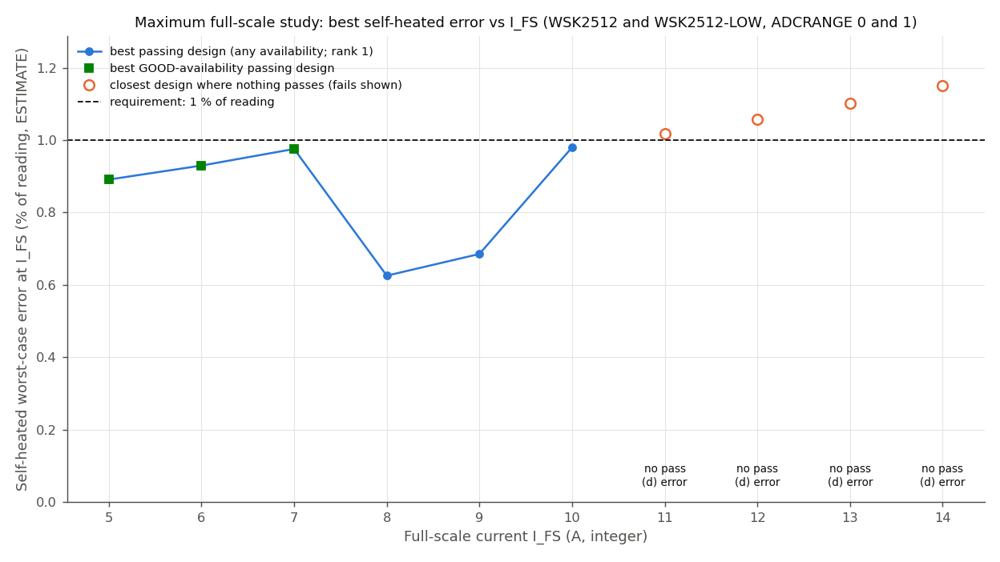
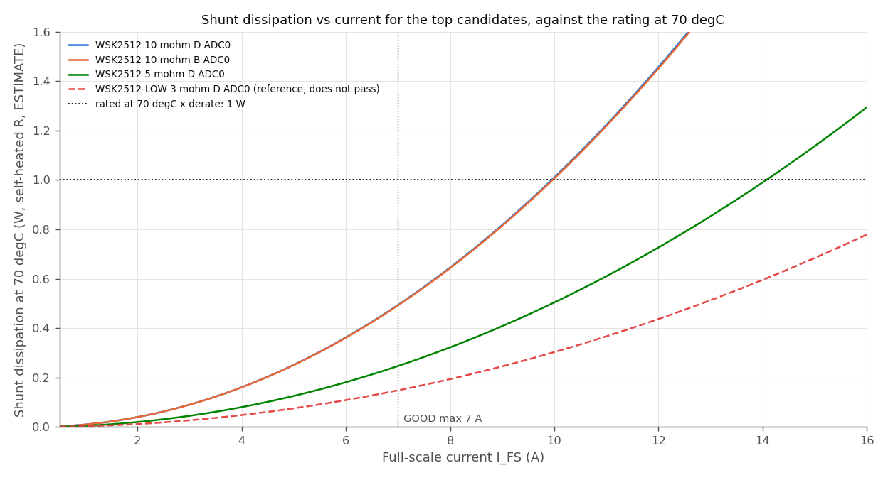
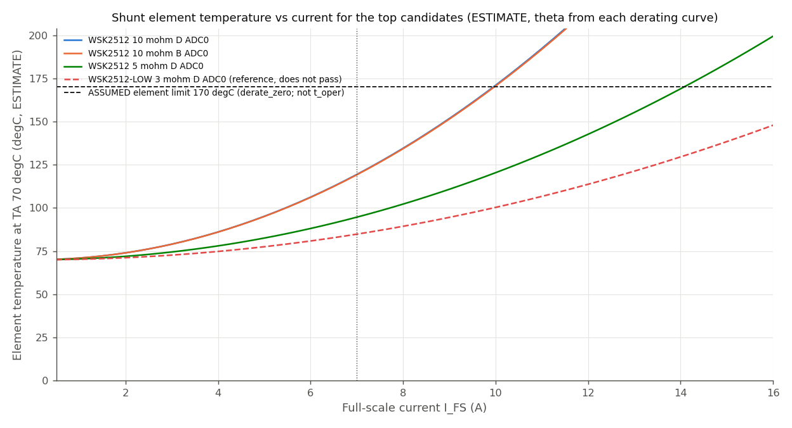
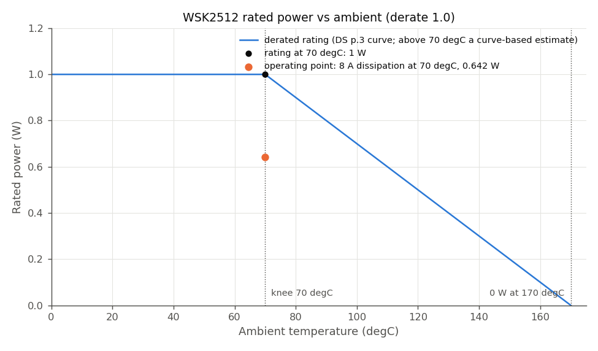
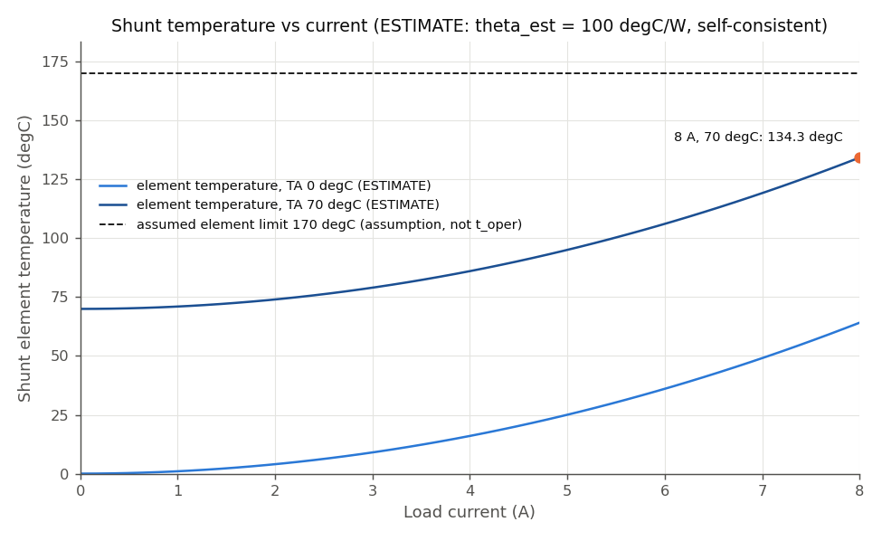
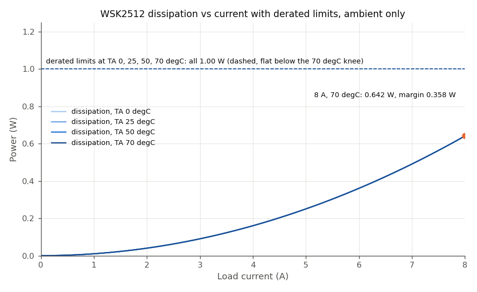

# INA229 + WSK2512 shunt block: design analysis

> GENERATED by `python3 -m analysis.ina229_block` from `analysis/ina229_block.py`. Do not edit this file; change the script and re-run.

- Library: zener-library v0.3.0 (`analysis/_zl.py`, component data and calc functions).
- Run date: 2026-11-15.
- Inputs: `analysis/data/shunt_stock_2026-11-15_rerank.json` (fit set at 5 A, a superset of the I_MAX fit set) and `analysis/data/shunt_stock_2026-11-15_maxfs.json` (maximum full-scale study, WSK2512 and WSK2512-LOW). Stock snapshots are sourcing records, not datasheet values.

High-side current sense: 8 A bidirectional full scale, bus 12 to 40 V, TA 0 to 70 degC, VS 3.3 V +/-3 %. Current design: ADCRANGE 0, 10 mohm code B.

## Requirement and design choices (not datasheet values)

- Accuracy requirement: +/-1 % of reading at 8 A full scale (designer requirement 2026-11-15), judged on the self-heated worst case (ESTIMATE). The 100 mA error is REPORT ONLY.
- I_MAX = 8 A, full scale, bidirectional. Bus 12 to 40 V, high-side.
- TA 0 to 70 degC; nominal (typ) reference 25 degC.
- VS = 3.3 V +/-3 %.
- Design shunt `SHUNT_SELECTED` = (ADCRANGE 0, code B, 10 mohm). The designer's selection basis and the fallback are in section 1.4.
- Derate = 1. Shunt TCR reference temperature 25 degC (the WSK2512 DS states none).
- Element temperature limit 170 degC is an ASSUMPTION (`T_ELEM_LIMIT`), not t_oper.
- Ambient full-scale error uses 2 interior samples per input (quadratic in TA); the self-heated band is multilinear in its two temperatures, so corners are exact (checked in section 5).
- Shunt candidates: every WSK2512 (value, code) fitting ADCRANGE 0 with self-heated Vsense (133 pairs; 2 also fit ADCRANGE 1). Availability snapshot 2026-11-15, a `pcb bom` sourcing record, not a guarantee.
- MISO series resistor 33 ohm (placeholder), ALERT_N pull-up 10 kohm (spec.md).

Conventions: PASS / FAIL against a datasheet, spec.md or the designer's requirement; ESTIMATE for curve-based or typical-based results; REPORT ONLY where no limit is set; REFERENCE for comparison only; OPEN ITEM for zero or placeholder margin; CHECK for a value with no spec limit.

## Contents

Summary; maximum full-scale current study and RECOMMENDATION (MF.0 to MF.9); 1 shunt selection and re-rank (1.4 selected design and basis, 1.5 ADCRANGE rows, 1.6 SHUNT_TEMPCO); 2 shunt power; 3 shunt self-heating (estimate); 4 firmware constants; 5 full-scale current error; 6 error vs current; 7 bus-voltage error; 8 power measurement error; 9 INA229 junction temperature (estimate); 10 quiescent current and power budget; 11 ratings; 12 MISO; 13 limits; 14 judgement calls.

## Summary of key results

| Result | Value (worst case) | Limit | Margin | Status |
|---|---|---|---|---|
| Design shunt (designer choice 2026-11-15, judged) | 10 mohm, code B (+/-0.1 %), ADCRANGE 0, `WSK2512R0100BEA` | availability (GOOD: 2+ distributors) | FAIR, 1 distributor(s); stock today 0 (informational) | FAIR (open item: lifecycle not checked) |
| Sense voltage headroom (self-heated worst Vsense at 8 A) | 80.39 mV | 163.8 mV (ADCRANGE 0) | 83.45 mV (50.94 %) | PASS |
| Shunt dissipation at 8 A, 70 degC (ambient rating) | 0.6416 W | 1 W (p70 x derate) | 0.3584 W (35.84 %) | PASS |
| Shunt element temperature at 8 A, 70 degC (theta_est 100 degC/W, self-consistent) | 134.3 degC | 170 degC (ASSUMED element limit) | 35.69 degC | ESTIMATE, PASS only if element limit = 170 degC (assumption) |
| Full-scale current error at 8 A, SELF-HEATED (judged) | -0.6235 to +0.6256 % (max 0.626 %) | +/-1 % of reading | +0.374 % of reading | PASS, ESTIMATE |
| Full-scale current error at 8 A, ambient only (reference) | -0.399 to +0.4 % (max 0.400 %) | reference only | n/a | REFERENCE (not judged) |
| Current error at 100 mA, self-heated (report) | -0.5573 to +0.5583 % (max 0.558 %) | none set at 100 mA | n/a | REPORT ONLY (no limit set), ESTIMATE |
| Current error at 100 mA, ambient only (report) | -0.5572 to +0.5583 % (max 0.558 %) | none set at 100 mA | n/a | REPORT ONLY (no limit set) |
| Bus-voltage error at 12 V (incl. 1 LSB) | +/-20.4 mV (+/-0.17 %) | none set | n/a | REPORT ONLY (no limit set) |
| Bus-voltage error at 40 V (incl. 1 LSB) | +/-59.6 mV (+/-0.149 %) | none set | n/a | REPORT ONLY (no limit set) |
| Power error at 8 A, 12 V (ambient) | -0.5683 to +0.5707 % | none set | n/a | REPORT ONLY (no limit set) |
| Power error at 8 A, 40 V (ambient) | -0.5474 to +0.5496 % | none set | n/a | REPORT ONLY (no limit set) |
| INA229 junction temperature at TA 70 degC (typical-based) | 71.04 degC (all power) | 150 degC (tj_abs) | 78.96 degC | ESTIMATE, PASS |
| INA229 quiescent current, active worst | 1.1 mA (iq_full); 0.64 mA typ at 25 degC | none set | n/a | REPORT ONLY |
| Quiescent power, V3V3 total worst (active + ALERT_N asserted) | 4.911 mW | none set | n/a | REPORT ONLY |
| Firmware: CURRENT_LSB, SHUNT_CAL | 15.2588 uA/LSB; SHUNT_CAL 2000 | exact integer (no spec limit) | +0 count | CHECK (exact integer; no spec limit) |
| Differential, hard load short (IN+ = 40 V, IN- = 0 V) | 40 to 40 V | `vin_diff_abs`: -40 to 40 V | 0 V | PASS, ZERO MARGIN (OPEN ITEM) |
| VIO high level, MOSI/MISO/SCLK/ALERT_N (3.3 V +/-3 %) | 3.399 to 3.399 V | `vio_abs`: -0.3 to 3.501 V | 0.102 V | PASS |
| MISO output source resistance (design placeholder) | 33 ohm | <= 400 ohm (`voh_25c`) | 367 ohm | PASS (placeholder, OPEN ITEM) |
| FALLBACK shunt (same value, GOOD availability, section 1.4) | `WSK2512R0100DEA`, 10 mohm code D | 1 % self-heated (full scale) | -0.029 % of reading | FAIL, ESTIMATE; alternate, not selected |

Status: PASS / FAIL against a limit from spec.md or the datasheet. ESTIMATE: a curve-based or typical-based result (theta_est, rtheta_ja, the self-heating band), not a datasheet bound. REPORT ONLY: no limit set in spec.md (`ERR_LIMIT_PCT` is set to 1 % for the full-scale current error only). REFERENCE: shown for comparison, not judged. OPEN ITEM: passes with zero or placeholder margin. CHECK: a value with no spec limit to judge against.

## Maximum full-scale current study

Question (designer, 2026-11-15): the highest integer full-scale current the block can support. Requirement: +/-1 % of reading at full scale, self-heated worst case, TA 0 to 70 degC, bus 12 to 40 V, V3V3 3.3 V +/-3 %, derate 1.0, no fault-headroom requirement. The current design (`SHUNT_SELECTED`, 8 A, 10 mohm code B) is NOT changed by this study; the sections below are the study and a RECOMMENDATION for the designer to approve.

### MF.0 Result

- **Maximum I_FS, primary rule** (at least one passing design rated GOOD or FAIR): **10 A**.
- **GOOD only:** **7 A**. **Any availability** (electrical pass only, POOR/UNKNOWN included): **10 A**.
- **RECOMMENDATION (GOOD):** 7 A with `WSK2512R0100DEA` (WSK2512 10 mohm, code D, ADCRANGE 0; 3 distributors). Self-heated error at 7 A: 0.976 % (limit 1 %, margin 0.024 %). Limit: (d) error 1 %; at 8 A it fails.
- **FAIR alternative (higher rating):** 10 A with `WSK25125L000DEA` (WSK2512 5 mohm, code D, ADCRANGE 0; 1 distributor, Mouser). Self-heated error 0.980 % (margin 0.020 %). Limit: (d) error 1 %; at 11 A nothing passes.
- **WSK2512-LOW:** no design passes at any integer I_FS from 5 A. Its best self-heated error at 5 A is 1.047 % (`WSK25123L000DEA`, criterion (d)); see MF.5.

### MF.1 Criteria (all at the 70 degC worst case; a design passes only if all six hold)

| Criterion | Check | Numbers from | Status |
|---|---|---|---|
| (a) Vsense | I_FS x R_element(worst) <= VDIFF max of the ADCRANGE (163.84 mV for 0, 40.96 mV for 1) | `vdiff_adcr0_full` (DS p.5, 6.5 Electrical Characteristics, INPUT, Shunt voltage input range VDIFF, ADCRANGE = 0), `vdiff_adcr1_full`; R_element at the self-heated element temperature | pass/fail |
| (b) Dissipation | I_FS^2 x R_element(worst) <= p70 x derate at TA 70 degC | `p70` (DS p.1, Standard Electrical Specifications, POWER RATING P70 degC, W, 1.0); the derating curve (knee and zero) of each series; derate 1 | pass/fail |
| (c) Working voltage | (P x R)^1/2 >= I_FS x R_element (P = rated at 70 degC) | `max_working_voltage` (DS p.2, Technical Specifications, Maximum working voltage, (P x R)^1/2). Algebraically the same test as (b) at the same R, counted once | pass/fail |
| (d) Error | Self-heated worst-case error <= 1 % of reading at I_FS: element tolerance and TCR at the element band (TA 0 to 70 degC plus its own rise); INA229 gain (GSERR, GS_DRFT) and offset (both Vos rows) at ambient; the SHUNT_CAL integer rounding; 1 LSB = I_FS / 2^19 | `tol_*`, `tcr_*` rows (per series); `gserr_25c`, `gs_drift_25c`, `vos_*`, `vos_drift_full` (INA229 DS p.5) | pass/fail; ESTIMATE (self-heating) |
| (e) Element temperature | T_element (worst) <= derate_zero of the series (the 0 % rating point, read from the derating curve) | ASSUMPTION: the element limit is read as derate_zero (as section 3), not t_oper | ESTIMATE |
| (f) SHUNT_CAL | 1 <= round(13107.2e6 x CURRENT_LSB x R x [4 for ADCRANGE 1]) <= 32767 | `shunt_cal` (INA229 DS p.30, Equation 2); register width: DS p.23, Table 7-7 (SHUNT_CAL bits 14-0, bit 15 reserved) | pass/fail; library gap, see MF.7 |

Candidate set: every orderable pair of each series (WSK2512: 403 pairs, codes B, D and F; WSK2512-LOW: 80 pairs, codes D and F), each at ADCRANGE 0 and 1 (966 records per integer I_FS). The self-heating fixed point is per series (theta_est 100 degC/W for WSK2512 and 100 degC/W for WSK2512-LOW, each from its own derating curve). The scan steps I_FS in 1 A integers from 5 A and stops 4 integers after the first integer with no passing design (11 A), so 14 A is the last integer checked.

**Ranking of passing designs:** availability (GOOD, then FAIR, then POOR/UNKNOWN), then lowest self-heated error (compared at 0.01 %), then lower dissipation at 70 degC. **Availability rating:** as the existing script (`avail_rating`): GOOD = recognized by the BOM (MATCH_EXACT), 2 or more distributors, standard value; FAIR = recognized, 1 distributor; POOR/UNKNOWN = not recognized, or no distributor listing. Stock is informational only. Lifecycle is not checked.

### MF.2 Series data used (each from its library rows; numbers are generated, not retyped)

| Series | Values (library value table) | Tolerance codes (DS p.1 range, before the directory clip) | TCR (DS p.2) | Power P70 (DS p.1) | Derating (DS p.3, curve) |
|---|---|---|---|---|---|
| `WSK2512` | 5 to 200 mohm (403 pairs) | B +/-0.1 % (10 to 200 mohm); D +/-0.5 % (1 to 200 mohm); F +/-1 % (0.5 to 200 mohm) | +/-35 ppm/degC for 5 to 200 mohm | 1 W (DS p.1, Standard Electrical Specifications, POWER RATING P70 degC, W, 1.0) | knee 70 degC, zero 170 degC (curve, `WSK2512` DS p.3); theta_est 100 degC/W (ESTIMATE) |
| `WSK2512-LOW` | 1 to 4.9 mohm (80 pairs) | D +/-0.5 % (1 to 200 mohm); F +/-1 % (0.5 to 200 mohm) | +/-350 ppm/degC for 0.5 to 0.99 mohm; +/-250 ppm/degC for 1 to 2.9 mohm; +/-75 ppm/degC for 3 to 4.9 mohm | 1 W (DS p.1, Standard Electrical Specifications, POWER RATING P70 degC, W, 1.0) | knee 70 degC, zero 170 degC (curve, `WSK2512-LOW` DS p.3); theta_est 100 degC/W (ESTIMATE) |

Value tables: `DS p.2, SOLDER PAD DIMENSIONS table, resistance range 0.005 to 0.2 row (also DS p.2, DIMENSIONS table, row 0.005 to 0.2)` and `DS p.2, SOLDER PAD DIMENSIONS table, resistance range 0.0005 to 0.0049 row (also DS p.2, DIMENSIONS table, rows 0.0005 to 0.00099 and 0.001 to 0.0049)` (the directory ranges); the decade values are Vishay doc 30117 (lib/series.py, DECADE). WSK2512-LOW has no code B (B starts at 0.01 ohm) and its lowest value is 1.0 mohm (library rule eseries_min 0.001 ohm; the 0.5 to 0.99 mohm TCR row therefore has no values). Its TCR is NOT the WSK2512 TCR: +/-350 ppm/degC for 0.5 to 0.99 mohm; +/-250 ppm/degC for 1 to 2.9 mohm; +/-75 ppm/degC for 3 to 4.9 mohm, against +/-35 ppm/degC for WSK2512 (5 to 200 mohm).

### MF.3 Result by integer full-scale current (5 A upward, until nothing passes)

| I_FS (A) | Passing designs: any / GOOD+FAIR / GOOD | Best passing design (rank 1) | Self-heated error at I_FS (%, ESTIMATE) | Element T at 70 degC (degC, ESTIMATE) | Dissipation at 70 degC (W, rated 1.0 W) | Vsense (mV) | Binding (closest design if nothing passes) |
|---|---|---|---|---|---|---|---|
| 5 | 118 / 5 / 1 | WSK2512 10 mohm D, ADCRANGE 0, `WSK2512R0100DEA`, GOOD | 0.891 | 95.2 | 0.252 | 50.37 | - |
| 6 | 92 / 5 / 1 | WSK2512 10 mohm D, ADCRANGE 0, `WSK2512R0100DEA`, GOOD | 0.930 | 106.3 | 0.363 | 60.47 | - |
| 7 | 70 / 5 / 1 | WSK2512 10 mohm D, ADCRANGE 0, `WSK2512R0100DEA`, GOOD | 0.976 | 119.4 | 0.494 | 70.58 | - |
| 8 | 45 / 3 / 0 | WSK2512 10 mohm B, ADCRANGE 0, `WSK2512R0100BEA`, FAIR | 0.626 | 134.3 | 0.643 | 80.39 | - |
| 9 | 15 / 2 / 0 | WSK2512 10 mohm B, ADCRANGE 0, `WSK2512R0100BEA`, FAIR | 0.686 | 151.4 | 0.814 | 90.49 | - |
| 10 | 6 / 1 / 0 | WSK2512 5 mohm D, ADCRANGE 0, `WSK25125L000DEA`, FAIR | 0.980 | 120.4 | 0.504 | 50.42 | - |
| 11 | 0 / 0 / 0 | none | - | - | - | - | closest: WSK2512 5 mohm, code D, ADCRANGE 0, fails d error 1 %; first: (d) error 1 % |
| 12 | 0 / 0 / 0 | none | - | - | - | - | closest: WSK2512 5 mohm, code D, ADCRANGE 0, fails d error 1 %; first: (d) error 1 % |
| 13 | 0 / 0 / 0 | none | - | - | - | - | closest: WSK2512 5 mohm, code D, ADCRANGE 0, fails d error 1 %; first: (d) error 1 % |
| 14 | 0 / 0 / 0 | none | - | - | - | - | closest: WSK2512 5 mohm, code D, ADCRANGE 0, fails d error 1 %; first: (d) error 1 % |

Maximum I_FS: primary (GOOD or FAIR) **10 A**; GOOD only **7 A**; any availability **10 A**. First integer with nothing passing: **11 A** (scan continued to 14 A, nothing passes above it).

Figure M1. Best passing design's self-heated error at each integer I_FS (blue: any availability; green: GOOD only), against the 1 % requirement. Where nothing passes (orange, hollow), the closest design is shown with the criterion that fails first.

ADCRANGE 1 (40.96 mV) passing designs by I_FS: 5 A: 32, 6 A: 18, 7 A: 9, 8 A: 1. GOOD-availability ADCRANGE 1 designs among them: 0. The ranking takes availability first, so an ADCRANGE 1 design ranks only where it is FAIR or better than the ADCRANGE 0 choice.

### MF.4 Limits of the candidates (where each design stops passing, and what stops it)

| Design | Availability (at its limit) | Last integer passing | Binding criterion (first to fail) | At the last passing integer |
|---|---|---|---|---|
| WSK2512 10 mohm, code D, ADCRANGE 0 | GOOD | 7 A | (d) error 1 % | 0.976 %, T 119.4 degC, P 0.494 W |
| WSK2512 10 mohm, code B, ADCRANGE 0 | FAIR | 9 A | (b) dissipation; same test as (c), (e) element T | 0.686 %, T 151.4 degC, P 0.814 W |
| WSK2512 5 mohm, code D, ADCRANGE 0 | FAIR | 10 A | (d) error 1 % | 0.980 %, T 120.4 degC, P 0.504 W |
| WSK2512-LOW 3 mohm, code D, ADCRANGE 0 | - | none (fails at 5 A) | (d) error 1 % | - |

The limit is the last integer before the first criterion fails (the scan is ascending; each design's first failure is recorded). Designs listed here are the rank-1 design at some integer, the recommended design, the FAIR alternative and the best WSK2512-LOW design at I_FS = 5 A (reference; it does not pass at any integer).

Figure M2. Shunt dissipation at 70 degC (element resistance, ESTIMATE) vs I_FS for the top candidates (solid) and the WSK2512-LOW reference (dashed), against the rating at 70 degC (p70 x derate). The dotted line marks the GOOD maximum.

Figure M3. Element temperature at TA 70 degC vs I_FS (ESTIMATE, each series' own theta) for the same candidates, against the ASSUMED element limit (derate_zero, 170 degC).

### MF.5 RECOMMENDATION (for the designer to approve)

**Recommended integer full-scale current: 7 A**, with `WSK2512R0100DEA` (WSK2512, 10 mohm, tolerance code D, ADCRANGE 0, GOOD availability: 3 distributors: DigiKey, LCSC, Mouser). Stock today 292 (informational). The design is judged at 70 degC, self-heated worst case, derate 1.0.

| Item | Value (worst case) | Limit | Margin | Status |
|---|---|---|---|---|
| Shunt (library MPN; BOM MPN agrees) | `WSK2512R0100DEA`, 10 mohm, code D (+/-0.5 %) | - | - | GOOD (proxy; lifecycle open item) |
| Vsense worst at I_FS, self-heated | 70.58 mV | 163.84 mV (ADCRANGE 0) | 93.26 mV (56.9 % of range) | PASS (a) |
| Shunt dissipation at 70 degC (element R, worst) | 0.494 W | 1 W (p70 x derate) | 0.506 W (50.6 % of rating) | PASS (b) |
| (P x R)^1/2 vs Vsense (working voltage) | Vsense 70.58 mV | (P x R)^1/2 100.42 mV | 29.83 mV | PASS (c) |
| Element temperature at 70 degC (ESTIMATE, self-consistent) | 119.41 degC (band low 48.7 degC at TA 0) | 170 degC (ASSUMED element limit = derate_zero) | 50.59 degC | ESTIMATE, PASS only under the assumed limit |
| Self-heated worst-case error at I_FS (judged; ESTIMATE) | 0.9755 % of reading (2-sample interior check 0.9755 %) | 1 % of reading | 0.0245 % of reading | PASS (d), ESTIMATE |
| Self-heated error at 1 % of I_FS (REPORT ONLY, no limit) | 1.025 % of reading at 0.07 A (above 1 %: at this low end the offset, 1 uV at 25 degC plus 10 nV/degC drift, is a large fraction of the 1 % of I_FS drop; no requirement is set at the low end) | none set | - | REPORT ONLY |
| Ambient-only error at I_FS (reference) | 0.8015 % | reference | - | REFERENCE |
| CURRENT_LSB = I_FS / 2^19 | 1.33514e-05 A/LSB (13.35 uA) | - | - | DS p.30 Equation 3 |
| SHUNT_CAL (ADCRANGE 0) | raw 1750.0000, register 1750 | 32767 (15-bit field, DS p.23) | 1749 counts | PASS (f) |
| Bus-voltage error (design independent, section 7, incl. 1 LSB) | +/-20.4 mV at 12 V, +/-59.6 mV at 40 V | none set | - | REPORT ONLY |
| Power error at I_FS, 12 V (ambient, REPORT ONLY) | -0.9667 to +0.9728 % | none set | - | REPORT ONLY |
| Power error at I_FS, 40 V (ambient, REPORT ONLY) | -0.9459 to +0.9517 % | none set | - | REPORT ONLY |
| Continuous current at 70 degC, rating basis (ambient R, calc.max_current) | 9.97 A | I_FS 7 A | +2.97 A | rating basis |
| Continuous current at 70 degC, self-heated (element R, bisection) | 9.95 A | I_FS 7 A | +2.95 A | ESTIMATE |

**Limits of this design and what fails above it.** The design passes up to 7 A. At 8 A its failing criteria are d error 1 % (first to fail: (d) error 1 %); its self-heated error is 1.029 % of reading, its dissipation 0.646 W against 1 W, and its element temperature 134.6 degC against the 170 degC assumed limit.

**FAIR alternative (only if the availability risk is accepted):** `WSK25125L000DEA` (5 mohm, code D, ADCRANGE 0), 10 A. Self-heated error 0.9799 % (margin 0.0201 %), element 120.4 degC (ESTIMATE), dissipation 0.504 W (margin 0.496 W), Vsense 50.42 mV (headroom 69.2 %), SHUNT_CAL 1250. Distributor: Mouser, stock today 0 (informational). Limit: (d) error 1 %.

**Why WSK2512-LOW does not reach 5 A.** Without self-heating (ambient 0 to 70 degC only) its best design, `WSK25123L000DEA`, would be 0.990 % at 5 A; self-heating (element 77.6 degC at 70 degC) raises it to 1.047 %. The 1.0 to 2.9 mohm values carry +/-250 ppm/degC and their best ambient-only error is already 1.783 % at 5 A; the 3.0 to 4.9 mohm values (+/-75 ppm/degC) reach 0.987 % ambient-only. The main WSK2512 (+/-35 ppm/degC) carries a much smaller TCR term.

### MF.6 What limits the maximum

- **GOOD design (`WSK2512R0100DEA`):** the first criterion to fail above 7 A is (d) error 1 % (self-heated error 0.976 % at 7 A, 1.029 % at 8 A).
- **Nothing passes at 11 A.** The closest design there is WSK2512 5 mohm, code D, ADCRANGE 0, failing d error 1 % (self-heated error 1.017 %, element 131.0 degC).
- **Code B (+/-0.1 %), 10 mohm, ADCRANGE 0** (the current design's value and tolerance, FAIR availability) passes up to 9 A; its first criterion to fail is (b) dissipation; same test as (c), (e) element T. At 9 A its self-heated error is 0.686 % against 1.089 % for code D at the same current, and its dissipation (0.814 W) and element temperature (151.4 degC) are the limits.

### MF.7 Library gaps, data read off the datasheet, and cites

- **SHUNT_CAL register width (INA229), library gap:** `calc.shunt_cal` returns the value and the library has no register-width row. Read from the datasheet page image (INA229 DS p.23, Table 7-7): SHUNT_CAL is bits 14-0 (R/W, reset 1000h), bit 15 is reserved. A 15-bit field, so the largest value is 32767 (7FFFh). Used as criterion (f) through the constant `SHUNT_CAL_MAX`. The library owner should add the register width as a row.
- **WSK2512-LOW data:** the LOW part has its own library directory (v0.2.0 is the pinned package tag; v0.3.0 identical). Its datasheet is the same Vishay document as WSK2512 (DS 30108, 11-Dec-2023), so every LOW number cites DS 30108: tolerance codes D and F (DS p.1, Standard Electrical Specifications), P70 1.0 W (DS p.1), TCR by range (DS p.2, Technical Specifications; TCR, tolerance and P70 rows checked against the datasheet text, pages 1 and 2), derating (DS p.3, DERATING graph; 100 % to 70 degC, 0 % at 170 degC, read off the curve; the page image checked), and the decade value table (Vishay doc 30117 (WSL), not referenced by DS 30108: library open item).
- **Derating curve (both series):** the knee (70 degC) and zero (170 degC) are curve readings, so theta_est (100 degC/W) and every element temperature depend on them. Both series print the same curve, but each series' theta is computed from its own rows.
- **TCR reference temperature:** not stated by either WSK2512 datasheet; 25 degC is assumed (existing open item). The TCR is applied as (1 + TCR x (T - 25 degC)) and the tolerance as a fixed +/- offset.

### MF.8 Current path (open item, one line)

- **Open item:** the block's BUS_IN/BUS_OUT copper, pads and connectors must be rated for the chosen I_FS (7 A recommended, 10 A FAIR alternative); layout not started.

### MF.9 Method and limits of this study

- Every criterion is a worst-case bound at 70 degC, except (d) and (e), which are ESTIMATES (self-heating from the derating curve). The INA229 terms (gain, offset, LSB) are at the ambient 0 to 70 degC.
- (c) is the same test as (b) at the same R (exact identity), so it is counted once in the fail count.
- SHUNT_CAL rounding: the written register value is round-half-up. A raw value on an exact .5 tie can be written either way, so the judged error takes the worse of the two integers (the rounding term is a worst case, not a sign).
- The self-heated error is multilinear in its two temperatures (element and ambient), so corners are exact. The recommended design is also checked with two interior points per input (2-sample check above).
- 'First failing' criterion per design: the scan is ascending, so the first integer where each criterion fails is recorded; a design whose criteria are not monotone would show its first failure only.
- The availability snapshot (`analysis/data/shunt_stock_2026-11-15_maxfs.json`) covers every passing design; the WSK2512 rows are reused from `shunt_stock_2026-11-15_rerank.json` and the WSK2512-LOW rows are new (80 pairs, pcb bom -f json in a scratch copy with the LOW dependency 0.2.0). Lifecycle, PCN and lead time are not checked. Stock is a snapshot.
- Power error (MF.5) is ambient only, as section 8 (report only, no limit).

## 1. Shunt selection and re-rank

Sense limits: `vdiff_adcr0_full` max = 163.8 mV (ADCRANGE 0, DS p.5, DS p.5, 6.5 Electrical Characteristics, INPUT, Shunt voltage input range VDIFF, ADCRANGE = 0); `vdiff_adcr1_full` max = 40.96 mV (ADCRANGE 1, DS p.5). Vsense (worst) = I_MAX x R_element, with R_element = `resistance_worst` at the self-heated element temperature (TA 70 degC + rise, rise from section 3, theta_est 100 degC/W), worst tolerance and TCR.

**Candidate set.** Every WSK2512 (value, code) in the library whose self-heated worst Vsense fits ADCRANGE 0: 133 pairs (B, D and F codes). 2 of them also fit ADCRANGE 1, i.e. R_element <= 5.12 mohm at 8 A, which is the series values up to 5 mohm. ADCRANGE 1 is therefore a design choice for the small shunts only. Each candidate is evaluated at the ADCRANGE it fits (ADCRANGE 0 always; ADCRANGE 1 where it fits).

**Availability sources.** `pcb bom -f json` re-run on 2026-11-15 for every candidate (scratch copy of the board, shunt `rshunt`/`rshunt_tol`/`vsense_max` set per candidate): `analysis/data/shunt_stock_2026-11-15_rerank.json`. Per candidate: whether the Diode BOM sources recognize the part (MATCH_EXACT or MATCH_FAILED), the distributors and regions listing it (offer count, kept even at zero stock), and today's total stock (informational only).

**Availability rating (proxy, not a lifecycle check).** GOOD = recognized, listed by at least 2 distributors, standard series value. FAIR = recognized, listed by 1 distributor (or a non-standard value). POOR/UNKNOWN = not found in the Diode BOM sources (MATCH_FAILED), or recognized with no distributor listing. Lifecycle status is **not checked**: the WSK2512 library directory carries no lifecycle field and the snapshot has none.

Stock today is a snapshot; long-term availability (lifecycle, multi-distributor listing, standard values) decides. Verify lifecycle/PCN with the manufacturer before release (open item).

**Judgement.** Ranked = recognized (MATCH_EXACT), self-heated 8 A error within 1 % of reading (the requirement), Vsense inside the ADC range, shunt rating at 70 degC (p70 x derate) met, and (P x R)^1/2 at or above the worst Vsense. Order: must pass 1 %, then availability rating (GOOD before FAIR), then lowest self-heated 8 A error (compared at 0.01 %), then headroom at or above 2 % of the range, then lower dissipation. The designer's selection (2026-11-15) uses accuracy first among the 1 % passers (section 1.4). Today's stock never decides the ranking. POOR/UNKNOWN rows are shown but sit below every rated row. BOM reuse: not applicable (one shunt).

**Table 1.1. All candidates (ADCRANGE 0 fit set, plus ADCRANGE 1 where it fits), ranked. Unranked rows are shown for reference.**

| Rank | ADCRANGE | Code | Value (mohm) | MPN | Availability | Distributors (regions) | Stock today (informational) | Full-scale self-heated error (%) | 1 % check (self-heated) | 100 mA self-heated (%) | Full-scale ambient, ref. (%) | Headroom (%) | Dissipation at full scale, 70 degC (W) | Element T at full scale, 70 degC (degC, ESTIMATE) | SHUNT_CAL raw -> reg | Note |
|---|---|---|---|---|---|---|---|---|---|---|---|---|---|---|---|---|
| 1 | 0 | B | 10 | WSK2512R0100BEA | FAIR | 1 (Global) | 0 | 0.626 | PASS | 0.558 | 0.400 | 50.94 | 0.642 | 134.3 | 2000.000 -> 2000 |  |
| 2 | 0 | D | 5 | WSK25125L000DEA | FAIR | 1 (US) | 0 | 0.917 | PASS | 1.104 | 0.803 | 75.4 | 0.322 | 102.2 | 1000.000 -> 1000 |  |
| 3 | 1 | D | 5 | WSK25125L000DEA | FAIR | 1 (US) | 0 | 0.917 | PASS | 1.104 | 0.803 | 1.59 | 0.322 | 102.2 | 4000.000 -> 4000 |  |
| 4 | 0 | D | 6 | WSK25126L000DEA | POOR/UNKNOWN | 0 | no offer returned | 0.939 | PASS | 1.056 | 0.802 | 70.47 | 0.387 | 108.7 | 1200.000 -> 1200 |  |
| 5 | 0 | D | 7 | WSK25127L000DEA | POOR/UNKNOWN | 0 | no offer returned | 0.961 | PASS | 1.022 | 0.802 | 65.54 | 0.451 | 115.2 | 1400.000 -> 1400 |  |
| 6 | 0 | D | 7.5 | WSK25127L500DEA | POOR/UNKNOWN | 0 | no offer returned | 0.972 | PASS | 1.008 | 0.802 | 63.08 | 0.483 | 118.4 | 1500.000 -> 1500 |  |
| 7 | 0 | D | 8 | WSK25128L000DEA | POOR/UNKNOWN | 0 | no offer returned | 0.984 | PASS | 0.996 | 0.802 | 60.61 | 0.515 | 121.6 | 1600.000 -> 1600 |  |
| - | 0 | B | 20 | WSK2512R0200BEA | FAIR | 1 (Global) | 0 | 0.851 | PASS | 0.486 | 0.399 | 1.651 | 1.283 | 198.9 | 4000.000 -> 4000 | fails a rating or ADC check (not ranked) |
| - | 0 | D | 9 | WSK25129L000DEA | POOR/UNKNOWN | 0 | no offer returned | 1.006 | FAIL | 0.976 | 0.801 | 55.68 | 0.580 | 128.1 | 1800.000 -> 1800 | fails 1 % (not ranked) |
| - | 0 | D | 10 | WSK2512R0100DEA | GOOD | 3 (Global, US) | 292 | 1.029 | FAIL | 0.960 | 0.801 | 50.74 | 0.644 | 134.6 | 2000.000 -> 2000 | fails 1 % (not ranked) |
| - | 0 | D | 12 | WSK2512R0120DEA | POOR/UNKNOWN | 0 | no offer returned | 1.074 | FAIL | 0.935 | 0.801 | 40.86 | 0.773 | 147.5 | 2400.000 -> 2400 | fails 1 % (not ranked) |
| - | 0 | D | 15 | WSK2512R0150DEA | POOR/UNKNOWN | 0 | no offer returned | 1.142 | FAIL | 0.911 | 0.801 | 26.03 | 0.966 | 167.0 | 3000.000 -> 3000 | fails 1 % (not ranked) |
| - | 0 | D | 18 | WSK2512R0180DEA | POOR/UNKNOWN | 0 | no offer returned | 1.211 | FAIL | 0.895 | 0.800 | 11.17 | 1.160 | 186.4 | 3600.000 -> 3600 | fails 1 % (not ranked) |
| - | 0 | D | 20 | WSK2512R0200DEA | POOR/UNKNOWN | 0 | no offer returned | 1.256 | FAIL | 0.887 | 0.800 | 1.256 | 1.288 | 199.4 | 4000.000 -> 4000 | fails 1 % (not ranked) |
| - | 0 | F | 5 | WSK25125L000FEA | GOOD | 3 (Global, US) | 211 | 1.419 | FAIL | 1.606 | 1.305 | 75.27 | 0.324 | 102.4 | 1000.000 -> 1000 | fails 1 % (not ranked) |
| - | 1 | F | 5 | WSK25125L000FEA | GOOD | 3 (Global, US) | 211 | 1.419 | FAIL | 1.606 | 1.305 | 1.1 | 0.324 | 102.4 | 4000.000 -> 4000 | fails 1 % (not ranked) |
| - | 0 | F | 5.3 | WSK25125L300FEA | POOR/UNKNOWN | 0 | no offer returned | 1.426 | FAIL | 1.590 | 1.304 | 73.79 | 0.343 | 104.4 | 1060.000 -> 1060 | fails 1 % (not ranked) |
| - | 0 | F | 5.5 | WSK25125L500FEA | POOR/UNKNOWN | 0 | no offer returned | 1.430 | FAIL | 1.580 | 1.304 | 72.8 | 0.356 | 105.7 | 1100.000 -> 1100 | fails 1 % (not ranked) |
| - | 0 | F | 6 | WSK25126L000FEA | FAIR | 1 (US) | 49 | 1.442 | FAIL | 1.558 | 1.304 | 70.32 | 0.388 | 108.9 | 1200.000 -> 1200 | fails 1 % (not ranked) |
| - | 0 | F | 6.1 | WSK25126L100FEA | POOR/UNKNOWN | 0 | no offer returned | 1.444 | FAIL | 1.554 | 1.304 | 69.83 | 0.395 | 109.5 | 1220.000 -> 1220 | fails 1 % (not ranked) |
| - | 0 | F | 6.2 | WSK25126L200FEA | POOR/UNKNOWN | 0 | no offer returned | 1.446 | FAIL | 1.550 | 1.304 | 69.33 | 0.401 | 110.2 | 1240.000 -> 1240 | fails 1 % (not ranked) |
| - | 0 | F | 6.5 | WSK25126L500FEA | POOR/UNKNOWN | 0 | no offer returned | 1.453 | FAIL | 1.539 | 1.304 | 67.85 | 0.421 | 112.1 | 1300.000 -> 1300 | fails 1 % (not ranked) |
| - | 0 | F | 7 | WSK25127L000FEA | GOOD | 2 (Global, US) | 2,669 | 1.464 | FAIL | 1.523 | 1.303 | 65.37 | 0.453 | 115.4 | 1400.000 -> 1400 | fails 1 % (not ranked) |
| - | 0 | F | 8 | WSK25128L000FEA | POOR/UNKNOWN | 0 | no offer returned | 1.487 | FAIL | 1.497 | 1.303 | 60.41 | 0.518 | 121.9 | 1600.000 -> 1600 | fails 1 % (not ranked) |
| - | 0 | F | 9 | WSK25129L000FEA | POOR/UNKNOWN | 0 | no offer returned | 1.510 | FAIL | 1.477 | 1.303 | 55.45 | 0.583 | 128.4 | 1800.000 -> 1800 | fails 1 % (not ranked) |
| - | 0 | F | 10 | WSK2512R0100FEA | GOOD | 3 (Global, US) | 25,667 | 1.532 | FAIL | 1.461 | 1.303 | 50.49 | 0.647 | 134.9 | 2000.000 -> 2000 | fails 1 % (not ranked) |
| - | 0 | F | 11 | WSK2512R0110FEA | POOR/UNKNOWN | 0 | no offer returned | 1.555 | FAIL | 1.448 | 1.303 | 45.53 | 0.712 | 141.4 | 2200.000 -> 2200 | fails 1 % (not ranked) |
| - | 0 | F | 12 | WSK2512R0120FEA | POOR/UNKNOWN | 0 | no offer returned | 1.578 | FAIL | 1.437 | 1.302 | 40.57 | 0.777 | 147.9 | 2400.000 -> 2400 | fails 1 % (not ranked) |
| - | 0 | F | 13 | WSK2512R0130FEA | POOR/UNKNOWN | 0 | no offer returned | 1.601 | FAIL | 1.428 | 1.302 | 35.6 | 0.842 | 154.4 | 2600.000 -> 2600 | fails 1 % (not ranked) |
| - | 0 | F | 15 | WSK2512R0150FEA | POOR/UNKNOWN | 0 | no offer returned | 1.647 | FAIL | 1.413 | 1.302 | 25.66 | 0.971 | 167.4 | 3000.000 -> 3000 | fails 1 % (not ranked) |
| - | 0 | F | 16 | WSK2512R0160FEA | POOR/UNKNOWN | 0 | no offer returned | 1.670 | FAIL | 1.407 | 1.302 | 20.68 | 1.036 | 174.0 | 3200.000 -> 3200 | fails 1 % (not ranked) |
| - | 0 | F | 18 | WSK2512R0180FEA | POOR/UNKNOWN | 0 | no offer returned | 1.716 | FAIL | 1.397 | 1.302 | 10.73 | 1.165 | 187.0 | 3600.000 -> 3600 | fails 1 % (not ranked) |
| - | 0 | F | 20 | WSK2512R0200FEA | GOOD | 3 (Global, US) | 21,561 | 1.762 | FAIL | 1.389 | 1.302 | 0.7628 | 1.295 | 200.1 | 4000.000 -> 4000 | fails 1 % (not ranked) |
| - | 0 | B | 11 | WSK2512R0110BEA | POOR/UNKNOWN | 0 | no offer returned | 0.648 | PASS | 0.545 | 0.400 | 46.02 | 0.706 | 140.8 | 2200.000 -> 2200 | not found in Diode BOM sources (may still be orderable by quote) |
| - | 0 | B | 12 | WSK2512R0120BEA | POOR/UNKNOWN | 0 | no offer returned | 0.671 | PASS | 0.534 | 0.400 | 41.1 | 0.770 | 147.2 | 2400.000 -> 2400 | not found in Diode BOM sources (may still be orderable by quote) |
| - | 0 | B | 13 | WSK2512R0130BEA | POOR/UNKNOWN | 0 | no offer returned | 0.693 | PASS | 0.525 | 0.400 | 36.17 | 0.834 | 153.7 | 2600.000 -> 2600 | not found in Diode BOM sources (may still be orderable by quote) |
| - | 0 | B | 14 | WSK2512R0140BEA | POOR/UNKNOWN | 0 | no offer returned | 0.716 | PASS | 0.517 | 0.400 | 31.25 | 0.898 | 160.1 | 2800.000 -> 2800 | not found in Diode BOM sources (may still be orderable by quote) |
| - | 0 | B | 15 | WSK2512R0150BEA | POOR/UNKNOWN | 0 | no offer returned | 0.738 | PASS | 0.510 | 0.399 | 26.32 | 0.962 | 166.6 | 3000.000 -> 3000 | not found in Diode BOM sources (may still be orderable by quote) |
| - | 0 | B | 16 | WSK2512R0160BEA | POOR/UNKNOWN | 0 | no offer returned | 0.761 | PASS | 0.504 | 0.399 | 21.39 | 1.027 | 173.0 | 3200.000 -> 3200 | not found in Diode BOM sources (may still be orderable by quote) |
| - | 0 | B | 17 | WSK2512R0170BEA | POOR/UNKNOWN | 0 | no offer returned | 0.783 | PASS | 0.499 | 0.399 | 16.46 | 1.091 | 179.5 | 3400.000 -> 3400 | not found in Diode BOM sources (may still be orderable by quote) |
| - | 0 | B | 18 | WSK2512R0180BEA | POOR/UNKNOWN | 0 | no offer returned | 0.806 | PASS | 0.494 | 0.399 | 11.53 | 1.155 | 186.0 | 3600.000 -> 3600 | not found in Diode BOM sources (may still be orderable by quote) |
| - | 0 | B | 19 | WSK2512R0190BEA | POOR/UNKNOWN | 0 | no offer returned | 0.829 | PASS | 0.490 | 0.399 | 6.59 | 1.219 | 192.4 | 3800.000 -> 3800 | not found in Diode BOM sources (may still be orderable by quote) |
| - | 0 | D | 5.1 | WSK25125L100DEA | POOR/UNKNOWN | 0 | no offer returned | 0.919 | PASS | 1.099 | 0.803 | 74.9 | 0.329 | 102.9 | 1020.000 -> 1020 | not found in Diode BOM sources (may still be orderable by quote) |
| - | 0 | D | 5.2 | WSK25125L200DEA | POOR/UNKNOWN | 0 | no offer returned | 0.921 | PASS | 1.093 | 0.803 | 74.41 | 0.335 | 103.5 | 1040.000 -> 1040 | not found in Diode BOM sources (may still be orderable by quote) |
| - | 0 | D | 5.3 | WSK25125L300DEA | POOR/UNKNOWN | 0 | no offer returned | 0.923 | PASS | 1.088 | 0.803 | 73.92 | 0.341 | 104.2 | 1060.000 -> 1060 | not found in Diode BOM sources (may still be orderable by quote) |
| - | 0 | D | 5.4 | WSK25125L400DEA | POOR/UNKNOWN | 0 | no offer returned | 0.925 | PASS | 1.083 | 0.803 | 73.43 | 0.348 | 104.8 | 1080.000 -> 1080 | not found in Diode BOM sources (may still be orderable by quote) |
| - | 0 | D | 5.5 | WSK25125L500DEA | POOR/UNKNOWN | 0 | no offer returned | 0.928 | PASS | 1.078 | 0.803 | 72.93 | 0.354 | 105.5 | 1100.000 -> 1100 | not found in Diode BOM sources (may still be orderable by quote) |
| - | 0 | D | 5.6 | WSK25125L600DEA | POOR/UNKNOWN | 0 | no offer returned | 0.930 | PASS | 1.073 | 0.803 | 72.44 | 0.361 | 106.1 | 1120.000 -> 1120 | not found in Diode BOM sources (may still be orderable by quote) |
| - | 0 | D | 5.7 | WSK25125L700DEA | POOR/UNKNOWN | 0 | no offer returned | 0.932 | PASS | 1.069 | 0.803 | 71.95 | 0.367 | 106.8 | 1140.000 -> 1140 | not found in Diode BOM sources (may still be orderable by quote) |
| - | 0 | D | 5.8 | WSK25125L800DEA | POOR/UNKNOWN | 0 | no offer returned | 0.934 | PASS | 1.064 | 0.803 | 71.46 | 0.374 | 107.4 | 1160.000 -> 1160 | not found in Diode BOM sources (may still be orderable by quote) |
| - | 0 | D | 5.9 | WSK25125L900DEA | POOR/UNKNOWN | 0 | no offer returned | 0.937 | PASS | 1.060 | 0.802 | 70.96 | 0.380 | 108.1 | 1180.000 -> 1180 | not found in Diode BOM sources (may still be orderable by quote) |
| - | 0 | D | 6.1 | WSK25126L100DEA | POOR/UNKNOWN | 0 | no offer returned | 0.941 | PASS | 1.052 | 0.802 | 69.98 | 0.393 | 109.4 | 1220.000 -> 1220 | not found in Diode BOM sources (may still be orderable by quote) |
| - | 0 | D | 6.2 | WSK25126L200DEA | POOR/UNKNOWN | 0 | no offer returned | 0.943 | PASS | 1.048 | 0.802 | 69.48 | 0.399 | 110.0 | 1240.000 -> 1240 | not found in Diode BOM sources (may still be orderable by quote) |
| - | 0 | D | 6.3 | WSK25126L300DEA | POOR/UNKNOWN | 0 | no offer returned | 0.945 | PASS | 1.045 | 0.802 | 68.99 | 0.406 | 110.6 | 1260.000 -> 1260 | not found in Diode BOM sources (may still be orderable by quote) |
| - | 0 | D | 6.4 | WSK25126L400DEA | POOR/UNKNOWN | 0 | no offer returned | 0.948 | PASS | 1.041 | 0.802 | 68.5 | 0.412 | 111.3 | 1280.000 -> 1280 | not found in Diode BOM sources (may still be orderable by quote) |
| - | 0 | D | 6.5 | WSK25126L500DEA | POOR/UNKNOWN | 0 | no offer returned | 0.950 | PASS | 1.038 | 0.802 | 68.01 | 0.419 | 111.9 | 1300.000 -> 1300 | not found in Diode BOM sources (may still be orderable by quote) |
| - | 0 | D | 6.6 | WSK25126L600DEA | POOR/UNKNOWN | 0 | no offer returned | 0.952 | PASS | 1.034 | 0.802 | 67.51 | 0.425 | 112.6 | 1320.000 -> 1320 | not found in Diode BOM sources (may still be orderable by quote) |
| - | 0 | D | 6.7 | WSK25126L700DEA | POOR/UNKNOWN | 0 | no offer returned | 0.954 | PASS | 1.031 | 0.802 | 67.02 | 0.432 | 113.2 | 1340.000 -> 1340 | not found in Diode BOM sources (may still be orderable by quote) |
| - | 0 | D | 6.8 | WSK25126L800DEA | POOR/UNKNOWN | 0 | no offer returned | 0.957 | PASS | 1.028 | 0.802 | 66.53 | 0.438 | 113.9 | 1360.000 -> 1360 | not found in Diode BOM sources (may still be orderable by quote) |
| - | 0 | D | 6.9 | WSK25126L900DEA | POOR/UNKNOWN | 0 | no offer returned | 0.959 | PASS | 1.025 | 0.802 | 66.03 | 0.445 | 114.5 | 1380.000 -> 1380 | not found in Diode BOM sources (may still be orderable by quote) |
| - | 0 | D | 7.1 | WSK25127L100DEA | POOR/UNKNOWN | 0 | no offer returned | 0.963 | PASS | 1.019 | 0.802 | 65.05 | 0.457 | 115.8 | 1420.000 -> 1420 | not found in Diode BOM sources (may still be orderable by quote) |
| - | 0 | D | 7.2 | WSK25127L200DEA | POOR/UNKNOWN | 0 | no offer returned | 0.966 | PASS | 1.016 | 0.802 | 64.55 | 0.464 | 116.5 | 1440.000 -> 1440 | not found in Diode BOM sources (may still be orderable by quote) |
| - | 0 | D | 7.3 | WSK25127L300DEA | POOR/UNKNOWN | 0 | no offer returned | 0.968 | PASS | 1.013 | 0.802 | 64.06 | 0.470 | 117.1 | 1460.000 -> 1460 | not found in Diode BOM sources (may still be orderable by quote) |
| - | 0 | D | 7.4 | WSK25127L400DEA | POOR/UNKNOWN | 0 | no offer returned | 0.970 | PASS | 1.010 | 0.802 | 63.57 | 0.477 | 117.8 | 1480.000 -> 1480 | not found in Diode BOM sources (may still be orderable by quote) |
| - | 0 | D | 7.6 | WSK25127L600DEA | POOR/UNKNOWN | 0 | no offer returned | 0.975 | PASS | 1.005 | 0.802 | 62.58 | 0.490 | 119.0 | 1520.000 -> 1520 | not found in Diode BOM sources (may still be orderable by quote) |
| - | 0 | D | 7.7 | WSK25127L700DEA | POOR/UNKNOWN | 0 | no offer returned | 0.977 | PASS | 1.003 | 0.802 | 62.09 | 0.496 | 119.7 | 1540.000 -> 1540 | not found in Diode BOM sources (may still be orderable by quote) |
| - | 0 | D | 7.8 | WSK25127L800DEA | POOR/UNKNOWN | 0 | no offer returned | 0.979 | PASS | 1.000 | 0.802 | 61.6 | 0.502 | 120.3 | 1560.000 -> 1560 | not found in Diode BOM sources (may still be orderable by quote) |
| - | 0 | D | 7.9 | WSK25127L900DEA | POOR/UNKNOWN | 0 | no offer returned | 0.981 | PASS | 0.998 | 0.802 | 61.1 | 0.509 | 121.0 | 1580.000 -> 1580 | not found in Diode BOM sources (may still be orderable by quote) |
| - | 0 | D | 8.1 | WSK25128L100DEA | POOR/UNKNOWN | 0 | no offer returned | 0.986 | PASS | 0.994 | 0.802 | 60.12 | 0.522 | 122.3 | 1620.000 -> 1620 | not found in Diode BOM sources (may still be orderable by quote) |
| - | 0 | D | 8.2 | WSK25128L200DEA | POOR/UNKNOWN | 0 | no offer returned | 0.988 | PASS | 0.991 | 0.802 | 59.62 | 0.528 | 122.9 | 1640.000 -> 1640 | not found in Diode BOM sources (may still be orderable by quote) |
| - | 0 | D | 8.3 | WSK25128L300DEA | POOR/UNKNOWN | 0 | no offer returned | 0.990 | PASS | 0.989 | 0.802 | 59.13 | 0.535 | 123.6 | 1660.000 -> 1660 | not found in Diode BOM sources (may still be orderable by quote) |
| - | 0 | D | 8.4 | WSK25128L400DEA | POOR/UNKNOWN | 0 | no offer returned | 0.993 | PASS | 0.987 | 0.802 | 58.64 | 0.541 | 124.2 | 1680.000 -> 1680 | not found in Diode BOM sources (may still be orderable by quote) |
| - | 0 | D | 8.5 | WSK25128L500DEA | POOR/UNKNOWN | 0 | no offer returned | 0.995 | PASS | 0.985 | 0.802 | 58.14 | 0.548 | 124.9 | 1700.000 -> 1700 | not found in Diode BOM sources (may still be orderable by quote) |
| - | 0 | D | 8.6 | WSK25128L600DEA | POOR/UNKNOWN | 0 | no offer returned | 0.997 | PASS | 0.983 | 0.802 | 57.65 | 0.554 | 125.5 | 1720.000 -> 1720 | not found in Diode BOM sources (may still be orderable by quote) |
| - | 0 | D | 8.7 | WSK25128L700DEA | POOR/UNKNOWN | 0 | no offer returned | 0.999 | PASS | 0.981 | 0.801 | 57.16 | 0.560 | 126.2 | 1740.000 -> 1740 | not found in Diode BOM sources (may still be orderable by quote) |
| - | 0 | D | 8.8 | WSK25128L800DEA | POOR/UNKNOWN | 0 | no offer returned | 1.002 | FAIL | 0.979 | 0.801 | 56.66 | 0.567 | 126.8 | 1760.000 -> 1760 | not found in Diode BOM sources (may still be orderable by quote) |
| - | 0 | D | 8.9 | WSK25128L900DEA | POOR/UNKNOWN | 0 | no offer returned | 1.004 | FAIL | 0.977 | 0.801 | 56.17 | 0.573 | 127.5 | 1780.000 -> 1780 | not found in Diode BOM sources (may still be orderable by quote) |
| - | 0 | D | 9.1 | WSK25129L100DEA | POOR/UNKNOWN | 0 | no offer returned | 1.008 | FAIL | 0.974 | 0.801 | 55.18 | 0.586 | 128.7 | 1820.000 -> 1820 | not found in Diode BOM sources (may still be orderable by quote) |
| - | 0 | D | 9.2 | WSK25129L200DEA | POOR/UNKNOWN | 0 | no offer returned | 1.011 | FAIL | 0.972 | 0.801 | 54.69 | 0.593 | 129.4 | 1840.000 -> 1840 | not found in Diode BOM sources (may still be orderable by quote) |
| - | 0 | D | 9.3 | WSK25129L300DEA | POOR/UNKNOWN | 0 | no offer returned | 1.013 | FAIL | 0.970 | 0.801 | 54.2 | 0.599 | 130.0 | 1860.000 -> 1860 | not found in Diode BOM sources (may still be orderable by quote) |
| - | 0 | D | 9.4 | WSK25129L400DEA | POOR/UNKNOWN | 0 | no offer returned | 1.015 | FAIL | 0.969 | 0.801 | 53.7 | 0.606 | 130.7 | 1880.000 -> 1880 | not found in Diode BOM sources (may still be orderable by quote) |
| - | 0 | D | 9.5 | WSK25129L500DEA | POOR/UNKNOWN | 0 | no offer returned | 1.017 | FAIL | 0.967 | 0.801 | 53.21 | 0.612 | 131.3 | 1900.000 -> 1900 | not found in Diode BOM sources (may still be orderable by quote) |
| - | 0 | D | 9.6 | WSK25129L600DEA | POOR/UNKNOWN | 0 | no offer returned | 1.020 | FAIL | 0.966 | 0.801 | 52.71 | 0.618 | 132.0 | 1920.000 -> 1920 | not found in Diode BOM sources (may still be orderable by quote) |
| - | 0 | D | 9.7 | WSK25129L700DEA | POOR/UNKNOWN | 0 | no offer returned | 1.022 | FAIL | 0.964 | 0.801 | 52.22 | 0.625 | 132.6 | 1940.000 -> 1940 | not found in Diode BOM sources (may still be orderable by quote) |
| - | 0 | D | 9.8 | WSK25129L800DEA | POOR/UNKNOWN | 0 | no offer returned | 1.024 | FAIL | 0.962 | 0.801 | 51.73 | 0.631 | 133.3 | 1960.000 -> 1960 | not found in Diode BOM sources (may still be orderable by quote) |
| - | 0 | D | 9.9 | WSK25129L900DEA | POOR/UNKNOWN | 0 | no offer returned | 1.026 | FAIL | 0.961 | 0.801 | 51.23 | 0.638 | 133.9 | 1980.000 -> 1980 | not found in Diode BOM sources (may still be orderable by quote) |
| - | 0 | D | 11 | WSK2512R0110DEA | POOR/UNKNOWN | 0 | no offer returned | 1.051 | FAIL | 0.946 | 0.801 | 45.8 | 0.709 | 141.0 | 2200.000 -> 2200 | not found in Diode BOM sources (may still be orderable by quote) |
| - | 0 | D | 13 | WSK2512R0130DEA | POOR/UNKNOWN | 0 | no offer returned | 1.097 | FAIL | 0.926 | 0.801 | 35.92 | 0.837 | 154.0 | 2600.000 -> 2600 | not found in Diode BOM sources (may still be orderable by quote) |
| - | 0 | D | 14 | WSK2512R0140DEA | POOR/UNKNOWN | 0 | no offer returned | 1.119 | FAIL | 0.918 | 0.801 | 30.97 | 0.902 | 160.5 | 2800.000 -> 2800 | not found in Diode BOM sources (may still be orderable by quote) |
| - | 0 | D | 16 | WSK2512R0160DEA | POOR/UNKNOWN | 0 | no offer returned | 1.165 | FAIL | 0.905 | 0.801 | 21.08 | 1.031 | 173.4 | 3200.000 -> 3200 | not found in Diode BOM sources (may still be orderable by quote) |
| - | 0 | D | 17 | WSK2512R0170DEA | POOR/UNKNOWN | 0 | no offer returned | 1.188 | FAIL | 0.900 | 0.800 | 16.12 | 1.095 | 179.9 | 3400.000 -> 3400 | not found in Diode BOM sources (may still be orderable by quote) |
| - | 0 | D | 19 | WSK2512R0190DEA | POOR/UNKNOWN | 0 | no offer returned | 1.233 | FAIL | 0.891 | 0.800 | 6.215 | 1.224 | 192.9 | 3800.000 -> 3800 | not found in Diode BOM sources (may still be orderable by quote) |
| - | 0 | F | 5.1 | WSK25125L100FEA | POOR/UNKNOWN | 0 | no offer returned | 1.421 | FAIL | 1.600 | 1.304 | 74.78 | 0.330 | 103.1 | 1020.000 -> 1020 | not found in Diode BOM sources (may still be orderable by quote) |
| - | 0 | F | 5.2 | WSK25125L200FEA | POOR/UNKNOWN | 0 | no offer returned | 1.424 | FAIL | 1.595 | 1.304 | 74.28 | 0.337 | 103.7 | 1040.000 -> 1040 | not found in Diode BOM sources (may still be orderable by quote) |
| - | 0 | F | 5.4 | WSK25125L400FEA | POOR/UNKNOWN | 0 | no offer returned | 1.428 | FAIL | 1.584 | 1.304 | 73.29 | 0.350 | 105.0 | 1080.000 -> 1080 | not found in Diode BOM sources (may still be orderable by quote) |
| - | 0 | F | 5.6 | WSK25125L600FEA | POOR/UNKNOWN | 0 | no offer returned | 1.433 | FAIL | 1.575 | 1.304 | 72.3 | 0.363 | 106.3 | 1120.000 -> 1120 | not found in Diode BOM sources (may still be orderable by quote) |
| - | 0 | F | 5.7 | WSK25125L700FEA | POOR/UNKNOWN | 0 | no offer returned | 1.435 | FAIL | 1.570 | 1.304 | 71.81 | 0.369 | 107.0 | 1140.000 -> 1140 | not found in Diode BOM sources (may still be orderable by quote) |
| - | 0 | F | 5.8 | WSK25125L800FEA | POOR/UNKNOWN | 0 | no offer returned | 1.437 | FAIL | 1.566 | 1.304 | 71.31 | 0.376 | 107.6 | 1160.000 -> 1160 | not found in Diode BOM sources (may still be orderable by quote) |
| - | 0 | F | 5.9 | WSK25125L900FEA | POOR/UNKNOWN | 0 | no offer returned | 1.439 | FAIL | 1.562 | 1.304 | 70.82 | 0.382 | 108.2 | 1180.000 -> 1180 | not found in Diode BOM sources (may still be orderable by quote) |
| - | 0 | F | 6.3 | WSK25126L300FEA | POOR/UNKNOWN | 0 | no offer returned | 1.448 | FAIL | 1.546 | 1.304 | 68.84 | 0.408 | 110.8 | 1260.000 -> 1260 | not found in Diode BOM sources (may still be orderable by quote) |
| - | 0 | F | 6.4 | WSK25126L400FEA | POOR/UNKNOWN | 0 | no offer returned | 1.451 | FAIL | 1.543 | 1.304 | 68.34 | 0.414 | 111.5 | 1280.000 -> 1280 | not found in Diode BOM sources (may still be orderable by quote) |
| - | 0 | F | 6.6 | WSK25126L600FEA | POOR/UNKNOWN | 0 | no offer returned | 1.455 | FAIL | 1.536 | 1.304 | 67.35 | 0.427 | 112.8 | 1320.000 -> 1320 | not found in Diode BOM sources (may still be orderable by quote) |
| - | 0 | F | 6.7 | WSK25126L700FEA | POOR/UNKNOWN | 0 | no offer returned | 1.457 | FAIL | 1.532 | 1.304 | 66.86 | 0.434 | 113.4 | 1340.000 -> 1340 | not found in Diode BOM sources (may still be orderable by quote) |
| - | 0 | F | 6.8 | WSK25126L800FEA | POOR/UNKNOWN | 0 | no offer returned | 1.460 | FAIL | 1.529 | 1.304 | 66.36 | 0.440 | 114.1 | 1360.000 -> 1360 | not found in Diode BOM sources (may still be orderable by quote) |
| - | 0 | F | 6.9 | WSK25126L900FEA | POOR/UNKNOWN | 0 | no offer returned | 1.462 | FAIL | 1.526 | 1.304 | 65.86 | 0.447 | 114.7 | 1380.000 -> 1380 | not found in Diode BOM sources (may still be orderable by quote) |
| - | 0 | F | 7.1 | WSK25127L100FEA | POOR/UNKNOWN | 0 | no offer returned | 1.466 | FAIL | 1.520 | 1.303 | 64.87 | 0.460 | 116.0 | 1420.000 -> 1420 | not found in Diode BOM sources (may still be orderable by quote) |
| - | 0 | F | 7.2 | WSK25127L200FEA | POOR/UNKNOWN | 0 | no offer returned | 1.469 | FAIL | 1.517 | 1.303 | 64.38 | 0.466 | 116.7 | 1440.000 -> 1440 | not found in Diode BOM sources (may still be orderable by quote) |
| - | 0 | F | 7.3 | WSK25127L300FEA | POOR/UNKNOWN | 0 | no offer returned | 1.471 | FAIL | 1.515 | 1.303 | 63.88 | 0.473 | 117.3 | 1460.000 -> 1460 | not found in Diode BOM sources (may still be orderable by quote) |
| - | 0 | F | 7.4 | WSK25127L400FEA | POOR/UNKNOWN | 0 | no offer returned | 1.473 | FAIL | 1.512 | 1.303 | 63.39 | 0.479 | 118.0 | 1480.000 -> 1480 | not found in Diode BOM sources (may still be orderable by quote) |
| - | 0 | F | 7.5 | WSK25127L500FEA | POOR/UNKNOWN | 0 | no offer returned | 1.475 | FAIL | 1.509 | 1.303 | 62.89 | 0.486 | 118.6 | 1500.000 -> 1500 | not found in Diode BOM sources (may still be orderable by quote) |
| - | 0 | F | 7.6 | WSK25127L600FEA | POOR/UNKNOWN | 0 | no offer returned | 1.478 | FAIL | 1.507 | 1.303 | 62.4 | 0.492 | 119.3 | 1520.000 -> 1520 | not found in Diode BOM sources (may still be orderable by quote) |
| - | 0 | F | 7.7 | WSK25127L700FEA | POOR/UNKNOWN | 0 | no offer returned | 1.480 | FAIL | 1.504 | 1.303 | 61.9 | 0.499 | 119.9 | 1540.000 -> 1540 | not found in Diode BOM sources (may still be orderable by quote) |
| - | 0 | F | 7.8 | WSK25127L800FEA | POOR/UNKNOWN | 0 | no offer returned | 1.482 | FAIL | 1.502 | 1.303 | 61.4 | 0.505 | 120.6 | 1560.000 -> 1560 | not found in Diode BOM sources (may still be orderable by quote) |
| - | 0 | F | 7.9 | WSK25127L900FEA | POOR/UNKNOWN | 0 | no offer returned | 1.485 | FAIL | 1.500 | 1.303 | 60.91 | 0.511 | 121.2 | 1580.000 -> 1580 | not found in Diode BOM sources (may still be orderable by quote) |
| - | 0 | F | 8.1 | WSK25128L100FEA | POOR/UNKNOWN | 0 | no offer returned | 1.489 | FAIL | 1.495 | 1.303 | 59.92 | 0.524 | 122.5 | 1620.000 -> 1620 | not found in Diode BOM sources (may still be orderable by quote) |
| - | 0 | F | 8.2 | WSK25128L200FEA | POOR/UNKNOWN | 0 | no offer returned | 1.491 | FAIL | 1.493 | 1.303 | 59.42 | 0.531 | 123.2 | 1640.000 -> 1640 | not found in Diode BOM sources (may still be orderable by quote) |
| - | 0 | F | 8.3 | WSK25128L300FEA | POOR/UNKNOWN | 0 | no offer returned | 1.494 | FAIL | 1.491 | 1.303 | 58.93 | 0.537 | 123.8 | 1660.000 -> 1660 | not found in Diode BOM sources (may still be orderable by quote) |
| - | 0 | F | 8.4 | WSK25128L400FEA | POOR/UNKNOWN | 0 | no offer returned | 1.496 | FAIL | 1.489 | 1.303 | 58.43 | 0.544 | 124.5 | 1680.000 -> 1680 | not found in Diode BOM sources (may still be orderable by quote) |
| - | 0 | F | 8.5 | WSK25128L500FEA | POOR/UNKNOWN | 0 | no offer returned | 1.498 | FAIL | 1.487 | 1.303 | 57.93 | 0.550 | 125.1 | 1700.000 -> 1700 | not found in Diode BOM sources (may still be orderable by quote) |
| - | 0 | F | 8.6 | WSK25128L600FEA | POOR/UNKNOWN | 0 | no offer returned | 1.500 | FAIL | 1.485 | 1.303 | 57.44 | 0.557 | 125.8 | 1720.000 -> 1720 | not found in Diode BOM sources (may still be orderable by quote) |
| - | 0 | F | 8.7 | WSK25128L700FEA | POOR/UNKNOWN | 0 | no offer returned | 1.503 | FAIL | 1.483 | 1.303 | 56.94 | 0.563 | 126.4 | 1740.000 -> 1740 | not found in Diode BOM sources (may still be orderable by quote) |
| - | 0 | F | 8.8 | WSK25128L800FEA | POOR/UNKNOWN | 0 | no offer returned | 1.505 | FAIL | 1.481 | 1.303 | 56.45 | 0.570 | 127.1 | 1760.000 -> 1760 | not found in Diode BOM sources (may still be orderable by quote) |
| - | 0 | F | 8.9 | WSK25128L900FEA | POOR/UNKNOWN | 0 | no offer returned | 1.507 | FAIL | 1.479 | 1.303 | 55.95 | 0.576 | 127.7 | 1780.000 -> 1780 | not found in Diode BOM sources (may still be orderable by quote) |
| - | 0 | F | 9.1 | WSK25129L100FEA | POOR/UNKNOWN | 0 | no offer returned | 1.512 | FAIL | 1.475 | 1.303 | 54.96 | 0.589 | 129.0 | 1820.000 -> 1820 | not found in Diode BOM sources (may still be orderable by quote) |
| - | 0 | F | 9.2 | WSK25129L200FEA | POOR/UNKNOWN | 0 | no offer returned | 1.514 | FAIL | 1.474 | 1.303 | 54.46 | 0.596 | 129.7 | 1840.000 -> 1840 | not found in Diode BOM sources (may still be orderable by quote) |
| - | 0 | F | 9.3 | WSK25129L300FEA | POOR/UNKNOWN | 0 | no offer returned | 1.516 | FAIL | 1.472 | 1.303 | 53.97 | 0.602 | 130.3 | 1860.000 -> 1860 | not found in Diode BOM sources (may still be orderable by quote) |
| - | 0 | F | 9.4 | WSK25129L400FEA | POOR/UNKNOWN | 0 | no offer returned | 1.519 | FAIL | 1.470 | 1.303 | 53.47 | 0.609 | 131.0 | 1880.000 -> 1880 | not found in Diode BOM sources (may still be orderable by quote) |
| - | 0 | F | 9.5 | WSK25129L500FEA | POOR/UNKNOWN | 0 | no offer returned | 1.521 | FAIL | 1.469 | 1.303 | 52.97 | 0.615 | 131.6 | 1900.000 -> 1900 | not found in Diode BOM sources (may still be orderable by quote) |
| - | 0 | F | 9.6 | WSK25129L600FEA | POOR/UNKNOWN | 0 | no offer returned | 1.523 | FAIL | 1.467 | 1.303 | 52.48 | 0.622 | 132.3 | 1920.000 -> 1920 | not found in Diode BOM sources (may still be orderable by quote) |
| - | 0 | F | 9.7 | WSK25129L700FEA | POOR/UNKNOWN | 0 | no offer returned | 1.526 | FAIL | 1.465 | 1.303 | 51.98 | 0.628 | 132.9 | 1940.000 -> 1940 | not found in Diode BOM sources (may still be orderable by quote) |
| - | 0 | F | 9.8 | WSK25129L800FEA | POOR/UNKNOWN | 0 | no offer returned | 1.528 | FAIL | 1.464 | 1.303 | 51.49 | 0.634 | 133.6 | 1960.000 -> 1960 | not found in Diode BOM sources (may still be orderable by quote) |
| - | 0 | F | 9.9 | WSK25129L900FEA | POOR/UNKNOWN | 0 | no offer returned | 1.530 | FAIL | 1.462 | 1.303 | 50.99 | 0.641 | 134.2 | 1980.000 -> 1980 | not found in Diode BOM sources (may still be orderable by quote) |
| - | 0 | F | 14 | WSK2512R0140FEA | POOR/UNKNOWN | 0 | no offer returned | 1.624 | FAIL | 1.420 | 1.302 | 30.63 | 0.906 | 160.9 | 2800.000 -> 2800 | not found in Diode BOM sources (may still be orderable by quote) |
| - | 0 | F | 17 | WSK2512R0170FEA | POOR/UNKNOWN | 0 | no offer returned | 1.693 | FAIL | 1.401 | 1.302 | 15.71 | 1.101 | 180.5 | 3400.000 -> 3400 | not found in Diode BOM sources (may still be orderable by quote) |
| - | 0 | F | 19 | WSK2512R0190FEA | POOR/UNKNOWN | 0 | no offer returned | 1.739 | FAIL | 1.392 | 1.302 | 5.746 | 1.230 | 193.5 | 3800.000 -> 3800 | not found in Diode BOM sources (may still be orderable by quote) |

Ranked rows are recognized (MATCH_EXACT), pass the 1 % check, and sit in rank order (availability first, then error). POOR/UNKNOWN rows (no distributor listing) are ranked below every FAIR and GOOD row only if they pass; the 'Stock today' column is informational and never orders a row.

**Table 1.2. Stocked candidates: sense, resolution and calibration.**

| ADCRANGE | Code | Value (mohm) | Vsense worst, self-heated (mV) | Headroom (mV) | ADC counts at full scale (x 1e3) | Shunt-voltage LSB (nV) | CURRENT_LSB (uA) | SHUNT_CAL rounding (% of reading) | MWV (V) | Rated P at 70 degC (W) |
|---|---|---|---|---|---|---|---|---|---|---|
| 0 | B | 10 | 80.39 | 83.45 | 257.2 | 312.5 | 15.2588 | +0.0000 | 0.1 | 1 |
| 0 | D | 5 | 40.31 | 123.5 | 129.0 | 312.5 | 15.2588 | +0.0000 | 0.0709 | 1 |
| 1 | D | 5 | 40.31 | 0.6513 | 516.0 | 78.12 | 15.2588 | +0.0000 | 0.0709 | 1 |
| 0 | D | 6 | 48.38 | 115.5 | 154.8 | 312.5 | 15.2588 | +0.0000 | 0.0777 | 1 |
| 0 | D | 7 | 56.46 | 107.4 | 180.7 | 312.5 | 15.2588 | +0.0000 | 0.0839 | 1 |
| 0 | D | 7.5 | 60.5 | 103.3 | 193.6 | 312.5 | 15.2588 | +0.0000 | 0.0869 | 1 |
| 0 | D | 8 | 64.54 | 99.3 | 206.5 | 312.5 | 15.2588 | +0.0000 | 0.0897 | 1 |
| 0 | B | 20 | 161.1 | 2.705 | 515.6 | 312.5 | 15.2588 | +0.0000 | 0.142 | 1 |
| 0 | D | 9 | 72.62 | 91.22 | 232.4 | 312.5 | 15.2588 | +0.0000 | 0.0952 | 1 |
| 0 | D | 10 | 80.71 | 83.13 | 258.3 | 312.5 | 15.2588 | +0.0000 | 0.1 | 1 |
| 0 | D | 12 | 96.89 | 66.95 | 310.1 | 312.5 | 15.2588 | +0.0000 | 0.11 | 1 |
| 0 | D | 15 | 121.2 | 42.64 | 387.8 | 312.5 | 15.2588 | +0.0000 | 0.123 | 1 |
| 0 | D | 18 | 145.5 | 18.3 | 465.7 | 312.5 | 15.2588 | +0.0000 | 0.135 | 1 |
| 0 | D | 20 | 161.8 | 2.058 | 517.7 | 312.5 | 15.2588 | +0.0000 | 0.142 | 1 |
| 0 | F | 5 | 40.51 | 123.3 | 129.6 | 312.5 | 15.2588 | +0.0000 | 0.0711 | 1 |
| 1 | F | 5 | 40.51 | 0.4505 | 518.5 | 78.12 | 15.2588 | +0.0000 | 0.0711 | 1 |
| 0 | F | 5.3 | 42.94 | 120.9 | 137.4 | 312.5 | 15.2588 | +0.0000 | 0.0732 | 1 |
| 0 | F | 5.5 | 44.57 | 119.3 | 142.6 | 312.5 | 15.2588 | +0.0000 | 0.0746 | 1 |
| 0 | F | 6 | 48.62 | 115.2 | 155.6 | 312.5 | 15.2588 | +0.0000 | 0.0779 | 1 |
| 0 | F | 6.1 | 49.43 | 114.4 | 158.2 | 312.5 | 15.2588 | +0.0000 | 0.0786 | 1 |
| 0 | F | 6.2 | 50.25 | 113.6 | 160.8 | 312.5 | 15.2588 | +0.0000 | 0.0792 | 1 |
| 0 | F | 6.5 | 52.68 | 111.2 | 168.6 | 312.5 | 15.2588 | +0.0000 | 0.0811 | 1 |
| 0 | F | 7 | 56.74 | 107.1 | 181.6 | 312.5 | 15.2588 | +0.0000 | 0.0841 | 1 |
| 0 | F | 8 | 64.86 | 98.98 | 207.5 | 312.5 | 15.2588 | +0.0000 | 0.09 | 1 |
| 0 | F | 9 | 72.98 | 90.86 | 233.5 | 312.5 | 15.2588 | +0.0000 | 0.0954 | 1 |
| 0 | F | 10 | 81.11 | 82.73 | 259.6 | 312.5 | 15.2588 | +0.0000 | 0.101 | 1 |
| 0 | F | 11 | 89.24 | 74.6 | 285.6 | 312.5 | 15.2588 | +0.0000 | 0.105 | 1 |
| 0 | F | 12 | 97.38 | 66.46 | 311.6 | 312.5 | 15.2588 | +0.0000 | 0.11 | 1 |
| 0 | F | 13 | 105.5 | 58.32 | 337.7 | 312.5 | 15.2588 | +0.0000 | 0.115 | 1 |
| 0 | F | 15 | 121.8 | 42.04 | 389.8 | 312.5 | 15.2588 | +0.0000 | 0.123 | 1 |
| 0 | F | 16 | 130 | 33.89 | 415.9 | 312.5 | 15.2588 | +0.0000 | 0.127 | 1 |
| 0 | F | 18 | 146.3 | 17.58 | 468.0 | 312.5 | 15.2588 | +0.0000 | 0.135 | 1 |
| 0 | F | 20 | 162.6 | 1.25 | 520.3 | 312.5 | 15.2588 | +0.0000 | 0.142 | 1 |
| 0 | B | 11 | 88.44 | 75.4 | 283.0 | 312.5 | 15.2588 | +0.0000 | 0.105 | 1 |
| 0 | B | 12 | 96.51 | 67.33 | 308.8 | 312.5 | 15.2588 | +0.0000 | 0.11 | 1 |
| 0 | B | 13 | 104.6 | 59.27 | 334.6 | 312.5 | 15.2588 | +0.0000 | 0.114 | 1 |
| 0 | B | 14 | 112.6 | 51.2 | 360.5 | 312.5 | 15.2588 | +0.0000 | 0.118 | 1 |
| 0 | B | 15 | 120.7 | 43.12 | 386.3 | 312.5 | 15.2588 | +0.0000 | 0.123 | 1 |
| 0 | B | 16 | 128.8 | 35.05 | 412.1 | 312.5 | 15.2588 | +0.0000 | 0.127 | 1 |
| 0 | B | 17 | 136.9 | 26.97 | 438.0 | 312.5 | 15.2588 | -0.0000 | 0.131 | 1 |
| 0 | B | 18 | 145 | 18.88 | 463.9 | 312.5 | 15.2588 | +0.0000 | 0.134 | 1 |
| 0 | B | 19 | 153 | 10.8 | 489.7 | 312.5 | 15.2588 | +0.0000 | 0.138 | 1 |
| 0 | D | 5.1 | 41.12 | 122.7 | 131.6 | 312.5 | 15.2588 | +0.0000 | 0.0716 | 1 |
| 0 | D | 5.2 | 41.92 | 121.9 | 134.2 | 312.5 | 15.2588 | +0.0000 | 0.0723 | 1 |
| 0 | D | 5.3 | 42.73 | 121.1 | 136.7 | 312.5 | 15.2588 | +0.0000 | 0.073 | 1 |
| 0 | D | 5.4 | 43.54 | 120.3 | 139.3 | 312.5 | 15.2588 | +0.0000 | 0.0737 | 1 |
| 0 | D | 5.5 | 44.34 | 119.5 | 141.9 | 312.5 | 15.2588 | +0.0000 | 0.0744 | 1 |
| 0 | D | 5.6 | 45.15 | 118.7 | 144.5 | 312.5 | 15.2588 | +0.0000 | 0.0751 | 1 |
| 0 | D | 5.7 | 45.96 | 117.9 | 147.1 | 312.5 | 15.2588 | +0.0000 | 0.0757 | 1 |
| 0 | D | 5.8 | 46.77 | 117.1 | 149.7 | 312.5 | 15.2588 | +0.0000 | 0.0764 | 1 |
| 0 | D | 5.9 | 47.57 | 116.3 | 152.2 | 312.5 | 15.2588 | -0.0000 | 0.0771 | 1 |
| 0 | D | 6.1 | 49.19 | 114.7 | 157.4 | 312.5 | 15.2588 | +0.0000 | 0.0784 | 1 |
| 0 | D | 6.2 | 50 | 113.8 | 160.0 | 312.5 | 15.2588 | +0.0000 | 0.079 | 1 |
| 0 | D | 6.3 | 50.8 | 113 | 162.6 | 312.5 | 15.2588 | +0.0000 | 0.0796 | 1 |
| 0 | D | 6.4 | 51.61 | 112.2 | 165.2 | 312.5 | 15.2588 | +0.0000 | 0.0803 | 1 |
| 0 | D | 6.5 | 52.42 | 111.4 | 167.7 | 312.5 | 15.2588 | +0.0000 | 0.0809 | 1 |
| 0 | D | 6.6 | 53.23 | 110.6 | 170.3 | 312.5 | 15.2588 | +0.0000 | 0.0815 | 1 |
| 0 | D | 6.7 | 54.03 | 109.8 | 172.9 | 312.5 | 15.2588 | +0.0000 | 0.0821 | 1 |
| 0 | D | 6.8 | 54.84 | 109 | 175.5 | 312.5 | 15.2588 | +0.0000 | 0.0827 | 1 |
| 0 | D | 6.9 | 55.65 | 108.2 | 178.1 | 312.5 | 15.2588 | -0.0000 | 0.0833 | 1 |
| 0 | D | 7.1 | 57.27 | 106.6 | 183.2 | 312.5 | 15.2588 | +0.0000 | 0.0845 | 1 |
| 0 | D | 7.2 | 58.07 | 105.8 | 185.8 | 312.5 | 15.2588 | +0.0000 | 0.0851 | 1 |
| 0 | D | 7.3 | 58.88 | 105 | 188.4 | 312.5 | 15.2588 | +0.0000 | 0.0857 | 1 |
| 0 | D | 7.4 | 59.69 | 104.2 | 191.0 | 312.5 | 15.2588 | +0.0000 | 0.0863 | 1 |
| 0 | D | 7.6 | 61.31 | 102.5 | 196.2 | 312.5 | 15.2588 | +0.0000 | 0.0875 | 1 |
| 0 | D | 7.7 | 62.11 | 101.7 | 198.8 | 312.5 | 15.2588 | +0.0000 | 0.088 | 1 |
| 0 | D | 7.8 | 62.92 | 100.9 | 201.3 | 312.5 | 15.2588 | +0.0000 | 0.0886 | 1 |
| 0 | D | 7.9 | 63.73 | 100.1 | 203.9 | 312.5 | 15.2588 | -0.0000 | 0.0892 | 1 |
| 0 | D | 8.1 | 65.35 | 98.49 | 209.1 | 312.5 | 15.2588 | +0.0000 | 0.0903 | 1 |
| 0 | D | 8.2 | 66.15 | 97.69 | 211.7 | 312.5 | 15.2588 | +0.0000 | 0.0909 | 1 |
| 0 | D | 8.3 | 66.96 | 96.88 | 214.3 | 312.5 | 15.2588 | +0.0000 | 0.0914 | 1 |
| 0 | D | 8.4 | 67.77 | 96.07 | 216.9 | 312.5 | 15.2588 | -0.0000 | 0.092 | 1 |
| 0 | D | 8.5 | 68.58 | 95.26 | 219.5 | 312.5 | 15.2588 | -0.0000 | 0.0925 | 1 |
| 0 | D | 8.6 | 69.39 | 94.45 | 222.0 | 312.5 | 15.2588 | +0.0000 | 0.093 | 1 |
| 0 | D | 8.7 | 70.2 | 93.64 | 224.6 | 312.5 | 15.2588 | +0.0000 | 0.0936 | 1 |
| 0 | D | 8.8 | 71 | 92.84 | 227.2 | 312.5 | 15.2588 | +0.0000 | 0.0941 | 1 |
| 0 | D | 8.9 | 71.81 | 92.03 | 229.8 | 312.5 | 15.2588 | +0.0000 | 0.0946 | 1 |
| 0 | D | 9.1 | 73.43 | 90.41 | 235.0 | 312.5 | 15.2588 | +0.0000 | 0.0957 | 1 |
| 0 | D | 9.2 | 74.24 | 89.6 | 237.6 | 312.5 | 15.2588 | +0.0000 | 0.0962 | 1 |
| 0 | D | 9.3 | 75.05 | 88.79 | 240.2 | 312.5 | 15.2588 | -0.0000 | 0.0968 | 1 |
| 0 | D | 9.4 | 75.86 | 87.98 | 242.7 | 312.5 | 15.2588 | +0.0000 | 0.0973 | 1 |
| 0 | D | 9.5 | 76.66 | 87.18 | 245.3 | 312.5 | 15.2588 | +0.0000 | 0.0978 | 1 |
| 0 | D | 9.6 | 77.47 | 86.37 | 247.9 | 312.5 | 15.2588 | +0.0000 | 0.0983 | 1 |
| 0 | D | 9.7 | 78.28 | 85.56 | 250.5 | 312.5 | 15.2588 | +0.0000 | 0.0988 | 1 |
| 0 | D | 9.8 | 79.09 | 84.75 | 253.1 | 312.5 | 15.2588 | -0.0000 | 0.0993 | 1 |
| 0 | D | 9.9 | 79.9 | 83.94 | 255.7 | 312.5 | 15.2588 | -0.0000 | 0.0998 | 1 |
| 0 | D | 11 | 88.8 | 75.04 | 284.2 | 312.5 | 15.2588 | +0.0000 | 0.105 | 1 |
| 0 | D | 13 | 105 | 58.85 | 336.0 | 312.5 | 15.2588 | +0.0000 | 0.114 | 1 |
| 0 | D | 14 | 113.1 | 50.75 | 361.9 | 312.5 | 15.2588 | +0.0000 | 0.119 | 1 |
| 0 | D | 16 | 129.3 | 34.53 | 413.8 | 312.5 | 15.2588 | +0.0000 | 0.127 | 1 |
| 0 | D | 17 | 137.4 | 26.42 | 439.7 | 312.5 | 15.2588 | -0.0000 | 0.131 | 1 |
| 0 | D | 19 | 153.7 | 10.18 | 491.7 | 312.5 | 15.2588 | +0.0000 | 0.138 | 1 |
| 0 | F | 5.1 | 41.32 | 122.5 | 132.2 | 312.5 | 15.2588 | +0.0000 | 0.0718 | 1 |
| 0 | F | 5.2 | 42.13 | 121.7 | 134.8 | 312.5 | 15.2588 | +0.0000 | 0.0725 | 1 |
| 0 | F | 5.4 | 43.75 | 120.1 | 140.0 | 312.5 | 15.2588 | +0.0000 | 0.0739 | 1 |
| 0 | F | 5.6 | 45.38 | 118.5 | 145.2 | 312.5 | 15.2588 | +0.0000 | 0.0753 | 1 |
| 0 | F | 5.7 | 46.19 | 117.7 | 147.8 | 312.5 | 15.2588 | +0.0000 | 0.0759 | 1 |
| 0 | F | 5.8 | 47 | 116.8 | 150.4 | 312.5 | 15.2588 | +0.0000 | 0.0766 | 1 |
| 0 | F | 5.9 | 47.81 | 116 | 153.0 | 312.5 | 15.2588 | -0.0000 | 0.0773 | 1 |
| 0 | F | 6.3 | 51.06 | 112.8 | 163.4 | 312.5 | 15.2588 | +0.0000 | 0.0798 | 1 |
| 0 | F | 6.4 | 51.87 | 112 | 166.0 | 312.5 | 15.2588 | +0.0000 | 0.0805 | 1 |
| 0 | F | 6.6 | 53.49 | 110.3 | 171.2 | 312.5 | 15.2588 | +0.0000 | 0.0817 | 1 |
| 0 | F | 6.7 | 54.3 | 109.5 | 173.8 | 312.5 | 15.2588 | +0.0000 | 0.0823 | 1 |
| 0 | F | 6.8 | 55.12 | 108.7 | 176.4 | 312.5 | 15.2588 | +0.0000 | 0.0829 | 1 |
| 0 | F | 6.9 | 55.93 | 107.9 | 179.0 | 312.5 | 15.2588 | -0.0000 | 0.0835 | 1 |
| 0 | F | 7.1 | 57.55 | 106.3 | 184.2 | 312.5 | 15.2588 | +0.0000 | 0.0847 | 1 |
| 0 | F | 7.2 | 58.36 | 105.5 | 186.8 | 312.5 | 15.2588 | +0.0000 | 0.0853 | 1 |
| 0 | F | 7.3 | 59.17 | 104.7 | 189.4 | 312.5 | 15.2588 | +0.0000 | 0.0859 | 1 |
| 0 | F | 7.4 | 59.99 | 103.9 | 192.0 | 312.5 | 15.2588 | +0.0000 | 0.0865 | 1 |
| 0 | F | 7.5 | 60.8 | 103 | 194.6 | 312.5 | 15.2588 | +0.0000 | 0.0871 | 1 |
| 0 | F | 7.6 | 61.61 | 102.2 | 197.2 | 312.5 | 15.2588 | +0.0000 | 0.0877 | 1 |
| 0 | F | 7.7 | 62.42 | 101.4 | 199.8 | 312.5 | 15.2588 | +0.0000 | 0.0883 | 1 |
| 0 | F | 7.8 | 63.23 | 100.6 | 202.4 | 312.5 | 15.2588 | +0.0000 | 0.0888 | 1 |
| 0 | F | 7.9 | 64.05 | 99.79 | 205.0 | 312.5 | 15.2588 | -0.0000 | 0.0894 | 1 |
| 0 | F | 8.1 | 65.67 | 98.17 | 210.1 | 312.5 | 15.2588 | +0.0000 | 0.0905 | 1 |
| 0 | F | 8.2 | 66.48 | 97.36 | 212.7 | 312.5 | 15.2588 | +0.0000 | 0.0911 | 1 |
| 0 | F | 8.3 | 67.3 | 96.54 | 215.3 | 312.5 | 15.2588 | +0.0000 | 0.0916 | 1 |
| 0 | F | 8.4 | 68.11 | 95.73 | 217.9 | 312.5 | 15.2588 | -0.0000 | 0.0922 | 1 |
| 0 | F | 8.5 | 68.92 | 94.92 | 220.5 | 312.5 | 15.2588 | -0.0000 | 0.0927 | 1 |
| 0 | F | 8.6 | 69.73 | 94.11 | 223.1 | 312.5 | 15.2588 | +0.0000 | 0.0933 | 1 |
| 0 | F | 8.7 | 70.55 | 93.29 | 225.7 | 312.5 | 15.2588 | +0.0000 | 0.0938 | 1 |
| 0 | F | 8.8 | 71.36 | 92.48 | 228.3 | 312.5 | 15.2588 | +0.0000 | 0.0944 | 1 |
| 0 | F | 8.9 | 72.17 | 91.67 | 230.9 | 312.5 | 15.2588 | +0.0000 | 0.0949 | 1 |
| 0 | F | 9.1 | 73.8 | 90.04 | 236.1 | 312.5 | 15.2588 | +0.0000 | 0.0959 | 1 |
| 0 | F | 9.2 | 74.61 | 89.23 | 238.7 | 312.5 | 15.2588 | +0.0000 | 0.0965 | 1 |
| 0 | F | 9.3 | 75.42 | 88.42 | 241.3 | 312.5 | 15.2588 | -0.0000 | 0.097 | 1 |
| 0 | F | 9.4 | 76.23 | 87.61 | 243.9 | 312.5 | 15.2588 | +0.0000 | 0.0975 | 1 |
| 0 | F | 9.5 | 77.05 | 86.79 | 246.5 | 312.5 | 15.2588 | +0.0000 | 0.098 | 1 |
| 0 | F | 9.6 | 77.86 | 85.98 | 249.1 | 312.5 | 15.2588 | +0.0000 | 0.0985 | 1 |
| 0 | F | 9.7 | 78.67 | 85.17 | 251.8 | 312.5 | 15.2588 | +0.0000 | 0.0991 | 1 |
| 0 | F | 9.8 | 79.48 | 84.36 | 254.4 | 312.5 | 15.2588 | -0.0000 | 0.0996 | 1 |
| 0 | F | 9.9 | 80.3 | 83.54 | 257.0 | 312.5 | 15.2588 | -0.0000 | 0.1 | 1 |
| 0 | F | 14 | 113.7 | 50.18 | 363.7 | 312.5 | 15.2588 | +0.0000 | 0.119 | 1 |
| 0 | F | 17 | 138.1 | 25.73 | 441.9 | 312.5 | 15.2588 | -0.0000 | 0.131 | 1 |
| 0 | F | 19 | 154.4 | 9.414 | 494.2 | 312.5 | 15.2588 | +0.0000 | 0.139 | 1 |

The current register LSB (CURRENT_LSB, DS p.30 Equation 3) is set by I_MAX and is the same for both ADCRANGE settings. ADCRANGE changes the shunt-voltage LSB (`lsb_vshunt_adcr0/1`, DS p.5), the ADC counts used at full scale, and SHUNT_CAL (x4 for ADCRANGE 1, DS p.30), so the SHUNT_CAL rounding term is ADCRANGE-dependent.

### 1.3 Top three (recognized, passing the 1 % check, ranked by availability first)

1. **10 mohm, code B, ADCRANGE 0, `WSK2512R0100BEA`**: 8 A self-heated error 0.626 % (ambient reference 0.400 %), 100 mA self-heated 0.558 %, headroom 50.94 %, dissipation 0.642 W at 70 degC (element 134.3 degC, ESTIMATE), availability FAIR (1 distributor(s), LCSC), stock today 0 (informational). Vsense (self-heated) 80.39 mV.
2. **5 mohm, code D, ADCRANGE 0, `WSK25125L000DEA`**: 8 A self-heated error 0.917 % (ambient reference 0.803 %), 100 mA self-heated 1.104 %, headroom 75.4 %, dissipation 0.322 W at 70 degC (element 102.2 degC, ESTIMATE), availability FAIR (1 distributor(s), Mouser), stock today 0 (informational). Vsense (self-heated) 40.31 mV.
3. **5 mohm, code D, ADCRANGE 1, `WSK25125L000DEA`**: 8 A self-heated error 0.917 % (ambient reference 0.803 %), 100 mA self-heated 1.104 %, headroom 1.59 %, dissipation 0.322 W at 70 degC (element 102.2 degC, ESTIMATE), availability FAIR (1 distributor(s), Mouser), stock today 0 (informational). Vsense (self-heated) 40.31 mV.

### 1.4 Selected design shunt and selection basis

**Designer choice, 2026-11-15:** `WSK2512R0100BEA`, 10 mohm, tolerance code B (+/-0.1 %), ADCRANGE 0 (`SHUNT_SELECTED`). Basis: best accuracy among the parts that pass +/-1 % of reading at 8 A (self-heated worst case); availability FAIR, carried as an open item.

**Basis check.** Self-heated 8 A error 0.626 % (PASS against 1 %). It is the lowest of the 50 candidates that pass, so the accuracy basis holds.

**Availability (proxy, snapshot 2026-11-15): FAIR.** Listed by 1 distributor(s): LCSC; stock today 0 (informational only; zero stock is accepted for this choice). Lifecycle, PCN and lead time are not checked. **OPEN ITEM:** confirm long-term availability and lead time with Vishay or the distributors before release.

**Fallback (same value and footprint):** `WSK2512R0100DEA`, 10 mohm, tolerance code D (+/-0.5 %): availability GOOD (3 distributor(s): DigiKey, LCSC, Mouser; stock today 292, informational). Self-heated 8 A error 1.029 % (FAIL against 1 %). Vsense (self-heated) 80.71 mV, headroom 50.74 %.

**Board values (ina229.zen):** `rshunt="10mohm"`, `rshunt_tol="B"`, `vsense_max="80.4mV"`. vsense_max is the self-heated worst Vsense 80.39 mV rounded up to 0.1 mV; headroom to the 163.8 mV ADCRANGE 0 limit is 83.45 mV (50.94 %). SHUNT_CAL raw 2000, register 2000. To change the design, change `SHUNT_SELECTED` first; the board values follow.

Passing the 1 % check but not ranked (for information): 11 mohm B ADCRANGE 0 (0.648 %, POOR/UNKNOWN, MATCH_FAILED); 12 mohm B ADCRANGE 0 (0.671 %, POOR/UNKNOWN, MATCH_FAILED); 13 mohm B ADCRANGE 0 (0.693 %, POOR/UNKNOWN, MATCH_FAILED); 14 mohm B ADCRANGE 0 (0.716 %, POOR/UNKNOWN, MATCH_FAILED).

### 1.5 ADCRANGE-dependent datasheet rows

| DS row (library key) | ADCRANGE 0 | ADCRANGE 1 | Used in this analysis |
|---|---|---|---|
| Shunt voltage input range, VDIFF (`vdiff_adcr0_full` / `vdiff_adcr1_full`, DS p.5) | +/-163.84 mV | +/-40.96 mV | Sense limit for the candidate fit (section 1) |
| 1 LSB, shunt voltage (`lsb_vshunt_adcr0_25c` / `lsb_vshunt_adcr1_25c`, DS p.5) | 312.5 nV | 78.12 nV | Counts at full scale (Table 1.2); not in the error budget |
| SHUNT_CAL (DS p.30 Equation 2 and its bullet: x4 for ADCRANGE 1) | 13107.2e6 x CURRENT_LSB x R | x 4 | Integer register and its rounding error (`calc.shunt_cal`, `adcrange`) |
| CURRENT_LSB (DS p.30 Equation 3) | 15.2588 uA | same | 1 LSB term and the current resolution |
| Offset Vos, VCM = 48 V / 0 V, dVos/dT (`vos_vcm48_25c`, `vos_vcm0_25c`, `vos_drift_full`, DS p.5) | +/-1 uV | same (no ADCRANGE condition) | Both rows used; larger magnitude kept |
| Gain error GSERR and GS_DRFT (`gserr_25c`, `gs_drift_25c`, DS p.5) | +/-0.05 %, +/-20 ppm/degC | same (no ADCRANGE condition) | Gain term (section 5) |

The ADCRANGE-1 effect on the error comes from the smaller shunt it forces (Vos / R grows) and from the SHUNT_CAL rounding (x4 larger integer). It does not come from a different offset.

### 1.6 SHUNT_TEMPCO

The INA229 SHUNT_TEMPCO register (DS p.16, Equation 1; register DS p.23, Table 7-8, 1 ppm/degC per LSB) rescales the shunt resistance in the device by RADJ = RNOM x (1 + TEMPCO x (DIETEMP - 25)). It compensates a KNOWN shunt tempco, using the die temperature as the measure of the shunt temperature. The WSK2512 TCR is only bounded here (+/-35 ppm/degC, either sign; WSK2512 DS p.2 and `tcr_5m_200m`), so no single TEMPCO setting makes the error smaller for every unit: a setting that helps one sign of TCR hurts the other. The die also does not track the shunt element temperature: the shunt is at its element temperature (the element rise at full scale, section 3), while the die sits near ambient plus its own dissipation (section 9). Both the TCR sign and the die-to-element offset are unknown, so SHUNT_TEMPCO cannot reduce the worst-case bound in section 5. It can only remove a known, matched TCR after the part is measured. Analysis, not a datasheet bound; the element-to-die offset is an open item.

**Design shunt availability (snapshot).** 10 mohm code B: FAIR (1 distributor(s)), stock today 0 (informational), `WSK2512R0100BEA`. The snapshot is the sourcing record for section 1.

## 2. Shunt power and rating

Worst-case dissipation at I_MAX = 8 A and R_worst (TA 70 degC, ambient resistance; the worst corner): **0.6416 W**. Rating: `p70` max = 1 W at 70 degC ambient (DS p.1, DS p.1, Standard Electrical Specifications, POWER RATING P70 degC, W, 1.0), `rated_power` at TA = 70 degC (derating knee `derate_knee` = 70 degC and zero `derate_zero` = 170 degC are read off the DS p.3 graph, curve) x derate 1 = 1 W.

| Check | Worst-case (W) | Rated (W) | Margin (W) | Margin (% of rating) | Result | Cite |
|---|---|---|---|---|---|---|
| Shunt dissipation at 8 A, 70 degC (ambient rating) | 0.6416 | 1 | 0.3584 | 35.84 | PASS | DS p.1, Standard Electrical Specifications, POWER RATING P70 degC, W, 1.0 |
| Continuous current at 70 degC, rating basis (ambient R, `calc.max_current`), A | 9.987 | 8 | +1.99 | 19.9 | PASS | DS p.1 P70, DS p.2 (P x R)^1/2 |
| Continuous current at 70 degC, self-heated (element R, bisection), A | 9.97 | 8 | +1.97 | 19.76 | ESTIMATE, PASS | section 3.2 theta_est (ESTIMATE) |

Rated working voltage (`max_working_voltage`, DS p.2 (P x R)^1/2): 0.1001 V at R_worst 10.03 mohm, vs worst Vsense 80.39 mV (self-heated): PASS.

The rating is against ambient. The element temperature is estimated in section 3, not rated by the DS.

## 3. Shunt self-heating (ESTIMATE)

### 3.1 Rated power vs ambient (derating curve)

Rated power = `p70` (1 W) up to the knee 70 degC, then a straight line to 0 W at 170 degC (`calc.rated_power`, DS p.3 graph, curve). Above the knee the curve is an estimate, not a bound.

Figure 1. Derating curve with the 8 A, 70 degC operating point (dissipation at worst R, from section 2).

### 3.2 Hot-spot thermal resistance and the self-heating equation (estimate)

**theta_est = (derate_zero - derate_knee) / p70 = (170 - 70) / 1 = 100 degC/W (ESTIMATE).** The DS prints no thermal resistance; this is read off the derating curve (derivation in `theta_est`, section notes in the script). It is not a datasheet value; the real element-to-ambient resistance depends on the copper and the layout (open item).

The self-heating rise is solved self-consistently: x = theta_est x I^2 x R(TA + x), where R is the worst-case `resistance_worst` (largest tolerance and TCR) at the element temperature TA + x. Fixed-point iteration from x = 0 converges; at 8 A and TA 70 degC the residual is 0.00e+00 degC (required below 0.001 degC).

### 3.3 Shunt temperature vs current (estimate)

| Current (A) | Worst P at TA 0 (W) | Worst P at TA 70 (W) | Rise at TA 0 (degC) | Rise at TA 70 (degC) | T_shunt at TA 0 (estimate, degC) | T_shunt at TA 70 (estimate, degC) | Margin to 170 degC at TA 70 (degC, assumed limit) |
|---|---|---|---|---|---|---|---|
| 0.1 | 0.0001002 | 0.0001003 | 0.01002 | 0.01003 | 0.01002 | 70.01 | 99.99 |
| 1 | 0.01002 | 0.01003 | 1.002 | 1.003 | 1.002 | 71 | 99 |
| 2 | 0.04008 | 0.0401 | 4.007 | 4.011 | 4.007 | 74.01 | 95.99 |
| 3 | 0.09017 | 0.09023 | 9.014 | 9.026 | 9.014 | 79.03 | 90.97 |
| 4 | 0.1603 | 0.1604 | 16.02 | 16.05 | 16.02 | 86.05 | 83.95 |
| 5 | 0.2505 | 0.2506 | 25.03 | 25.09 | 25.03 | 95.09 | 74.91 |
| 6 | 0.3607 | 0.3609 | 36.05 | 36.14 | 36.05 | 106.1 | 63.86 |
| 7 | 0.4909 | 0.4913 | 49.09 | 49.21 | 49.09 | 119.2 | 50.79 |
| 8 | 0.6412 | 0.6416 | 64.15 | 64.31 | 64.15 | 134.3 | 35.69 |

Reproduce a row: T_shunt = TA + rise, rise = theta_est x I^2 x R_worst(T_shunt); the 'Worst P' columns are at ambient resistance (rating basis) and are below the element-resistance power that sets the rise.

Limits: the element limit used here is **170 degC, an ASSUMPTION** (the derating curve's zero point, `derate_zero`, read as the element limit). It is NOT `t_oper`: the library records `t_oper` (max 170 degC, DS p.2) as an AMBIENT operating range, so it is not cited as the element limit. At 8 A and TA 70 degC: T_shunt = 134.3 degC (ESTIMATE), margin 35.69 degC: **ESTIMATE, PASS only if element limit = 170 degC (assumption)**. The estimate depends on theta_est; the copper, the layout and the true element limit are open items.

Figure 2. Estimated shunt element temperature vs current at TA 0 and 70 degC (self-consistent, worst-case R), against the assumed 170 degC element limit.

### 3.4 Dissipation vs current and the derated limit at each ambient

| TA (degC) | Derated limit (W) | Worst dissipation at full scale (W) | Margin (W) | Margin (%) | Result |
|---|---|---|---|---|---|
| 0 | 1 | 0.6412 | 0.3588 | 35.88 | PASS |
| 25 | 1 | 0.6406 | 0.3594 | 35.94 | PASS |
| 50 | 1 | 0.6412 | 0.3588 | 35.88 | PASS |
| 70 | 1 | 0.6416 | 0.3584 | 35.84 | PASS |

The limit is flat at p70 x derate below the knee (70 degC), so the 70 degC row is the tightest. Dissipation is I^2 x R_worst (ambient resistance, rating against ambient, as the DS states).

Figure 3. Worst-case dissipation vs current at TA 0, 25, 50 and 70 degC, with the derated limit at each ambient. The four dissipation curves overlap: the shunt TCR changes R by under 0.3 % across 0-70 degC, far below the scale of the chart.

## 4. Firmware constants

| Constant | Value | Equation / cite |
|---|---|---|
| CURRENT_LSB | 1.525878906e-05 A/LSB (15.2588 uA) | I_MAX / 2^19, DS p.30 Equation 3 (`calc.current_lsb`); same for both ADCRANGE |
| SHUNT_CAL (raw) | 2000.000000 | 13107.2e6 x CURRENT_LSB x R_NOM, DS p.30 Equation 2 (`calc.shunt_cal`, ADCRANGE 0) |
| SHUNT_CAL (register) | **2000** | rounded integer written to the register |
| SHUNT_CAL if ADCRANGE 1 were used (not selected) | 8000.000000 | x4 for ADCRANGE 1 (DS p.30 bullet) |

R_NOM used in SHUNT_CAL = 10 mohm (WSK2512R0100BEA). SHUNT_CAL is an exact integer, so the rounding term is zero.

## 5. Full-scale current error at 8 A (TA 0 to 70 degC)

Design shunt: 10 mohm, code B, `WSK2512R0100BEA`, ADCRANGE 0. Inputs (INA229 INPUTS map for `current_error`, plus the shunt):

| Term | Min | Max | Source |
|---|---|---|---|
| Shunt tolerance | -0.1 % | +0.1 % | DS p.1, Standard Electrical Specifications, TOL. +/-0.1 % column; DS p.1, Global Part Number Information, tolerance code B = +/-0.1 % |
| Shunt TCR | -35 ppm/degC | 35 ppm/degC | DS p.2, Technical Specifications, Temperature coefficient (RESISTOR CHARACTERISTICS), +/-35 for 0.005 ohm to 0.2 ohm |
| Vos (VCM choice) | -1 uV | 1 uV | DS p.5, 6.5 Electrical Characteristics, INPUT, Shunt offset voltage Vos, VCM = 48 V |
| dVos/dT | -10 nV/degC | 10 nV/degC | DS p.5, 6.5 Electrical Characteristics, INPUT, Shunt offset voltage drift dVos/dT |
| Gain error GSERR | -0.05 % | 0.05 % | DS p.5, 6.5 Electrical Characteristics, DC ACCURACY, Shunt voltage gain error GSERR |
| Gain drift GS_DRFT | -20 ppm/degC | 20 ppm/degC | DS p.5, 6.5 Electrical Characteristics, DC ACCURACY, Shunt voltage gain error drift GS_DRFT |
| SHUNT_CAL rounding | +0 % | +0 % | `SHUNT_CAL` 2000 vs raw 2000.0000, DS p.30 Eq. 2 |
| 1 LSB | -15.26 uA | +15.26 uA | `current_lsb(I_MAX)`, DS p.30 Eq. 3 (added separately) |

**Vos row choice.** Both rows give +/-1 uV max at 25 degC (`vos_vcm48_25c` and `vos_vcm0_25c`). Worst-case full-scale error magnitude: VCM = 48 V row 0.0320017 A, VCM = 0 V row 0.0320017 A. Chosen: `vos_vcm48_25c` (the two rows give the same worst-case magnitude, so the INPUTS map entry is kept). Neither row is at the 12-40 V bus voltage; the offset is specified at VCM 48 V and 0 V only (open item). The offset rows carry no ADCRANGE condition (section 1.5).

| Contributor (this term alone, others at zero) | Min (A) | Max (A) | Min (%) | Max (%) |
|---|---|---|---|---|
| Shunt tolerance (code B) | -0.008 | 0.008 | -0.1 | 0.1 |
| Shunt TCR (TA 0-70 degC) | -0.0126 | 0.0126 | -0.1575 | 0.1575 |
| VOS + drift | -0.000145 | 0.000145 | -0.001813 | 0.001813 |
| Gain error + drift | -0.0112 | 0.0112 | -0.14 | 0.14 |
| SHUNT_CAL integer rounding | 0 | 0 | 0 | 0 |
| 1 LSB (conservative, +/- one step) | -1.526e-05 | 1.526e-05 | -0.0001907 | 0.0001907 |

Sum of individual contributor maxima = 0.031945 A; the combined ambient worst case without the LSB is 0.0319865 A, which is 4.15e-05 A MORE than that sum. The excess is the cross products of the terms that each multiply the current: tolerance x TCR = 1.26e-05 A and (tolerance + TCR) x gain = 2.88e-05 A (sum 4.14e-05 A; the remaining 1.8e-08 A is the higher-order and Vos terms). The combined corner, not the sum, is the number to use.

**Ambient-only result (reference; all terms, worst-case corners, plus 1 LSB):**

| Quantity | Min | Typ | Max |
|---|---|---|---|
| Error (A) | -0.03192 | 0 | 0.032 |
| Error (% of full-scale reading) | -0.399 | 0 | 0.4 |

Typ = all terms at their DS typical value of zero (bound-only rows are centred; typ_pm rows are centred with the DS typical spread kept separately: gserr typ spread 0.01 %, Vos typ spread 0.3 uV). It is the nominal part at 25 degC, not a statistical typical.

Sampling check (ambient): the function is quadratic in TA (the shunt TCR times the gain drift), so interior samples are needed. Corners only (samples = 0) give min -0.0319036 A, max 0.0319865 A; with 2 interior samples min -0.0319036 A, max 0.0319865 A. Difference: 0.00e+00 A low side, 0.00e+00 A high side.

**Self-heated ESTIMATE (the judged result).** The shunt element runs from TA 0 degC plus its lowest-R rise to TA 70 degC plus its worst-R rise (self-consistent, section 3). At 8 A the element reaches 134.3 degC at TA 70 degC (rise 64.31 degC), so the shunt TCR is evaluated up to 134.3 degC. The INA229 drift stays at the ambient 0 to 70 degC.

| Case (8 A) | Min error (A) | Max error (A) | Min (% of reading) | Max (% of reading) | Max magnitude (% of reading) | 1 % check |
|---|---|---|---|---|---|---|
| Ambient only (TA 0-70 degC), reference | -0.03192 | 0.032 | -0.399 | 0.4 | 0.4 | REFERENCE, not judged |
| With self-heating (ESTIMATE), judged | -0.04988 | 0.05005 | -0.6235 | 0.6256 | 0.6256 | PASS vs 1 % (margin +0.374 %), ESTIMATE |

Self-heating check: corners only give min -0.0498669 A, max 0.0500362 A; with 2 interior samples min -0.0498669 A, max 0.0500362 A. The function is MULTILINEAR in the shunt and the ambient temperature (separate inputs), so corners are exact, and the interior check agrees.

Result: the self-heated worst case at 8 A is **0.626 %** of reading (ambient reference 0.400 %). Requirement 1 %: **PASS** for the current design. The shunt TCR and the self-heating rise are the terms that move from the ambient to the self-heated case.

## 6. Error spread vs current (100 mA to 8 A)

40 log-spaced points. Each point is the worst-case function of section 5, with the 1 LSB term added to min and max. Blue: ambient only (TA 0-70 degC). Orange: with self-heating (ESTIMATE), where the shunt is at its element temperature band. Top: % of reading, with the +/-1 % requirement dotted. Bottom: mA.

Figure 4. Full-scale current error vs load current, ambient only and with the self-heating estimate.

Ambient only: at 0.1 A min -0.557 %, max 0.558 %; at 8 A min -0.399 %, max 0.4 %. With self-heating (ESTIMATE): at 0.1 A min -0.557 %, max 0.558 %; at 8 A min -0.624 %, max 0.626 %. The self-heated band differs only at the high end (the shunt rises 64.3 degC at 8 A and 0.01 degC at 0.1 A).

Worst case, self-heated (ESTIMATE): **8 A: 0.626 % of reading (judged vs 1 %: PASS); 100 mA: 0.558 % (REPORT ONLY, no limit set at 100 mA)** (ambient only: 8 A 0.400 %, 100 mA 0.558 %).

## 7. Bus-voltage worst-case error

Terms and cites: `vos_bus_25c` (DS p.5, 6.5 Electrical Characteristics, INPUT, VBUS offset voltage Vos_bus), `vos_bus_drift_full` (DS p.5, 6.5 Electrical Characteristics, INPUT, VBUS offset voltage drift dVos/dT), `gberr_25c` (DS p.5, 6.5 Electrical Characteristics, DC ACCURACY, VBUS voltage gain error GBERR), `gb_drift_25c` (DS p.5, 6.5 Electrical Characteristics, DC ACCURACY, VBUS voltage gain error drift GB_DRFT), `lsb_vbus_25c` (DS p.5, 6.5 Electrical Characteristics, DC ACCURACY, 1 LSB step size, Bus voltage).

`vos_bus_psrr_25c` (DS p.5, 6.5 Electrical Characteristics, INPUT, VBUS offset voltage vs power supply PSRR) prints only a typ, +/-0.25 mV/V in the TYP column and no MIN or MAX. It is not a bound and is excluded from min and max (typ-only row). Its typical size is shown in the last column with dVS = +/-99 mV (3.3 V +/-3 %). The PSRR row's test condition is VS = 2.7 to 5.5 V, so the dVS reference is an assumption (open item).

| V_true (V) | Min err (mV) | Typ err (mV) | Max err (mV) | Min (% of V) | Max (% of V) | Min incl. 1 LSB (mV) | Max incl. 1 LSB (mV) | PSRR typical, not bounded (mV) |
|---|---|---|---|---|---|---|---|---|
| 12 | -20.2 | 0 | 20.2 | -0.1683 | 0.1683 | -20.4 | 20.4 | +/-0.02475 |
| 18 | -28.6 | 0 | 28.6 | -0.1589 | 0.1589 | -28.8 | 28.8 | +/-0.02475 |
| 28 | -42.6 | 0 | 42.6 | -0.1521 | 0.1521 | -42.8 | 42.8 | +/-0.02475 |
| 36 | -53.8 | 0 | 53.8 | -0.1494 | 0.1494 | -54 | 54 | +/-0.02475 |
| 40 | -59.4 | 0 | 59.4 | -0.1485 | 0.1485 | -59.6 | 59.6 | +/-0.02475 |

Figure 5. Bus-voltage error vs bus voltage 12 to 40 V (band: min to max incl. 1 LSB; the typ-only PSRR is not in the band).

1 LSB = 195.3125 uV (`lsb_vbus_25c`), added to min and max. Typ = nominal part at 25 degC with all bound rows centred (their DS typical spread is not added).

The bus offset (`vos_bus_25c`) is specified only at VBUS = 20 mV, and the bus gain error at the table header condition. Their use at 12-40 V assumes the errors are flat with bus voltage (open item).

## 8. Power measurement error (V x I)

Worst case over all corners of the current error (section 5, ambient) and the bus-voltage error (section 7), combined as (1 + e_I / I)(1 + e_V / V) - 1 (`power_error`). The temperature is shared and enumerated at 4 points (min, interior and max); 1 LSB is added to each of current and bus voltage. Ambient only (the self-heated current error is in section 5 and is not combined here). No requirement is set for power error: REPORT ONLY.

| Current (A) | 12 V min (%) | 12 V max (%) | 24 V min (%) | 24 V max (%) | 40 V min (%) | 40 V max (%) |
|---|---|---|---|---|---|---|
| 0.1 | -0.7263 | 0.7292 | -0.7114 | 0.7141 | -0.7054 | 0.7081 |
| 8 | -0.5683 | 0.5707 | -0.5533 | 0.5556 | -0.5474 | 0.5496 |

Sampling check (9 ambient points vs the 4 used, at 8 A): difference at 12 V 0.00e+00 low, 0.00e+00 high; at 40 V 0.00e+00 low, 0.00e+00 high (fraction).

Cross-check: the INA229 device spec `ptme_full` (DS p.5, 6.5 Electrical Characteristics, DC ACCURACY, Power total measurement error (TME) PTME) is -0.5 to +0.5 % at full scale over -40 to 125 degC. It is a device figure with an ideal shunt and does not include the external shunt's tolerance and TCR, which this result does. The power error here is therefore larger, as expected.

Figure 6. Worst-case power measurement error vs current at 12, 24 and 40 V (min and max, ambient only).

## 9. INA229 junction temperature (ESTIMATE, typical-based)

| Term | Value | Basis (library cite) |
|---|---|---|
| Supply current, active worst (`iq_full`) | 1.1 mA | DS p.6, 6.5 Electrical Characteristics, POWER SUPPLY, Quiescent current IQ, VSENSE = 0 V, TA = -40 degC to +125 degC |
| Power from V3V3, active worst | 3.739 mW | `iq_full` x VS max (3.399 V) |
| ALERT_N asserted: sink into the part (worst) | 0.138 mW | VOL max 0.4 V x I_alert max 344.9 uA (section 10); DS p.6, 6.5 Electrical Characteristics, DIGITAL INPUT / OUTPUT, Logic output level, low VOL, IOL = 1 mA |
| Dissipation from V3V3 (INA229) | **3.877 mW** | iq + ALERT sink |
| VBUS divider at 40 V (V^2 / zvbus min) | 2 mW (incl. IN bias) | DS p.5, 6.5 Electrical Characteristics, INPUT, VBUS pin input impedance ZVBUS |
| rtheta_ja (typical) | 177.6 degC/W | DS p.4, 6.4 Thermal Information, RthetaJA, DGS (VSSOP) 10 PINS |
| Junction temperature at TA 70 degC, V3V3 only (ESTIMATE) | **70.69 degC** | TA + P_V3 x rtheta_ja |
| Junction temperature at TA 70 degC, all INA229 power (ESTIMATE) | **71.04 degC** | adds the VBUS divider at 40 V |
| Absolute maximum junction temperature | 150 degC | DS p.3, 6.1 Absolute Maximum Ratings, TJ, Junction temperature |
| Margin to tj_abs (all power) | 78.96 degC | ESTIMATE, PASS |

`rtheta_ja` is a typical value (no max printed), so this is a typical-based estimate, not a worst-case bound. The junction temperature also depends on the board copper; the DS value assumes the JEDEC board.

## 10. Quiescent current and power budget

| Item | Supply | Min | Typ | Max | Basis (library cite) |
|---|---|---|---|---|---|
| INA229 active current, 25 degC (`iq_25c`) | V3V3 | - | 0.64 mA | 0.75 mA | DS p.6, 6.5 Electrical Characteristics, POWER SUPPLY, Quiescent current IQ, VSENSE = 0 V |
| INA229 active current, -40 to 125 degC (`iq_full`) | V3V3 | - | - | 1.1 mA | DS p.6, 6.5 Electrical Characteristics, POWER SUPPLY, Quiescent current IQ, VSENSE = 0 V, TA = -40 degC to +125 degC |
| INA229 shutdown current (`iqsd_25c`) | V3V3 | - | 2.8 uA | 5 uA | DS p.6, 6.5 Electrical Characteristics, POWER SUPPLY, Quiescent current, shutdown IQSD |
| ALERT_N pull-up current, asserted (VS / R) | V3V3 | 0 (not asserted) | 330 uA | 344.9 uA | 10 kohm ERJ3EKF1002V: R min 9.855 kohm over tol, TCR, 0-70 degC (ERJ-3EKF tol at 20 degC, TCR at 25 degC) |
| Power from V3V3: active, 25 degC | V3V3 | - | 2.112 mW | 2.549 mW | `iq_25c` x VS (nom / max 3.399 V) |
| Power from V3V3: active, worst | V3V3 | - | - | 3.739 mW | `iq_full` x VS max |
| Power from V3V3: ALERT_N asserted (rail) | V3V3 | 0 | 1.089 mW | 1.172 mW | VS x I_alert |
| VBUS input current at 12 V (`zvbus_25c`) | Bus | 10 uA | 12 uA | 15 uA | DS p.5, 6.5 Electrical Characteristics, INPUT, VBUS pin input impedance ZVBUS |
| VBUS input current at 40 V (`zvbus_25c`) | Bus | 33.33 uA | 40 uA | 50 uA | V / zvbus |
| Power in INA229 from VBUS at 12 V | Bus | 0.12 mW | 0.144 mW | 0.18 mW | V x I |
| Power in INA229 from VBUS at 40 V | Bus | 1.333 mW | 1.6 mW | 2 mW | V x I |
| IN+ / IN- input bias (`ib_25c`) | Bus | -2.5 nA | 0 | 2.5 nA | DS p.5, 6.5 Electrical Characteristics, INPUT, Input bias current IB; current, negligible power (< 1 uW) |
| Shunt insertion loss I^2 R at 8 A (outside the part) | Bus | 638.4 mW | 640 mW | 641.6 mW | `power_worst` at TA 0 and 70 degC (ambient R); typ = nominal 25 degC |
| ALERT pull-up resistor power, asserted (ERJ-3EKF) | V3V3 | - | - | 1.034 mW | rating p70 100 mW (DS PDF p.3, Ratings <+/-1 %>, Power rating (70 degC) (W), ERJ3EK row): PASS |

**Totals per supply.**

| Supply | Case | Total (mW) |
|---|---|---|
| V3V3 | Active, 25 degC, ALERT_N not asserted (typical) | 2.112 |
| V3V3 | Active, worst (`iq_full`, VS max), ALERT_N asserted | 4.911 |
| V3V3 | Shutdown, worst (`iqsd_25c`), ALERT_N asserted (conservative) | 1.189 |
| Bus 12 V | INA229 pin power, worst (VBUS divider + IN bias) | 0.18 |
| Bus 40 V | INA229 pin power, worst (VBUS divider + IN bias) | 2 |
| Bus 12 V | Shunt I^2 R at 8 A, worst (outside the INA229) | 641.6 |
| Bus 40 V | Shunt I^2 R at 8 A, worst (outside the INA229) | 641.6 |

Assumptions: `iq_full` and `iq_25c` are printed without a VS condition; the worst case assumes VS = 3.399 V. `zvbus_25c` is a 25 degC row; the 800 kohm minimum is applied at all temperatures (open item). The ALERT_N pull-up is assumed asserted in shutdown (conservative).

Figure 7. Worst-case power budget. Left: V3V3 rail (INA229 active plus ALERT_N pull-up asserted). Right: bus-pin power inside the INA229 at 12 and 40 V. The shunt I^2 R at 8 A (642 mW, outside the part) is annotated, not drawn to scale.

## 11. Ratings (absolute maximum and recommended operating)

| Check | Applied (worst case) | Rating (library key) | Margin | Result | Cite |
|---|---|---|---|---|---|
| Bus voltage VBUS (applied 12 to 40 V) | 12 to 40 V | `vbus_abs`: -0.3 to 85 V | 12.3 V | PASS | DS p.3, 6.1 Absolute Maximum Ratings, VBUS |
| Common mode VIN+/VIN- (abs, applied 12 to 40 V) | 12 to 40 V | `vcm_abs`: -0.3 to 85 V | 12.3 V | PASS | DS p.3, 6.1 Absolute Maximum Ratings, VIN+, VIN- Common-mode |
| Common mode VIN+/VIN- (rec, applied 12 to 40 V) | 12 to 40 V | `vcm_rec`: -0.3 to 85 V | 12.3 V | PASS | DS p.4, 6.3 Recommended Operating Conditions, VCM, Common-mode input range |
| Differential, hard load short (IN+ = 40 V, IN- = 0 V) | 40 to 40 V | `vin_diff_abs`: -40 to 40 V | 0 V | PASS, ZERO MARGIN (OPEN ITEM) | DS p.3, 6.1 Absolute Maximum Ratings, VIN+, VIN- Differential (VIN+) - (VIN-) |
| IIN into any pin (applied: input bias IB max) | 0 to 2.5e-06 mA | `iin_abs`: -inf to 5 mA | 5 mA | PASS | DS p.3, 6.1 Absolute Maximum Ratings, IIN, Input current into any pin |
| IOUT, digital output (applied: ALERT_N sink I_alert max) | 0 to 0.3449 mA | `iout_abs`: -inf to 10 mA | 9.655 mA | PASS | DS p.3, 6.1 Absolute Maximum Ratings, IOUT, Digital output current |
| VS supply, rec (applied 3.3 V +/-3 %) | 3.201 to 3.399 V | `vs_rec`: 2.7 to 5.5 V | 0.501 V | PASS | DS p.4, 6.3 Recommended Operating Conditions, VS, Operating supply range |
| VS supply, abs max (applied 3.3 V +/-3 %) | 3.201 to 3.399 V | `vs_abs`: -inf to 6 V | 2.601 V | PASS | DS p.3, 6.1 Absolute Maximum Ratings, Supply voltage VS |
| VIO, MOSI/MISO/SCLK/ALERT_N low level (applied 0 V; limit GND - 0.3 V) | 0 to 0 V | `vio_abs`: -0.3 to 3.501 V | 0.3 V | PASS | DS p.3, 6.1 Absolute Maximum Ratings, VIO, MOSI, MISO, SCLK, ALERT |
| VIO, MOSI/MISO/SCLK/ALERT_N high level (applied 3.3 V +/-3 % max; limit VS + 0.3 V, VS at its min) | 3.399 to 3.399 V | `vio_abs`: -0.3 to 3.501 V | 0.102 V | PASS | DS p.3, 6.1 Absolute Maximum Ratings, VIO, MOSI, MISO, SCLK, ALERT |
| TA ambient (rec, applied 0 to 70 degC) | 0 to 70 degC | `ta_rec`: -40 to 125 degC | 40 degC | PASS | DS p.4, 6.3 Recommended Operating Conditions, TA, Ambient temperature |
| Junction temperature (INA229, ESTIMATE) | 71.04 degC (ESTIMATE) | `tj_abs` 150 degC max | 78.96 degC | ESTIMATE, PASS | DS p.3, 6.1 Absolute Maximum Ratings, TJ, Junction temperature |
| Shunt sense voltage (worst, self-heated) | -80.39 to 80.39 mV | `vdiff_adcr0_full`: -163.8 to 163.8 mV | 83.45 mV | PASS | DS p.5, 6.5 Electrical Characteristics, INPUT, Shunt voltage input range VDIFF, ADCRANGE = 0 |
| Shunt dissipation vs rating (70 degC) | 0 to 0.6416 W | p70 x derate: 1 W | 0.3584 W | PASS | DS p.1, Standard Electrical Specifications, POWER RATING P70 degC, W, 1.0 |
| Shunt sense vs (P x R)^1/2 | 80.39 mV | (P x R)^1/2 = 100.1 mV | 19.74 mV | PASS | DS p.2, Technical Specifications, Maximum working voltage, (P x R)^1/2 |
| Storage temperature Tstg (abs) | - | `tstg_abs` -65 to 150 degC | - | rating only / owner: assembly | DS p.3, 6.1 Absolute Maximum Ratings, Tstg, Storage temperature |
| ESD HBM (abs) | - | `esd_hbm` +/-2000 V | - | rating only / owner: assembly | DS p.4, 6.2 ESD Ratings, Human body model (HBM), V(ESD) |
| ESD CDM (abs) | - | `esd_cdm` +/-1000 V | - | rating only / owner: assembly | DS p.4, 6.2 ESD Ratings, Charged device model (CDM), V(ESD) |

VIO (`vio_abs`, DS p.3): the printed limits are GND - 0.3 V and VS + 0.3 V, referenced to GND and VS. The supply is taken at its MINIMUM for the upper limit, as the library's `resolve` does: VS + 0.3 V = 3.501 V. The applied high level is the 3.3 V +/-3 % maximum, 3.399 V, so the margin is 102 mV. This is the basis of the +/-3 % rail in spec.md: a 3.3 V +/-5 % rail (3.465 V maximum) would fail by 30 mV (3.465 V against 3.435 V). CS is not in the DS row (DS omission, library note): not checked.

Differential check: the hard-short differential equals the 40 V bus across the shunt (zero drop at the short). It sits exactly at the `vin_diff_abs` max of 40 V (DS p.3). Zero margin: OPEN ITEM (needs a clamp, a lower bus maximum, or a DS-approved exception).

The VS row checks 3.3 V +/-3 % (3.201 to 3.399 V) against `vs_rec` (2.7 to 5.5 V, DS p.4); the `vs_abs` max is 6 V (DS p.3).

The ESD rows (DS p.4 ESD ratings) and the storage temperature are rating-only: this board's assembly and handling process owns them (open item, owner assembly). IIN and IOUT are applied at the worst values this design produces.

## 12. MISO output note

`voh_25c` (DS p.6, 6.5 Electrical Characteristics, DIGITAL INPUT / OUTPUT, Logic output level, high VOH, IOL = 1 mA): the DS bounds the MISO output drop to 0.4 V at 1 mA, so the source resistance is bounded by R_out <= 0.4 V / 1 mA = **400 ohm** from the datasheet alone. The 33 ohm series resistor in the design is a placeholder DESIGN CHOICE; it is inside that bound but is not a derived value (OPEN ITEM). The row's condition prints IOL rather than IOH (DS ambiguity, noted in the library).

## 13. Limits of this analysis

- DC steady state only. No transient, no SPI timing, no ADC conversion-time effects.
- 25 degC-only rows are extended by their drift rows (SPEC recipe step 2). Drift rows are used as printed; GS_DRFT and GB_DRFT are DS-printed under the 25 degC header (DS ambiguity).
- Typical-only rows are not used as bounds: `vos_bus_psrr_25c` is shown separately (section 7), `rtheta_ja` is typical only (section 9, typical-based estimate), and the `typ` columns of bound rows are centred at zero, not the DS typical spread. `zvbus_25c` and `ib_25c` are 25 degC rows used at all temperatures (section 10).
- Self-heating (section 3.2) is a self-consistent fixed point: x = theta_est x I^2 x R_worst(TA + x), with R from `resistance_worst` at the element temperature, iterated to below 0.001 degC. theta_est is a derating-curve estimate of the shunt hot-spot thermal resistance, not a datasheet value. The result is ESTIMATE; the copper, the layout and the real element temperature are the open item.
- The element limit (170 degC) is an ASSUMPTION (derate_zero read as the element limit). `t_oper` is an ambient rating in the library and is not used as the element limit. PASS on the element margin holds only if the limit is 170 degC.
- Copper and connector heating at full scale is not analysed (trace, connector and terminal resistance and their temperature rise are outside this model).
- PCB thermal coupling between the shunt and the INA229 is ignored: the INA229 is assumed at ambient except for its own dissipation (section 9).
- The shunt TCR reference temperature (25 degC) and the TCR validity span are not stated in the WSK2512 DS.
- Availability is a proxy from the `pcb bom` snapshot (2026-11-15): distributor listings and regions, with today's stock informational only. Lifecycle status is NOT checked (no lifecycle data in the WSK2512 library or the snapshot). Verify lifecycle and PCN with the manufacturer before release (open item).
- ADCRANGE 1 rows use the same Vos rows as ADCRANGE 0: the DS gives no ADCRANGE condition for them (section 1.5). The ADCRANGE 1 candidates are the series values up to 5 mohm (the 40.96 mV limit at 8 A, self-heated).
- Excluded terms: CMRR (`cmrr_full`), INL, DNL, INA229 internal die-temperature effects, PCB and Kelvin trace resistance, the ADC noise, and the 1 LSB term is conservative (a quantizer is +/-0.5 LSB; 1 LSB was requested). SHUNT_CAL rounding is included (section 5). The INA229 POWER register is not used: the power result here is V x I from the measured current and bus voltage.
- The gain error row (`gserr_25c`) is specified at VCM = 24 V; the bus is 12-40 V (open item).
- The shunt rating is a DS rating against ambient at 70 degC; the element temperature is an estimate (section 3).
- The board's `vsense_max` (80.4 mV, `ina229.zen`) is the self-heated worst Vsense (80.39 mV) rounded up to 0.1 mV. It is a declared value for the rating check, not a measured one.

## 14. Judgement calls

- Shunt: designer choice 2026-11-15, 10 mohm, code B, ADCRANGE 0 (`SHUNT_SELECTED`). Basis: best self-heated 8 A accuracy among the 1 % passers (0.626 %). Availability is FAIR (one distributor listing) and is an open item (section 1.4). Fallback: the GOOD-availability 10 mohm code D part (section 1.4).
- Availability: the snapshot is `analysis/data/shunt_stock_2026-11-15_rerank.json` (second check, all 169 candidates). Ranking uses the availability rating (distributor count, recognition, standard value), not today's stock. The first snapshot `analysis/data/shunt_stock_2026-11-15.json` is kept unchanged.
- Shunt tolerance and TCR are bound-only rows; their typ is set to zero in the FS and bus analyses (caller choice).
- `gs_drift_25c` and `gb_drift_25c` have no typ in the library and are centred at zero with `with_typ(0.0)`.
- The dVS reference for the PSRR row is assumed to be the 3.3 V nominal (the row prints a VS range, not a single deviation).
- Self-heating (section 3.2): theta_est = (zero - knee) / p70 from the derating curve; the rise is the self-consistent fixed point with the worst-case R at the element temperature. The self-heated band is the lowest-R rise at TA 0 degC up to the worst-R rise at TA 70 degC. The INA229 drift stays at ambient.
- Power error (section 8) combines the ambient current error only. The self-heated power error is not computed; the The full-scale self-heated current error is in section 5 and is the judged result.
- ALERT_N: the pull-up is 10 kohm (DESIGN CHOICE, spec.md); the sink into the INA229 uses VOL max (0.4 V at 1 mA) with the asserted current, which is conservative. ALERT_N is assumed asserted in shutdown.
- The ERJ-3EKF pull-up tolerance is referenced to 20 degC (library note) and its TCR to 25 degC.
- Junction temperature includes the VBUS divider at 40 V in the total (the requested path is V3V3 only; both shown).
- Error limit: +/-1 % of reading at 8 A (designer requirement, 2026-11-15), judged on the self-heated worst case (`ERR_LIMIT_PCT = 1.0`). The 100 mA error is REPORT ONLY.
- Element temperature limit: 170 degC is an ASSUMPTION (`T_ELEM_LIMIT`). The element margin is ESTIMATE and PASS only under that assumption.

## Library observations (for the library owner)

- `vih_25c` (INA229): MIN 1.2 V and MAX = VS, stored as an offset of 0 from pin VS (max_ref = VS). `part.resolve()` gives the absolute bound. Consistent with DS p.6; not used in this report.
- `shunt_tempco_fs` (INA229): max 0.01638 1/degC (16383 ppm/degC), which matches the SHUNT_TEMPCO register full scale, not a physical tempco. Unused here; check the row.
- `voh_25c` (INA229): stored as min -400 mV (offset below VS), the R_out bound uses it as a drop at 1 mA. The row's condition prints IOL = 1 mA (DS p.6, as printed).
- `zvbus_25c` (INA229): 25 degC only; no temperature drift row, so the 800 kohm minimum is applied at all temperatures.
- `rtheta_ja` (INA229): typical only, no max; used only for a typical-based estimate.
- `vos_bus_psrr_25c` (INA229): typical only (0 with a +/-0.25 mV/V spread); shown, not bounded.
- WSK2512 `derate_knee` and `derate_zero`: typ-only curve values (curve = true). The theta_est estimate depends on them.
- WSK2512 `t_oper`: -65 to 170 degC, read as AMBIENT (DS p.2). Not used as the element limit (section 3.3).

